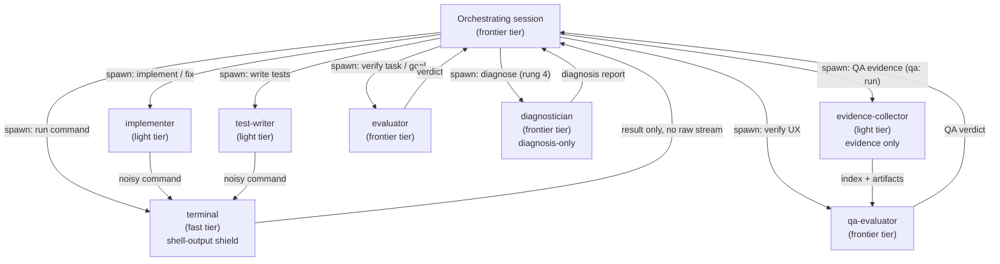
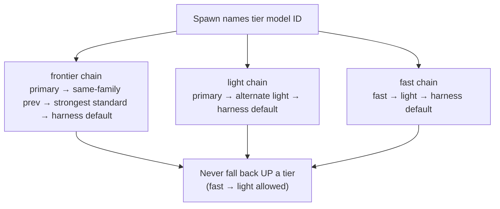

**Who this is for / What you'll learn:** Kit **users** and **contributors** who need to understand the seven subagents, which model tier each role runs on, and how `models.map.md` governs IDs, fallbacks, and fix-cycle rotation. You will learn each agent's role, write boundaries, and prohibitions; why evaluators and the diagnostician run frontier models, workers run light models, and `terminal` runs the fast tier; the diagnostician's role in the post-exhaustion continuation ladder; the structure and rules of the model map; and harness caveats that affect tiering. For what evaluators enforce (verdict vocabulary, confidence ladder, contracts), see [evaluation-system.md](evaluation-system.md). For where each agent appears in the `/feature` phases, see [feature-workflow.md](feature-workflow.md).

# Agents and Model Configuration

The kit uses **three model tiers**: **coordination and verification** on the **frontier** tier, **checklist-driven execution** on the **light** tier, and **single-command runs** on the **fast** tier (`terminal`). One orchestrating main session prepares context, makes decisions, and spawns subagents — it never implements tasks itself. Every spawn passes its model explicitly (the model map's resolved ID for the agent's tier); each agent report starts with **`**Model (self-reported)**: ...`**. Seven specialized subagents handle implementation, testing, command execution, optional QA evidence gathering, evaluation, user-facing QA review, and post-exhaustion diagnosis. Model IDs, fallback chains, and fix-cycle rotation are configured in a single template file that `/agent-kit` resolves per harness. See [architecture.md](architecture.md) for how tiers fit the spawn lifecycle.

## The seven subagents at a glance

| Agent | Tier | May write | Must never |
|-------|------|-----------|------------|
| `evaluator` | `frontier` (`{{MODEL_FRONTIER}}`) | Nothing — read and verify only | Edit files or fix anything; only evaluate |
| `qa-evaluator` | `frontier` | Nothing | Fix anything; extrapolate untested behavior |
| `implementer` | `light` (`{{MODEL_LIGHT}}`) | Only paths in the task's `writes` set | Edit out-of-fence files; run rung-3 full suites |
| `test-writer` | `light` | Only test files in task `writes` | Hit live external services; edit source to make tests pass |
| `evidence-collector` | `light` | Only the goal's `qa/` evidence folder | Issue verdicts; run test-ladder rungs; edit product or goal files outside `qa/` |
| `terminal` | `fast` (`{{MODEL_FAST}}`; falls back to light when an install omits `fast`) | Shell side effects only (no Edit/Write tools) | Dump raw command streams into the caller session |
| `diagnostician` | `frontier` (`{{MODEL_FRONTIER}}`) | Nothing — diagnosis-only report | Edit files or write product code; re-litigate whether the acceptance criteria are sound (rung-5 arbitration's job) |

The sections below quote or paraphrase the canonical agent templates under [`skills/agent-kit/templates/agents/`](../../../skills/agent-kit/templates/agents/). Capabilities not confirmed there are omitted.

## Report Footprint (all seven agents)

Every agent completion report ends with a machine-readable **`### Footprint`** block — the last non-blank lines inside the report fence:

```markdown
### Footprint
files_read: <N> (~<C> chars)
commands_run: <N>
```

`C` is the agent's estimate of total characters read (sum of file sizes opened; rounding to the nearest thousand is fine). `terminal` reports `files_read: 0` and `commands_run: 1` (or the count it ran). The block is never omitted — write `files_read: 0 (~0 chars)` when nothing was read.

**Why it exists:** `_kit/log-spawn.* outcome` parses the `files_read: N (~C chars)` line and emits `work_read_chars: C · work_est_tokens: C/4` on the orchestration-log OUTCOME line (integer division), or `work_read_chars: n/a · work_est_tokens: n/a` when the line is absent or malformed. That **`work_est_tokens`** value is the subagent's self-reported working footprint — distinct from **`io_est_tokens`**, which measures only orchestrator↔subagent I/O chars/4. Neither is billed usage; the loop driver's `usage:` line (when `LOOP_USAGE_FORMAT` is active) is the only real token count. See [evaluation-system.md](evaluation-system.md) § Orchestration log.

## Evaluator

**Role:** Skeptical, problem-finding reviewer for goals, task definitions, and completed implementation work. Launch after every goal creation, every task execution, and as the final audit.

**Tier:** `frontier` — frontmatter `model: {{MODEL_FRONTIER}}`, effort `high`.

**What it may write:** Nothing. The evaluator reads, verifies, and returns a verdict. It never edits files and never fixes anything.

**What it must never do:**

- Fix or edit anything — only evaluate.
- Score from the report or diff alone without executing targeted tests first.
- Talk itself into a PASS after finding an issue (identified issues must appear in the verdict).
- Treat unverified claims as verified.

The evaluator also has an orchestrator-invoked **arbitration mode** (continuation-ladder rung 5, pinned to `{{MODEL_FRONTIER_ALT_FAMILY}}`) that reviews criteria rather than code — semantics in [evaluation-system.md](evaluation-system.md).

Evaluation criteria — verdict vocabulary, confidence ladder, anti-fabrication rules, auto-fail triggers — are owned by [evaluation-system.md](evaluation-system.md), not repeated here.

## QA Evaluator

**Role:** Skeptical user-perspective QA reviewer for user-facing surfaces. When the goal's `phases:` block sets `qa: run`, launch after Phase 5 **APPROVED** and quality checks, once `evidence-collector` has written the goal's `qa/index.md` and listed artifacts — read that index and the artifacts it cites (command output, API responses, screenshots). Every QA re-run re-collects evidence first.

**Tier:** `frontier` — frontmatter `model: {{MODEL_FRONTIER}}`, effort `high`.

**What it may write:** Nothing. Fixes flow back through implementer and evaluator; QA re-runs.

**What it must never do:**

- Fix anything.
- Describe behavior not seen in the evidence — verdicts cite observed output only.
- Pass when evidence for a claimed surface was not provided.

The QA evaluator evaluates **behavior a user actually experiences**, not the code. Missing evidence is an issue, not a pass.

## Evidence Collector

**Role:** Behavioral QA evidence gatherer for the goal's changed user-facing surfaces. Launch when a goal runs the optional QA gate (`qa: run` in `goal.md`), with the surface list, the goal's visual-QA choice, and a write fence limited to the goal's `qa/` folder. Exercises surfaces (smoke, optional visual checks after a browser-tool probe), writes `qa/index.md` — never issues verdicts.

**Tier:** `light` — frontmatter `model: {{MODEL_LIGHT}}`, effort `medium`.

**What it may write:** Only under the goal's `qa/` folder (`smoke.md`, optional `visual/` artifacts, BLOCKED log tails, and `index.md`).

**What it must never do:**

- Issue PASS / ISSUES / REJECT or any verdict language — verdicts belong to `qa-evaluator`.
- Run test-ladder rungs 1–3 (those belong to executors and the orchestrator).
- Edit product source, docs, or goal files outside the `qa/` write fence.
- Invent screenshots, stdout, status codes, or response bodies — record what you observed or mark a surface **BLOCKED**.
- Hit production or customer environments; never echo secrets in captured output.

When the goal asks for visual QA but no browser-automation tool exists, record the literal line `visual QA not run (no browser tool)` in the evidence set. When visual QA is skipped, record `visual QA not run (skipped: <reason>)`. Context packages for this role omit the prior-knowledge (recalled-memory) fence — recall applies to implementer, test-writer, and diagnostician only.

## Implementer

**Role:** Focused, checklist-driven task executor. Launch with a complete context package (task definition, requirements, files to read, constraints). Executes exactly one task or one fix cycle per invocation.

**Tier:** `light` — frontmatter `model: {{MODEL_LIGHT}}`, effort `medium`.

**What it may write:** Only paths listed in the task's `writes` set. The `reads` list is read-only interface briefs.

**What it must never do:**

- Edit, refactor, or "improve" anything outside the write fence — escalate instead, naming the exact path and why.
- Run rung 3 (full test suites) — that runs once at cycle end after the final audit.
- Touch live external services from tests (all network/service access is mocked).
- Guess when the context package is missing something — report it instead.

For noisy Bash or PowerShell commands whose raw output is not needed, spawn `terminal` with the exact command and the result you want back (where the harness allows — not Copilot).

**Apply-verbatim mode:** When the context package marks the fix cycle **line-patch-only**, apply exactly the evaluator's listed substitutions — bottom-up per file, report `NOT APPLIED` for patches whose old text is missing, no refactors — then run rung 1–2 verification and report it. The orchestrator resumes the same implementer on the same model (fresh spawn on that model when the harness cannot resume; no fix-cycle rotation) for that cycle.

## Test Writer

**Role:** Coverage-obsessed test author for the dedicated test task of a goal. Writes outcome-verifying tests with all external services mocked.

**Tier:** `light` — frontmatter `model: {{MODEL_LIGHT}}`, effort `medium`.

**What it may write:** Only paths in the task's `writes` set (test files). Modules under test in `reads` are read-only.

**What it must never do:**

- Hit the network or a live service — mock all external services.
- Edit out-of-fence files (source fixes, shared fixtures) to make tests pass — escalate instead.
- Write tests that assert nothing or mock the unit under test.
- Run rung 3 (full suites) — rungs 1–2 only during the task.

For noisy commands, spawn `terminal` where the harness allows (not Copilot).

**Apply-verbatim mode:** Same as implementer — line-patch-only cycles apply listed substitutions verbatim, skip missing patches with `NOT APPLIED`, verify rungs 1–2, no model rotation on that cycle.

## Terminal

**Role:** Command runner. Spawn with a Bash or PowerShell command and the result you need back (exit code, last N lines, a match, pass/fail, a path). Executes that command and returns **only** that result.

**Tier:** `fast` — frontmatter `model: {{MODEL_FAST}}`, effort `low`. When an install omits a `fast` pin, emit runs `terminal` on the light model. Tools: Bash/shell and Read only — no Edit/Write.

**What it may write:** No files via Edit/Write tools. The shell command itself may create or change files if the caller asked — the terminal still runs it exactly.

**What it must never do:**

- Dump the full command stream into the caller (orchestrator or worker) — return only what the spawn prompt asked for.
- Use Edit/Write tools or add "helpful" extra commands beyond what the prompt lists.
- Diagnose failures, suggest fixes, or interpret output — the caller Reads a log slice if it needs more.

The terminal is the **shell-output shield**: noisy test runs, builds, and git operations stay in a fast-tier subagent so raw streams do not flood the frontier orchestrating session.

## Diagnostician

**Role:** Fresh-context root-cause analyst spawned at continuation-ladder rung 4 after three implement→evaluate fix cycles exhaust without a PASS.

**Inputs:** The task file (including its `## Acceptance Criteria` section), all three fix-cycle histories (implementer reports + evaluator verdicts), and pointers to the current code.

**Tier:** `frontier` — frontmatter `model: {{MODEL_FRONTIER}}`, effort `xhigh`. Tools: Bash, Read, Grep, Glob — no Edit/Write.

**Execute before you diagnose:** Run the task's targeted verification command(s) yourself to observe the failure — reading prior reports or the diff alone is not enough.

**Report format:** Return a frozen five-section report — Root-Cause Hypothesis, Evidence, Rewritten Required-Fixes, Split Recommendation, Signature Declaration.

**What it may write:** Nothing — diagnosis-only report.

**What it must never do:**

- Edit files or write product code.
- Propose skipping evaluation.
- Re-litigate whether the contract is sound (defer to rung-5 arbitration).
- Invent command output (quoted output must come from commands it ran).

You supply the report — the orchestrator routes (signature match → rung 6 or escalate; otherwise ONE diagnosis-driven implementation attempt). Routing details in [feature-workflow.md](feature-workflow.md).

## Roster diagram

The orchestrating session runs on the frontier tier. It dispatches light-tier workers for execution and optional QA evidence, a fast-tier terminal for isolated command output, and frontier-tier evaluators for verification. When the goal opts into the QA gate, a light-tier `evidence-collector` gathers smoke and optional visual artifacts under the goal's `qa/` folder; `qa-evaluator` reads that index. A frontier-tier diagnostician is spawned for post-exhaustion diagnosis.



Workers never advance a phase on their own — evaluators gate progression. See [feature-workflow.md](feature-workflow.md) for where each spawn happens in the seven phases.

## Why frontier vs light

Evaluators, the diagnostician, and the orchestrating session run **frontier** models; `implementer`, `test-writer`, and `evidence-collector` run **light** models; `terminal` runs the **fast** tier (or light when an install omits `fast`). The split follows a simple cost–quality tradeoff:

| Tier | Roles | Rationale |
|------|-------|-----------|
| `frontier` | Orchestrator (main session), `evaluator`, `qa-evaluator`, `diagnostician` | Delegation and evaluation have a capability floor — don't cheap out on the roles that decide and verify; continuation-ladder diagnosis needs frontier-tier reasoning |
| `light` | `implementer`, `test-writer`, `evidence-collector` | Checklist-driven execution retains most quality at a fraction of the cost when the plan and the verification are strong |
| `fast` | `terminal` | Single-command execution and result extraction need no deep reasoning — the cheapest, quickest tier fits |

**Verification quality is where frontier spend pays off.** Implementation is cheaper-tier work that evaluators re-check before anything advances. A light-tier implementer following the task file (including its Acceptance Criteria) and strong evaluation is cheaper than running everything on frontier — without sacrificing gate quality at the roles that matter.

Reasoning-effort pins (where the harness supports them): `evaluator` and `qa-evaluator` `high`, `diagnostician` `xhigh`, `implementer`, `test-writer`, and `evidence-collector` `medium`, `terminal` `low`.

## `models.map.md` anatomy

[`skills/agent-kit/templates/models.map.md`](../../../skills/agent-kit/templates/models.map.md) is the single place model IDs are defined for an install. Model IDs are **configuration, not constants** — re-run `/agent-kit` (or edit the map and re-emit) when providers rotate model names.

### Tier → model ID table structure

The map has two related tables:

1. **Tier assignments** — maps each role to `frontier`, `light`, or `fast` (see previous section).
2. **Resolved models** — one row per tier, one column per harness, cells filled with placeholder tokens such as `{{MODEL_FRONTIER}}`, `{{MODEL_LIGHT}}`, `{{MODEL_FAST}}`, `{{CURSOR_MODEL_FRONTIER}}`, `{{CURSOR_MODEL_FAST}}`, etc. During `/agent-kit`, these tokens are replaced with harness-specific IDs from the live model list.

Describe the **structure** (tier rows, per-harness columns, placeholder tokens) — not any concrete ID as permanent truth. If you see an illustrative resolved value in a local install, treat it as a snapshot, not a recommendation.

### Per-tier fallback chains

Each tier has a ordered chain — **first available wins**:

| Tier | Chain (first available wins) |
|------|------------------------------|
| `frontier` | `{{MODEL_FRONTIER}}` → same-family previous version → strongest standard model → (omit pin — harness default) |
| `light` | `{{MODEL_LIGHT}}` → alternate light model → (omit pin — harness default) |
| `fast` | `{{MODEL_FAST}}` → `{{MODEL_LIGHT}}` → (omit pin — harness default) |

Additional rules from the map:

- Max **3** fallback attempts, then omit the model pin and take the harness default.
- Fallbacks are silent to the user but **logged in the orchestration log**.
- Apply at most **one** complexity adjustment per spawn — no cascading bumps.
- **Prompts are executable — narrowly**: only tasks that edit `templates/agents/*` or
  `templates/skills/*-criteria/*` use the frontier tier; skills, emitters, drivers, docs,
  and tests stay on the light tier.
- **Every spawn names its model.** The orchestrator passes the tier's resolved ID
  explicitly on every spawn and records requested vs self-reported in the orchestration log;
  `inherit` is legitimate only for a tier the install deliberately left unpinned.

The autonomous loop has its own light-tier chain resolving `{{LOOP_MODEL_CHAIN}}` when the loop is installed — same omit-the-pin rule at the end.

Per-tier fallback chains resolve at spawn time as follows.



### Never fall back UP a tier

A **light** role must never silently land on a **frontier** model. A **frontier** role never degrades below the standard rung of its chain. This is the **never fall back UP** rule — it prevents cost surprises (light work on frontier models) and quality surprises (frontier verification on downgraded models). One carve-out: **fast → light** is allowed, because light is `terminal`'s baseline tier when an install omits `fast`.

### Fix-cycle rotation

After evaluator rejections, rotate the implementer's model — a model blind to its own class of mistake rarely fixes it on retry:

| Fix cycle | Implementer model |
|-----------|-------------------|
| 1 | `{{MODEL_LIGHT}}` (normal) |
| 2 | `{{MODEL_ALT_FAMILY}}` — a different model **family** at comparable tier (analytical diversity), or a different same-family model labelled `same-family rotation (reduced diversity)` when none is reachable |
| 3 | `{{MODEL_FRONTIER}}` |

**Same-family rotation.** When no different-family model at comparable tier is reachable on a harness, fix cycle 2 may pin a different same-family model (see the table above) and label the row `same-family rotation (reduced diversity)`. A second harness such as Copilot or Codex provides cross-family models when targeted. When `alt_family` equals `light`, emit warns that fix cycle 2 would not rotate models (counted in emit warnings, stderr, exit 0).

**Exceptions — no rotation:** A **line-patch-only** NEEDS FIXES verdict (every required fix tagged `[line-patch]`) resumes the same executor (`implementer` or `test-writer`) in apply-verbatim mode on the **same model** — fresh spawn on that model when the harness cannot resume — and the cycle still counts toward the three-cycle cap. Evaluators tag each required fix `[line-patch]` or `[structural]`; any `[structural]` item routes a normal fix cycle with line patches applied verbatim. **`NOT APPLIED`** patches trigger re-evaluation; rotation resumes on the next normal cycle.

**Degraded mode** also skips fix-cycle rotation: Case 1 (model argument rejected → subsequent spawns use `inherit`) logs rotation as skipped per cycle; Case 2 (no spawn tool) runs one task at a time and logs each rotation skip while the orchestrator performs worker roles inside write fences.

The workflow context for when fix cycles fire is in [feature-workflow.md](feature-workflow.md).

### After cycle 3 — continuation ladder pins

When fix cycles 1–3 exhaust, the continuation ladder applies these pins:

| Ladder step | Model pin |
|-------------|-----------|
| Diagnosis-driven implementation attempt (rung 4) | `{{MODEL_FRONTIER}}` |
| Evaluator arbitration mode (rung 5) | `{{MODEL_FRONTIER_ALT_FAMILY}}` — a different model **family** from the primary evaluator at frontier tier (or same-family when flagged — see below) |

`{{MODEL_ALT_FAMILY}}` (light tier) is never reused for arbitration.

**Same-family arbiter.** When no different-family frontier model is reachable on a harness, answers may set `frontier_alt_family` equal to `frontier` with `arbiter_same_family: true`; emit otherwise prints a warning (counted in emit warnings, stderr, exit 0). The rung-5 row is then labelled **same-family arbiter (reduced independence)** in the model map, and the arbiter's verdict header states `same-family arbiter`. Reusing the fix-cycle-2 alternate (`alt_family`) for arbitration stays forbidden — when `frontier_alt_family` equals `alt_family` (and differs from `frontier`), emit warns even with the flag. When all three IDs are equal and the flag is set, emit is silent.

### Cost-ceiling policy

Three outcomes when a model choice conflicts with a plan or admin ceiling:

1. **Explicit human choice above ceiling** → warn loudly and honor it.
2. **Implicit (auto-selected) choice above ceiling** → downgrade to the ceiling.
3. **No compliant model at all** → fail loud — never silently substitute.

## Harness caveats

These caveats shape tiering and emitter behavior. They are drawn from [`models.map.md`](../../../skills/agent-kit/templates/models.map.md), [`harness-matrix.md`](../../../skills/agent-kit/reference/harness-matrix.md), and the emitter caveats in [`emitters/cursor.md`](../../../skills/agent-kit/emitters/cursor.md) and [`emitters/claude-code.md`](../../../skills/agent-kit/emitters/claude-code.md); the `model_check` note follows [`templates/tools/log-spawn.sh`](../../../skills/agent-kit/templates/tools/log-spawn.sh).

### Copilot cost ceiling

A Copilot subagent **cannot run a stronger model than the session**. The main session must run the `frontier` tier; workers pin **down**. Evaluators cannot pin up — the ceiling is "cannot exceed the parent tier," not "must equal the parent tier." Cheaper-than-parent pins are valid. Frontier = session tier, so the diagnostician and rung-5 arbiter pins respect the cost ceiling; Copilot has no reasoning-effort key (the effort pin is dropped there).

Practical implication: on Copilot, your orchestrating session is the frontier anchor. Light-tier worker pins must stay at or below that session's tier.

### Cursor silent fallback

Under team-admin or plan restrictions, or when a resolved model ID is unknown or stale (rotated-out or misspelled name), Cursor **substitutes a compatible model without erroring** (unresolved subagent models may fall back to the parent's model). A typo'd or stale ID in the map fails quietly downstream instead of at resolution time. Bracket params (`<model-id>[effort=high]`) are the documented frontmatter form; slug-suffix effort variants appear in pickers and listings — use the form verified for the account at emit time. YAML `model:` values are emitted **unquoted**; quoting can trigger silent fallback to the parent model. When `agent models` prints no models, use the IDE's Settings → Models / subagent model picker.

Evaluators should state their expected model in the prompt and report **which model actually produced the verdict** so silent substitution is visible in the audit trail. Orchestration-log OUTCOME lines include **`model_check: match|MISMATCH|unverified`** after `model reported:` — family-level comparison that surfaces substitution even when the harness stays silent (`MISMATCH` also prints a stderr warning; exit 0). See [evaluation-system.md](evaluation-system.md) for the re-spawn policy on verification agents.

### Cursor live model list (emit-time check)

Before emitting Cursor agent files, **confirm every resolved model ID against the harness's live model list**. Unknown or invalid IDs are substituted silently — there is no error at resolution time. The model map's bootstrap comment and the harness matrix both require re-checking the live model list and current model-ID format before emission.

This obligation applies at `/agent-kit` emit time; it is not tied to a specific kit version in the canonical sources cited here.

### Other harness notes (brief)

- **Claude Code:** `CLAUDE_CODE_SUBAGENT_MODEL` and `CLAUDE_CODE_EFFORT_LEVEL` env vars override frontmatter; org `availableModels` allowlists can cause pins to be ignored. Claude Code runs **Anthropic models only** — a cross-family arbiter is unreachable natively (use `arbiter_same_family: true` when the arbiter ID equals frontier). Aliases such as `opus` resolve per provider — prefer full IDs and record the minimum Claude Code version each pin needs. Headless loop chains must not include `best`, `fable`, or `claude-fable*` — emit exits 3 when they appear (usage-credit billing).
- **Codex:** Model pins are committable in `.codex/config.toml`, but `model_provider` / `model_providers` / `profile(s)` are ignored at project level.

For the full capability comparison, see [`harness-matrix.md`](../../../skills/agent-kit/reference/harness-matrix.md).

## Where agents appear in workflows

Each subagent is spawned at specific moments in the orchestration lifecycle:

- **Goal and task evaluation** — `evaluator` after goal creation, after each task, and at final audit; `evaluator` in **arbitration mode** at continuation-ladder rung 5 on unanimous same-item failure across fix cycles 1–3. Criteria and verdict mechanics: [evaluation-system.md](evaluation-system.md).
- **Post-exhaustion diagnosis** — `diagnostician` at continuation-ladder rung 4 after Phase 4 fix cycles exhaust.
- **Implementation and fixes** — `implementer` for each task and fix cycle (model rotates per the fix-cycle table above, except line-patch-only and degraded-mode cycles).
- **Dedicated test tasks** — `test-writer` when a goal includes a test-only task.
- **Noisy commands** — `terminal` for rung-3 full suites at cycle end, and whenever a worker or orchestrator needs command output without flooding context.
- **User-facing QA** — when `qa: run`, `evidence-collector` after Phase 5 quality checks (smoke and optional visual artifacts under the goal's `qa/` folder), then `qa-evaluator` with that index; the orchestrator does not capture QA evidence itself except in degraded Case 2. Every QA re-run re-collects.

Phase-by-phase spawn timing, contracts, and escalation: [feature-workflow.md](feature-workflow.md).

## Maintaining model configuration

1. Edit [`skills/agent-kit/templates/models.map.md`](../../../skills/agent-kit/templates/models.map.md) (contributors) or the emitted copy in your install.
2. Verify IDs against each harness's **live model list** — especially Cursor.
3. Re-run `/agent-kit` to re-emit agents, skills, and loop drivers with updated pins.

Never copy model IDs from kit documentation without checking — IDs rotate frequently. Placeholder tokens (`{{MODEL_FRONTIER}}`, `{{MODEL_FRONTIER_ALT_FAMILY}}`, `{{MODEL_LIGHT}}`, `{{MODEL_FAST}}`, `{{MODEL_ALT_FAMILY}}`, per-harness `*_MODEL_*` variants including `*_MODEL_FAST`) describe the map's structure; concrete IDs are install-specific configuration. Optional answers field `models.<harness>.fast` sets the fast-tier ID (defaults to light when omitted).

## Sources

- [`skills/agent-kit/templates/agents/evaluator.md`](../../../skills/agent-kit/templates/agents/evaluator.md) — evaluator role, stance, prohibitions
- [`skills/agent-kit/templates/agents/qa-evaluator.md`](../../../skills/agent-kit/templates/agents/qa-evaluator.md) — QA evaluator role, index and artifact evidence, prohibitions
- [`skills/agent-kit/templates/agents/evidence-collector.md`](../../../skills/agent-kit/templates/agents/evidence-collector.md) — evidence collector role, qa write fence, smoke/visual/index, no verdicts
- [`skills/agent-kit/templates/skills/feature/SKILL.template.md`](../../../skills/agent-kit/templates/skills/feature/SKILL.template.md) — `qa:` gate, line-patch-only fix cycles, Phase 5 QA spawn order
- [`skills/agent-kit/templates/skills/feature/reference/degraded-mode.md`](../../../skills/agent-kit/templates/skills/feature/reference/degraded-mode.md) — Case 1/2 fix-cycle rotation skip, Case 2 QA index by orchestrator
- [`skills/agent-kit/templates/ORCHESTRATION.md`](../../../skills/agent-kit/templates/ORCHESTRATION.md) — QA Evaluation section (orchestrator never captures QA evidence itself; collector context package and `qa/**` fence)
- [`skills/agent-kit/templates/skills/feature/reference/memory-protocol.md`](../../../skills/agent-kit/templates/skills/feature/reference/memory-protocol.md) — prior-knowledge fence recipients (excludes evidence-collector)
- [`skills/agent-kit/templates/skills/task-criteria/SKILL.template.md`](../../../skills/agent-kit/templates/skills/task-criteria/SKILL.template.md) — required-fix `[line-patch]` / `[structural]` tags
- [`skills/agent-kit/templates/agents/implementer.md`](../../../skills/agent-kit/templates/agents/implementer.md) — implementer rules, write fence, test ladder, terminal spawn
- [`skills/agent-kit/templates/agents/test-writer.md`](../../../skills/agent-kit/templates/agents/test-writer.md) — test writer coverage rules, mocking, write fence
- [`skills/agent-kit/templates/agents/terminal.md`](../../../skills/agent-kit/templates/agents/terminal.md) — terminal command runner, output isolation
- [`skills/agent-kit/templates/agents/diagnostician.md`](../../../skills/agent-kit/templates/agents/diagnostician.md) — diagnostician role, report format, routing
- [`skills/agent-kit/templates/models.map.md`](../../../skills/agent-kit/templates/models.map.md) — tier assignments, resolved models table, fallback chains, never-fall-up, fix-cycle rotation, cost ceiling, harness caveats
- [`skills/agent-kit/reference/harness-matrix.md`](../../../skills/agent-kit/reference/harness-matrix.md) — per-harness capabilities, Copilot ceiling, Cursor silent fallback, live model list
- [`skills/agent-kit/emitters/cursor.md`](../../../skills/agent-kit/emitters/cursor.md) — Cursor emitter caveats (`agent models` fallback, unquoted `model:` values, bracket params)
- [`skills/agent-kit/emitters/claude-code.md`](../../../skills/agent-kit/emitters/claude-code.md) — Claude Code single provider, `fable` in loop chain exits 3, minimum CLI version per pin
- [`skills/agent-kit/templates/tools/log-spawn.sh`](../../../skills/agent-kit/templates/tools/log-spawn.sh) — orchestration-log OUTCOME `model_check` field
- [`skills/agent-kit/SKILL.md`](../../../skills/agent-kit/SKILL.md) — placeholder table `{{MODEL_FAST}}` / `*_MODEL_FAST`, answers field `models.<harness>.fast`
- [`README.md`](../../../skills/agent-kit/README.md) — Model tiers section (three tiers — frontier, light, fast; map as single source, re-run `/agent-kit` on rotation)
