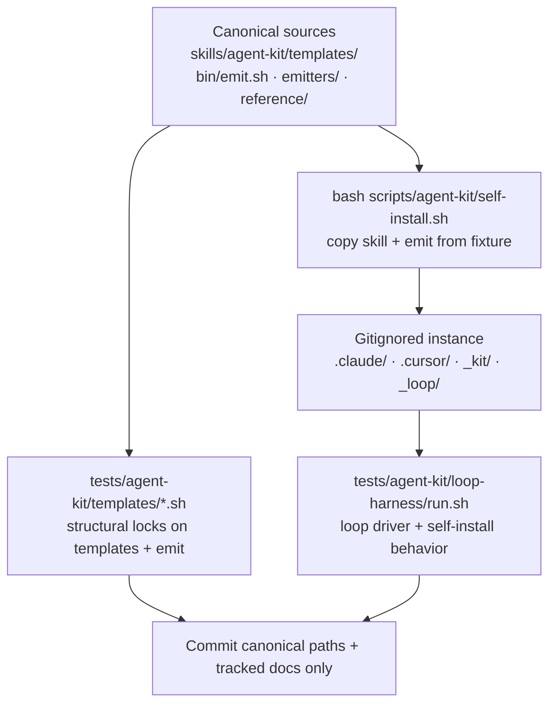
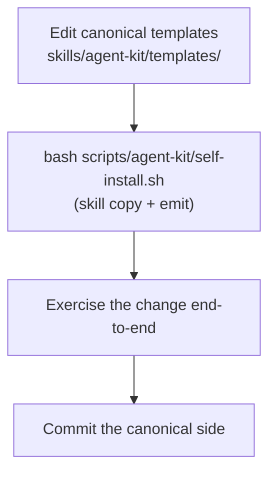

**Who this is for / What you'll learn:** Kit **contributors and maintainers** working on the AI Orchestration Kit itself — not end users installing into their projects. You will understand the repo's three-layer anatomy (canonical source, gitignored emitted instance, tracked docs), the self-install dogfood loop for exercising template changes locally, how to edit templates and emitters safely, what the harness matrix and manifest are for, how version bumps, releases, and install upgrades flow, and how to run the tracked test harnesses before committing canonical changes. For install paths, `/agent-kit` compile flow, and first-session usage, see [getting-started.md](getting-started.md).

# Contributing to the Kit

The kit keeps **one canonical template source** under `skills/agent-kit/` and compiles it per harness via `/agent-kit`. Contributors edit that canonical side only; the emitted instance in this repo is gitignored and never source of truth. User-side install and compile mechanics live in [getting-started.md](getting-started.md); structural maps live in [architecture.md](architecture.md); harness research ground truth lives in [`_memory/research/multi-harness-upgrade.md`](../../../_memory/research/multi-harness-upgrade.md); the docs hub is [`docs/agent-kit/README.md`](../README.md). The full install story is in the skill's [README.md](../../../skills/agent-kit/README.md).

## Repo anatomy: three layers

The kit lives in the multi-skill [kdcllc/skills](https://github.com/kdcllc/skills) repository. Every kit path in it belongs to one of three layers. Treat them differently: commit canonical and doc changes; treat instance paths as disposable output.

| Layer | Role | Key paths (tracked unless noted) |
|-------|------|----------------------------------|
| **CANONICAL** | Source of truth — what `/agent-kit` reads and compiles | `skills/agent-kit/templates/` (Claude Code format), `skills/agent-kit/bin/` (`emit.sh` + `emit.cmd` (Windows launcher) — deterministic emit), `skills/agent-kit/emitters/` (per-harness caveats), `skills/agent-kit/reference/` (`harness-matrix.md`, `bootstrap-ids.md`), `metadata.version` in `skills/agent-kit/SKILL.md` (kit version written into each install's manifest) |
| **INSTANCE** | Emitted by `/agent-kit` and self-install in **this repo only** — gitignored, re-runnable, never committed | Entire `.claude/`; **partial** `.cursor/` only — `.cursor/skills/`, `.cursor/agents/`, `.cursor/rules/`, `.cursor/ORCHESTRATION.md` (the rest of `.cursor/` is **not** gitignored); `.agents/skills/` (self-install `--symlink` canonical tree); `.loop-worktrees/` (loop driver scratch); `_kit/`, `_loop/`, `_memory/work/`, `_memory/loop/`, `_memory/.index/`, `_memory/raw/`; `orchestration-kit.manifest.json`. Tracked memory: `_memory/README.md`, `_memory/records/`, `_memory/quarantine/` |
| **MAINTAINER (tracked, not shipped)** | Tooling and documentation for kit contributors; lives outside the skill folder so it never reaches installs | `skills/agent-kit/README.md` and `CHANGELOG.md` (ship with the skill), `docs/agent-kit/` (this guide suite and the hub `README.md`) plus `_memory/research/` (research briefs and index), `tests/agent-kit/` (checks, guards, harness, `fixtures/self-answers.json`), `scripts/agent-kit/` (`self-install.sh`), `scripts/checks/agent-kit.sh` (fast guard run by `scripts/validate-skills.sh`) |

**Instance-specific note:** In consumer projects, `/agent-kit` emits into harness-native directories (`.claude/`, `.cursor/`, `.github/`, `.codex/`, root `ORCHESTRATION.md`, etc.) per the emitters. This repo dogfoods the kit: its `.gitignore` lists the instance paths above so local dogfood output never reaches git, and `scripts/validate-skills.sh` rejects agent skill directories only when they contain tracked files.

### docs/agent-kit hub

The tracked [`docs/agent-kit/README.md`](../README.md) is the maintainer-facing **hub** for this guide suite, research brief index links, and pointers into canonical kit sources. The canonical architecture template lives at [`skills/agent-kit/templates/ORCHESTRATION.md`](../../../skills/agent-kit/templates/ORCHESTRATION.md); `/agent-kit` compiles it into each harness's native location (for example `.claude/ORCHESTRATION.md` or `.cursor/ORCHESTRATION.md`). Never edit emitted instance copies when changing kit behavior — edit templates and re-run `/agent-kit` locally to refresh the instance.

## The dogfood loop

When you change canonical kit content, exercise the full path before committing tracked files:

Canonical sources, the dogfood emitter, gitignored runtime instance, and guard tests form one loop.



Day-to-day contributor flow:



1. **Edit** templates (and `bin/emit.*` when translation logic changes; emitters or reference docs when harness caveats change).
2. **Self-install** copies `skills/agent-kit/` into harness skill directories and emits the instance from `tests/agent-kit/fixtures/self-answers.json` (unless `--no-emit`).
3. **Exercise** the change — run workflows, spot-check emitted files, run the test harnesses below.
4. **Commit** only canonical and repo-doc paths; instance output stays gitignored.

If you also changed emitter mappings or `skills/agent-kit/SKILL.md`, include those tracked paths in the commit. Record kit behavior changes under `## [Unreleased]` in `skills/agent-kit/CHANGELOG.md` (see [Version, manifest, and upgrades](#version-manifest-and-upgrades)).

## Self-install script

[`scripts/agent-kit/self-install.sh`](../../../scripts/agent-kit/self-install.sh) is a **kit-repo-only** first-mile helper with defaults, guards, and exit codes documented below.

### What it copies

Self-install copies only `skills/agent-kit/` — the other skills in kdcllc/skills would also land in `.cursor/skills/`, where their `.claude/` references fail emit verify and checks M/N. Nested paths like `skills/agent-kit/templates/skills/feature/SKILL.md` are not skills. Destinations:

| Mode | Destinations |
|------|----------------|
| **Default (copy)** | `.claude/skills/<name>/` and `.cursor/skills/<name>/` — overwrite-copy from the working tree |
| **`--symlink`** | Canonical real tree at `.agents/skills/<name>/`; `.claude/skills/<name>` and `.cursor/skills/<name>` become symlinks pointing there |

Run from repo root:

```bash
bash scripts/agent-kit/self-install.sh
```

### Flags

| Flag | Semantics |
|------|-----------|
| `--dry-run` | Prints planned destination paths to stdout; writes nothing; exits 0. Combined with `--symlink`, prints the symlink plan. When emit runs, passes `--dry-run` to `emit.sh` (action lines only; no writes). |
| `--symlink` | Places the canonical real tree at `.agents/skills/<name>/` and makes `.claude/skills/<name>` and `.cursor/skills/<name>` symlinks pointing there. Fails loudly on symlink failure; **never** falls back to copy. |
| `--force` | Accepted and ignored — overwrite is already the default. |
| `--no-emit` | Copy skills only; skip emit (legacy behaviour). |
| `--force-emit` | Pass `--force` to `emit.sh` (overwrite user-modified instance files and pre-existing files at kit paths). |

### What self-install emits

After copying skills, self-install runs `skills/agent-kit/bin/emit.sh --answers tests/agent-kit/fixtures/self-answers.json` unless `--no-emit`. That produces the full gitignored instance (agents, loop drivers, manifest, project-specific resolved content) with zero LLM involvement. Consumer projects still use `/agent-kit` Steps 1–6 in a session; self-install is kit-repo dogfood only.

Nothing the self-install script writes reaches git — all destination paths are listed in [`.gitignore`](../../../.gitignore).

## Editing templates

All canonical orchestration content lives under [`skills/agent-kit/templates/`](../../../skills/agent-kit/templates/) in Claude Code format. `skills/agent-kit/bin/emit.*` resolves and translates templates deterministically.

New feature-skill detail goes into `templates/skills/feature/reference/`; `SKILL.template.md` gets a one-line pointer, and its 11264-byte budget stays.

### Template grammar (authoring)

- **`{{TOKEN}}`** — replaced from `answers.tokens` (and derived keys such as `{{IDE_DIR}}` resolved per harness).
- **`<!-- BOOTSTRAP[id]: … -->`** — `id` matches `^[a-z0-9]+(-[a-z0-9]+)*$`; the whole comment is replaced by `answers.bootstrap[id]` verbatim; `""` deletes silently; missing keys warn and appear in `--check-answers` output. Whole-line comments collapse to ≤1 blank between neighbours. Class-d instruction comments use the `kit-` prefix and are always deleted.
- **`<!-- IF flag -->` … `<!-- ENDIF flag -->`** (and `!flag`) — keep or drop the span; nesting allowed; mismatch ⇒ exit 6. Flags include `research`, `loop`, `greenfield`, `lint`, `typecheck`, `models_pinned`, per-target `is_*`, and harness-membership `want_*`.

Resolution order: IF → BOOTSTRAP[id] → `{{TOKEN}}`. Id table:
[`skills/agent-kit/reference/bootstrap-ids.md`](../../../skills/agent-kit/reference/bootstrap-ids.md). Verify greps emitted files for stray `{{…}}`, `<!-- BOOTSTRAP`, and `<!-- IF` — zero hits required.

The full placeholder reference table lives in [`skills/agent-kit/SKILL.md`](../../../skills/agent-kit/SKILL.md) (Step 4). Read it before adding or renaming tokens.

### Where harness-specific logic belongs

| Concern | Location |
|---------|----------|
| Canonical prose and structure | `skills/agent-kit/templates/` |
| Harness-agnostic tool twins (`log-spawn.sh`, `memory.sh` / `memory.ps1`, and the `bash-launcher.cmd` Windows launcher; no tokens) | `skills/agent-kit/templates/tools/` — emitted single-copy to `_kit/log-spawn.sh`, `_kit/memory.sh` / `_kit/memory.ps1`, and `bash-launcher.cmd` copied to `_kit/log-spawn.cmd` and `_kit/memory.cmd` (`_kit/` is gitignored in this repo; `_memory/records/` and `_memory/quarantine/` are tracked; `_memory/work/` and `_memory/loop/` are gitignored here) |
| Per-harness translation (frontmatter shape, path mapping, pointer rules) | `skills/agent-kit/bin/emit.sh` — see [`bin/README.md`](../../../skills/agent-kit/bin/README.md) |
| Harness caveats (live model-check URLs, silent-fallback warnings) | `skills/agent-kit/emitters/` |
| Verified harness capabilities and friction points | `skills/agent-kit/reference/harness-matrix.md` |

When live vendor docs contradict the harness matrix, trust the live docs for emission, then **update the matrix** with a new verified-on date. The matrix is the kit's ledger of verified facts; `bin/emit.*` implements translation on top of it.

## Emitters (caveats only)

Per-harness translation runs in [`skills/agent-kit/bin/emit.sh`](../../../skills/agent-kit/bin/emit.sh) /
[`emit.cmd`](../../../skills/agent-kit/bin/emit.cmd). Emitter files under
[`skills/agent-kit/emitters/`](../../../skills/agent-kit/emitters/) hold **caveats only** — live
model-list check URLs, silent-fallback warnings, and similar harness friction — not
translation tables. Full CLI contract: [`skills/agent-kit/bin/README.md`](../../../skills/agent-kit/bin/README.md).

| Emitter file | Target harness | Caveats cover |
|--------------|----------------|---------------|
| [`claude-code.md`](../../../skills/agent-kit/emitters/claude-code.md) | Claude Code (`.claude/`) | Model-config docs plus `claude --version` per-pin floor; Anthropic models only (same-family arbiter flag); aliases resolve per provider (prefer full IDs); `best`, `fable`, or `claude-fable*` in a loop chain → emit exit 3; inherit/unpinned behaviour; ready groups (parallel Agent spawns for write-disjoint Phase 4 tasks, `parallel: false` opts out); orchestrator spawn allowlist includes `evidence-collector` for the QA gate |
| [`cursor.md`](../../../skills/agent-kit/emitters/cursor.md) | Cursor (self-contained `.cursor/`) | Unresolved IDs → parent's model ([`harness-matrix.md`](../../../skills/agent-kit/reference/harness-matrix.md) ⚠️); admin/plan limits → compatible model (vendor docs); values emitted unquoted; bracket-param form documented, suffix slugs in pickers; empty `agent models` → IDE picker; live model list check URL; ready groups (parallel Task spawns for write-disjoint Phase 4 tasks, `parallel: false` opts out); degraded mode when a model pin is rejected or the spawn tool is unavailable (`inherit` re-spawn or self-performed worker/evaluator roles with disclosed gates) |
| [`copilot.md`](../../../skills/agent-kit/emitters/copilot.md) | GitHub Copilot VS Code (`.github/`) | Cost-ceiling policy; model fallback arrays; ready groups (parallel `runSubagent` for write-disjoint Phase 4 tasks, concurrency ⚠️ unverified — sequential fallback on error, `parallel: false` opts out) |
| [`codex.md`](../../../skills/agent-kit/emitters/codex.md) | OpenAI Codex (`AGENTS.md` + `.codex/`) | Role config in TOML; `AGENTS.md` size cap; ready groups (parallel spawns for write-disjoint Phase 4 tasks, concurrency ⚠️ unverified — sequential fallback on error, `parallel: false` opts out) |

When you change a canonical template file, update `bin/emit.*` if translation paths
change — emitters no longer carry Emit tables. The Cursor emitter is
order-independent relative to Claude Code (self-contained emission).

## Version, manifest, and upgrades

### Version and releases

`metadata.version` in [`skills/agent-kit/SKILL.md`](../../../skills/agent-kit/SKILL.md) holds the kit version; `bin/emit.*` reads it from there (the old `VERSION` file is gone). Record every kit change under `## [Unreleased]` in [`skills/agent-kit/CHANGELOG.md`](../../../skills/agent-kit/CHANGELOG.md). Changes confined to `docs/agent-kit/`, `tests/agent-kit/`, or `scripts/` ship nothing to users and need no release.

Unlike other skills in this repo, agent-kit bumps its version **inside the PR that ships the release**, not with `release-skill.sh` after the merge. Other tracked files encode the version and the suite checks them: the `Kit version: **X.Y.Z**` line in [`skills/agent-kit/README.md`](../../../skills/agent-kit/README.md) (asserted by `cursor-isolation.sh`, `forge-adapter.sh`, `escalation-ladder.sh`, and the loop harness) and every emit golden (`kitVersion` in `orchestration-kit.manifest.json.golden`, `kit X.Y.Z` in `emit.stdout.golden`). A bump made only by the release script on `master` leaves them stale, so the tagged commit fails `run-all.sh` and the README advertises the old version.

In the release PR:

1. Set `metadata.version` to `"X.Y.Z"` in `skills/agent-kit/SKILL.md`.
2. In `CHANGELOG.md`, insert `## [X.Y.Z] - YYYY-MM-DD` directly under `## [Unreleased]`, so Unreleased is empty and the release notes sit under the new heading.
3. Update `Kit version: **X.Y.Z**` and the `#agent-kit/vX.Y.Z` install pin in `skills/agent-kit/README.md`, and the install pin in [getting-started.md](getting-started.md).
4. Regenerate goldens with `bash tests/agent-kit/templates/emit-golden.sh --update`; beyond the PR's own template changes, the diff should touch only the `kitVersion` and `kit X.Y.Z` lines.
5. Run `bash scripts/validate-skills.sh && bash tests/agent-kit/run-all.sh`.

After the PR merges, run `bash scripts/release-skill.sh agent-kit X.Y.Z` on an up-to-date, clean `master`. Because `X.Y.Z` is already the recorded version, the script only validates and creates the `agent-kit/vX.Y.Z` tag; it never pushes. Publish with `git push origin master agent-kit/vX.Y.Z`.

### Manifest shape

`/agent-kit` writes `orchestration-kit.manifest.json` at the project root. The manifest records:

- `kit` (`agent-kit`), `kitVersion` (from `metadata.version`), `installedAt`, `harnesses`, `options`
- `files`: map of emitted path → SHA-256 hash
- `seedFiles`: paths created-if-missing, never overwritten on upgrade

It also records `answers` (snapshot of the answers file used at emit),
`primary` (primary harness id), and flat `options` flags (`"forge": "<detected>"` plus
optional `forgeHost`; see [`skills/agent-kit/SKILL.md`](../../../skills/agent-kit/SKILL.md) Upgrading).

In this repo the manifest is gitignored (instance layer). See the live example shape in `orchestration-kit.manifest.json` after a local `/agent-kit` run.

### Upgrade flow

For installed projects (including dogfood in this repo):

1. **Re-pull** the kit — for example `npx skills add kdcllc/skills --skill agent-kit` again, or `npx agent-skills-cli update` (run `npx agent-skills-cli check` first to see installed skills).
2. **Re-emit** — `bash .claude/skills/agent-kit/bin/emit.sh --upgrade` (or `.cursor/skills/agent-kit`, `.github/skills/agent-kit`; answers come from the manifest; add `--answers` only when the interview changed). Manifests from the private **`setup`** kit have no embedded `answers` snapshot — see [getting-started.md](getting-started.md) § Upgrading from the private setup kit. Exit 4 lists user-modified files and pre-existing files at kit paths with no previous-manifest entry (stderr distinguishes the two); confirm with `--force`. Use `--dry-run` to preview.

**Hash diff protects local modifications:** Unmodified emitted files update silently; modified files require confirmation before overwrite; pre-existing files at kit paths with no previous-manifest entry also need `--force`.

**`seedFiles` semantics:** When loop is enabled, the manifest lists `_memory/loop/backlog.md` in `seedFiles` only (not in `files`). Seeds are created only when missing, never overwritten on upgrade, and are exempt from the hash-diff overwrite flow.

**Stale-file pruning:** After regeneration, paths in the old manifest but absent from the new emit set are deleted if unmodified, or reported for manual removal if the user edited them.

## Running tests

Contributors should run the tracked harnesses before committing canonical changes.

### Loop and self-install harness

```bash
bash tests/agent-kit/loop-harness/run.sh
```

This is the tracked **behavioral** test suite (test-ladder rung 3 territory — run manually or via `tests/agent-kit/run-all.sh`). Coverage per the script header includes:

- **Breaker state machine** — canonical `breaker.sh` assertions with injected timestamps (no wall-clock reads)
- **Rate-limit detection** — live `detect_rate_limit` extracted from canonical `loop.sh`
- **Re-emitted instance stub** — end-to-end `_loop/loop.sh` run inside a throwaway repo when `_loop/` exists in this repo
- **Structural guards** — PowerShell parity, emitter/SKILL text coverage, SIGPIPE regressions, checks J/K mutation proofs, and related story additions
- **Self-install block** — runs **without** requiring `_loop/`: exercises `scripts/agent-kit/self-install.sh` (copy mode, overwrite, `--force`, `--dry-run`, `--symlink`, rollback, `.gitignore` dest-lines, and related assertions)
- **Memory integrator step 3b** — assertions 136–141

When `_loop/` is absent (fresh clone before `/agent-kit`), loop-instance assertions are skipped in aggregate — self-install assertions still run.

### Standalone template guards

Tracked structural guards live under `tests/agent-kit/templates/`. Each script locks a specific layer:

| Guard | What it locks |
|-------|----------------|
| [`cursor-isolation.sh`](../../../tests/agent-kit/templates/cursor-isolation.sh) | No `.claude/` literals under canonical templates; Cursor self-contained emission |
| [`degraded-mode.sh`](../../../tests/agent-kit/templates/degraded-mode.sh) | Degraded-mode reference, feature-skill and ORCHESTRATION wiring, harness-matrix and Cursor emitter caveats, ship-pr self-evaluated gates section, emitted degraded-mode instances, negative self-test on a copied template |
| [`evidence-collector.sh`](../../../tests/agent-kit/templates/evidence-collector.sh) | Evidence-collector agent template, models map, emit wiring, QA flow docs, emit smoke, optional `QA_SURFACES` token, negative self-test on a copied template |
| [`invocation-flags.sh`](../../../tests/agent-kit/templates/invocation-flags.sh) | Seven `disable-model-invocation: true` skill flags plus `terminal` agent wiring (frontmatter, models map, test-ladder, ORCHESTRATION, emitters, Codex registration) |
| [`escalation-ladder.sh`](../../../tests/agent-kit/templates/escalation-ladder.sh) | Phase 4 continuation-ladder prose, failure-class taxonomy alignment, diagnostician wiring, `{{MODEL_FRONTIER_ALT_FAMILY}}` docs, fix-cycles reference anchors (continuation-ladder pointer, bypass classes, `phases.ladder`, model-ID scan) |
| [`phase-handoffs.sh`](../../../tests/agent-kit/templates/phase-handoffs.sh) | Align-docs working-tree change set and snapshot scope literals; research path-Read handoff to `feature` Phase 3; mutation proofs under mktemp |
| [`template-currency.sh`](../../../tests/agent-kit/templates/template-currency.sh) | Seven shipped template claims (research handoff at Phase 3, escalation **Ladder** line, closer-task rung-3 carve-out, loop dispatch/exit/merge gates, Feature Flow mermaid byte-identical to [feature-workflow.md](feature-workflow.md)) plus optional instance mirrors |
| [`skill-slimming.sh`](../../../tests/agent-kit/templates/skill-slimming.sh) | Feature skill template byte budget, feature skill pointers to `reference/fix-cycles.md`, that file's intro line and moved anchors, and four ORCHESTRATION reference trees listing it |
| [`forge-adapter.sh`](../../../tests/agent-kit/templates/forge-adapter.sh) | Ship-PR / forge adapter strings |
| [`model-enforcement.sh`](../../../tests/agent-kit/templates/model-enforcement.sh) | Model tier policy strings in templates and agents |
| [`model-currency.sh`](../../../tests/agent-kit/templates/model-currency.sh) | Fast tier, arbiter warnings, loop model denylist, upgrade compatibility, dogfood pins |
| [`install-feedback.sh`](../../../tests/agent-kit/templates/install-feedback.sh) | Pre-existing emit paths, bootstrap ids, alt_family-equals-light warning, model-map same-family rotation, loop_worktree, path-scoped routing, Codex append, memory-table IF guards, frozen rule-file wording in agent, ORCHESTRATION, feature templates and the install skill (`SKILL.md`), harness-matrix delivery observation, table-cell `\|` escaping, emitted rule-file wording |
| [`feature-feedback.sh`](../../../tests/agent-kit/templates/feature-feedback.sh) | Goal-criteria (executable-criteria evidence, reference sweep, corrective-task and xref-audit anchors), criteria-defect at-detection routing and Phase 3 re-checks in task-criteria and evaluator, preflight five checks, goal-revisions and corrective-tasks reference anchors, continuation-ladder early routing, feature skill reference pointers and size cap, criteria-defect route anchor in the fix-cycles reference, ORCHESTRATION repository-safety baseline and orchestration-log volume notes, frozen wording identity across listed templates, emitted `goal-revisions.md` and `corrective-tasks.md` under feature/reference |
| [`ready-groups.sh`](../../../tests/agent-kit/templates/ready-groups.sh) | Ready-groups reference, feature-skill and ORCHESTRATION wiring, goal template `parallel` flag, harness-matrix and emitter caveats, emitted ready-groups instances, negative self-test on a copied template |
| [`log-spawn.sh`](../../../tests/agent-kit/templates/log-spawn.sh) | Canonical `log-spawn.sh` ledger behavior, Footprint ingestion, OUTCOME `model_check`, `_kit/log-spawn.*` emit wiring |
| [`memory.sh`](../../../tests/agent-kit/templates/memory.sh) | Memory CLI twins, redact/check/rm/capture, quarantine, `_memory/` emit wiring; helpers [`memory-release-c.sh`](../../../tests/agent-kit/lib/memory-release-c.sh) and [`memory-redaction-behavioral.sh`](../../../tests/agent-kit/lib/memory-redaction-behavioral.sh); pwsh legs assert bash-only stubs exit **2** |
| [`memory-capture.sh`](../../../tests/agent-kit/templates/memory-capture.sh) | Synthetic transcript fixtures for `capture` |
| [`memory-wiring.sh`](../../../tests/agent-kit/templates/memory-wiring.sh) | Memory pointer blocks, memory-capture emission, mutation proofs |
| [`research-layout.sh`](../../../tests/agent-kit/templates/research-layout.sh) | Canonical `/research` templates and memory wiring for tracked `_memory/research/`; mutation proofs under mktemp |
| [`emit-determinism.sh`](../../../tests/agent-kit/templates/emit-determinism.sh) | Byte-identical re-emit and Bash 3.2 / jq-free portability |
| [`emit-golden.sh`](../../../tests/agent-kit/templates/emit-golden.sh) | Golden corpus for `bin/emit.sh` (use `--update` only with reviewed diff) |
| [`emit-portability.sh`](../../../tests/agent-kit/templates/emit-portability.sh) | sha256 tools, JSON edges; Docker `bash:3.2` emit-golden leg **skips by default**, `AGENT_KIT_DOCKER=1` opts in and **FAILs** when docker or the `bash:3.2` image is missing; CI does not run this leg (it runs only `run-all.sh --quick`), so run it locally before touching Bash 3.2-sensitive code |
| [`emit-migrate.sh`](../../../tests/agent-kit/templates/emit-migrate.sh) | Legacy layout migration on `--upgrade` (private fixtures; cases run in parallel via [`parallel.sh`](../../../tests/agent-kit/lib/parallel.sh) / `AGENT_KIT_CASE_JOBS`) |
| [`emit-perf.sh`](../../../tests/agent-kit/templates/emit-perf.sh) | Default: structural checks + in-suite mutation proofs (no timing); `EMIT_PERF=1` adds three timed self-answers emits (median vs `EMIT_PERF_MAX`, default **4.0**) and optional strace fork budget (`EMIT_PERF_MAX_FORKS`, default **589**) |
| [`legacy-paths.sh`](../../../tests/agent-kit/templates/legacy-paths.sh) | No stray legacy `_goals` / `_research` tokens outside the allow-list |
| [`loop-cli-recipes.sh`](../../../tests/agent-kit/templates/loop-cli-recipes.sh) | Documented `LOOP_CLI` recipes: no bare Codex recipe under `skills/` or `docs/` (hidden files included), explicit `codex exec --sandbox danger-full-access` in both loop driver headers, a single `### CLI recipes` subsection under `## Driver knobs` of the autonomous-loop guide with its required terms; mutation proofs under mktemp; needs `rg` on PATH |
| [`line-patch-preflight.sh`](../../../tests/agent-kit/templates/line-patch-preflight.sh) | Pre-flight reference, bootstrap id, evaluator/implementer/task-criteria line-patch wording, continuation-ladder tag-stripping, feature-skill, fix-cycles reference and ORCHESTRATION wiring, emitted preflight instances, negative self-test on copied templates |
| [`memory-backfill.sh`](../../../tests/agent-kit/templates/memory-backfill.sh) | `memory.sh backfill` plan/apply semantics |
| [`windows-launcher.sh`](../../../tests/agent-kit/templates/windows-launcher.sh) | Windows `.cmd` launcher static checks everywhere; behavior checks only under Git Bash on Windows, otherwise **SKIP** |

Run any guard with `bash tests/agent-kit/templates/<name>.sh`; they are not invoked by `tests/agent-kit/loop-harness/run.sh`.

**Suite authors:** A script that creates fixtures, runs emit, or runs git against a project root must set `REPO_ROOT` to the repository's absolute path, allocate a private `FIXTURE_TMPDIR` under `mktemp -d`, source [`tests/agent-kit/lib/fixture-root.sh`](../../../tests/agent-kit/lib/fixture-root.sh), and call `assert_fixture_root <dir>` before every write into a directory. Resolve canonical paths from `REPO_ROOT` (for example `$REPO_ROOT/skills/agent-kit/bin/emit.sh`); do not `cd` to the repository root for fixture work. Sourcing the library exits unless both inputs are non-empty absolute paths to existing directories and `FIXTURE_TMPDIR` is not `/`, not the repository root, not under it, and not an ancestor of it; `assert_fixture_root` additionally refuses empty or missing paths, the repository root or anything under it, and any directory outside `FIXTURE_TMPDIR`. Emit suites may also source [`tests/agent-kit/lib/emit-cache.sh`](../../../tests/agent-kit/lib/emit-cache.sh): a shared cache directory may sit outside `FIXTURE_TMPDIR` (for example a run-all log dir), but `_emit_cache_assert_cache_dir` requires the cache directory to be non-empty, absolute, and existing, and must not be the repository or anywhere under it.

### Everything at once

```bash
bash scripts/validate-skills.sh     # repo layout, frontmatter, versions, plus scripts/checks/agent-kit.sh
bash tests/agent-kit/run-all.sh      # self-install, then checks.sh, every guard, the docs checker, and the harness
```

`scripts/checks/agent-kit.sh` runs only the checks that need no emitted instance (it emits into temp roots), so it is safe inside the validator and in CI. `run-all.sh` refreshes the gitignored instance first. Options: `--quick`, `--only SUBSTR` (repeatable), `-j N`, `--no-install`; environment `AGENT_KIT_CASE_JOBS`, `AGENT_KIT_DOCKER`.

### Documentation suite checker

```bash
bash tests/agent-kit/docs-link-check.sh
```

Added by the developer-guide-docs goal: validates the finished `docs/agent-kit/guide/` suite against the conventions frozen in [README.md](README.md). Run this after editing any guide document. This contributing doc describes purpose and run command only — the check implementations are owned by the goal's dedicated test task.

## Documentation conventions

If you add or revise guide content under `docs/agent-kit/guide/`, follow the frozen conventions in [README.md](README.md): Mermaid rules (core types only, `flowchart TD` default, no init directives, quoted punctuation labels), relative file-level cross-links resolved from the linking file's directory, opener blocks, Sources sections, present-tense 1.0.0 facts (no pre-1.0 version history in user-facing prose), and canonical-vs-instance labeling.

Install and user-side usage topics belong in [getting-started.md](getting-started.md), not here.

## Quick reference

| Task | Command or path |
|------|-----------------|
| Copy skills for local dogfood | `bash scripts/agent-kit/self-install.sh` |
| Preview self-install plan | `bash scripts/agent-kit/self-install.sh --dry-run` |
| Symlink mode (single canonical tree) | `bash scripts/agent-kit/self-install.sh --symlink` |
| Full instance emit | `bash scripts/agent-kit/self-install.sh` (copy + emit from fixture) or `/agent-kit` in a consumer project |
| Emitter CLI contract | `skills/agent-kit/bin/README.md` |
| Edit architecture template | `skills/agent-kit/templates/ORCHESTRATION.md` |
| Placeholder reference | `skills/agent-kit/SKILL.md` |
| Harness verified facts | `skills/agent-kit/reference/harness-matrix.md` |
| Behavioral tests | `bash tests/agent-kit/loop-harness/run.sh` |
| Structural template guards | `bash tests/agent-kit/templates/escalation-ladder.sh` (and siblings) |
| Guide suite integrity | `bash tests/agent-kit/docs-link-check.sh` |
| Full kit suite | `bash tests/agent-kit/run-all.sh` |
| Fast subset of the kit suite | `bash tests/agent-kit/run-all.sh --quick` |
| Bash 3.2 Docker check | `docker pull bash:3.2`, then `AGENT_KIT_DOCKER=1 bash tests/agent-kit/templates/emit-portability.sh` |
| Emitter speed guard | `EMIT_PERF=1 bash tests/agent-kit/templates/emit-perf.sh` |
| Release | `bash scripts/release-skill.sh agent-kit X.Y.Z` |
| Harness research ground truth | [`_memory/research/multi-harness-upgrade.md`](../../../_memory/research/multi-harness-upgrade.md) |

## Sources

- [`docs/agent-kit/guide/README.md`](README.md) — frozen document map, Mermaid/link/opener conventions, glossary
- [`skills/agent-kit/README.md`](../../../skills/agent-kit/README.md) — install, generated files, upgrading, editing templates
- [`docs/agent-kit/README.md`](../README.md) — maintainer docs hub
- [`.gitignore`](../../../.gitignore) — instance paths gitignored in this repo
- [`skills/agent-kit/SKILL.md`](../../../skills/agent-kit/SKILL.md) — `/agent-kit` workflow, placeholder reference, manifest and upgrade semantics
- [`skills/agent-kit/bin/README.md`](../../../skills/agent-kit/bin/README.md) — emitter CLI contract (flags, exit codes, determinism)
- [`skills/agent-kit/reference/bootstrap-ids.md`](../../../skills/agent-kit/reference/bootstrap-ids.md) — bootstrap id and flag table
- [`skills/agent-kit/emitters/claude-code.md`](../../../skills/agent-kit/emitters/claude-code.md) — Claude Code caveats
- [`skills/agent-kit/emitters/cursor.md`](../../../skills/agent-kit/emitters/cursor.md) — Cursor caveats
- [`skills/agent-kit/emitters/copilot.md`](../../../skills/agent-kit/emitters/copilot.md) — Copilot VS Code caveats
- [`skills/agent-kit/emitters/codex.md`](../../../skills/agent-kit/emitters/codex.md) — Codex caveats
- [`skills/agent-kit/reference/harness-matrix.md`](../../../skills/agent-kit/reference/harness-matrix.md) — verified per-harness capability ledger
- [`scripts/agent-kit/self-install.sh`](../../../scripts/agent-kit/self-install.sh) — bash self-install flags and copy/symlink logic
- [`tests/agent-kit/lib/emit-cache.sh`](../../../tests/agent-kit/lib/emit-cache.sh) — shared emit cache directory validation (`_emit_cache_assert_cache_dir`)
- [`tests/agent-kit/lib/fixture-root.sh`](../../../tests/agent-kit/lib/fixture-root.sh) — `FIXTURE_TMPDIR` init and `assert_fixture_root` refuse rules
- [`tests/agent-kit/loop-harness/run.sh`](../../../tests/agent-kit/loop-harness/run.sh) — behavioral harness header and coverage scope
- [`tests/agent-kit/run-all.sh`](../../../tests/agent-kit/run-all.sh) — full kit suite driver (options, env, timing summary)
- [`tests/agent-kit/templates/`](../../../tests/agent-kit/templates/) — guard script header comments (what each guard locks)
- [`.github/workflows/agent-kit.yml`](../../../.github/workflows/agent-kit.yml) — CI agent-kit workflow (`run-all.sh --quick` on every trigger — pull requests, `master` pushes, and manual runs; the full suite and the bash:3.2 Docker check run only locally)
- `orchestration-kit.manifest.json` — manifest shape and `seedFiles` (instance file; gitignored in this repo)
