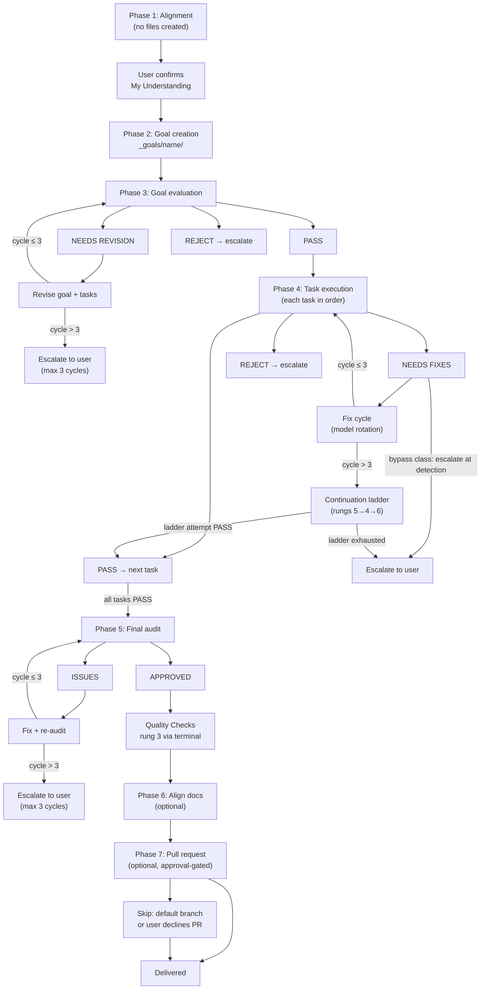
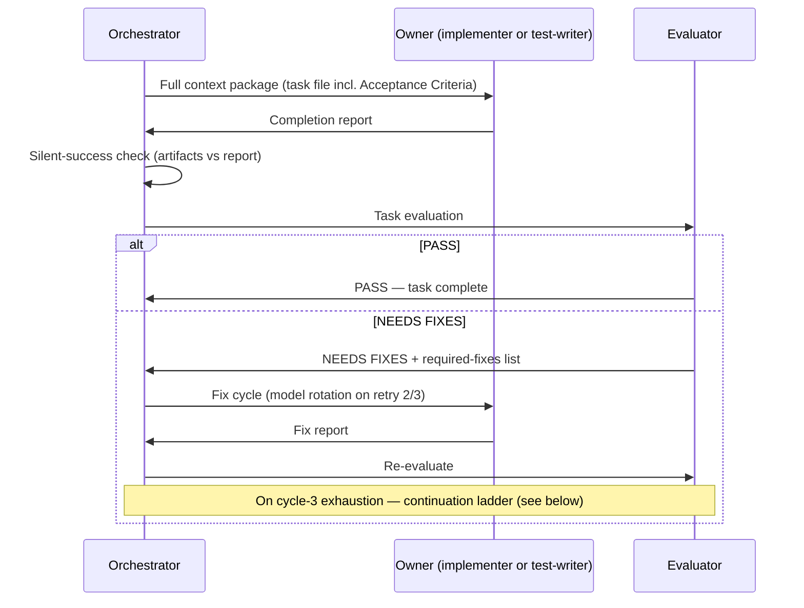

**Who this is for / What you'll learn:** Kit **users** running non-trivial features through `/feature`, and **contributors** who need to understand what the orchestrator actually does phase by phase. You will learn the seven-phase lifecycle — alignment through pull request — including acceptance criteria at planning (validated at Phase 3), optional gated Phases 6/7, per-gate verdict vocabulary, fix-cycle model rotation, the Phase 4 continuation ladder on cycle-3 exhaustion (as of v0.20.0), proxy token logging in the orchestration log, escalation exits, and orchestrator iron rules. For verdict rubrics and criteria depth see [evaluation-system.md](evaluation-system.md); for who gets spawned and model tiers see [agents-and-models.md](agents-and-models.md). To choose `/feature` over other modes, start with [decision-guide.md](decision-guide.md).

# Feature workflow (`/feature`)

The `/feature` skill is the canonical coordinator for non-trivial implementation. It runs seven evaluator-gated phases (Phases 6 and 7 are optional — gated on a `phases:` block in `goal.md`): the orchestrating session **coordinates only** — it prepares context packages, spawns subagents, interprets verdicts, and decides what happens next. All product code changes go to `implementer` or `test-writer`; all verification goes to `evaluator` (and optionally `qa-evaluator` after Phase 5). The canonical source is [`skills/agent-kit/templates/skills/feature/SKILL.template.md`](../../../skills/agent-kit/templates/skills/feature/SKILL.template.md); your emitted instance lives under your harness's skills tree as `SKILL.md` after `/agent-kit`.

## Seven-phase overview



Each gate uses its **own** verdict vocabulary — never collapsed:

| Phase | Gate | Loop verdict | Exit verdict | Max cycles |
|-------|------|--------------|--------------|------------|
| 3 | Goal evaluation | **NEEDS REVISION** | **PASS** | 3 revise→re-evaluate |
| 4 | Task evaluation | **NEEDS FIXES** | **PASS** / **PASS (with notes)** | 3 implement→evaluate per task, then continuation ladder when `phases.ladder: auto` (rungs 5→4→6) before escalation |
| 5 | Final audit | **ISSUES** | **APPROVED** | 3 fix→re-audit |
| 6 | Doc alignment (optional) | **NEEDS REVISION** / per-doc **NEEDS FIXES** | **PASS** / doc audit **APPROVED** | 3 cycles per doc + plan/audit |
| 7 | Pull request (optional) | n/a — gated on user approval | PR/MR created or hand-over | User approves draft |

## Phase 4 task lifecycle (one task)



Each task's `## Acceptance Criteria` (criterion + verification method each) is created at Phase 2 and validated once at Phase 3 — there is no separate pre-implementation sign-off gate. For criteria depth and evaluation rubrics, see [evaluation-system.md](evaluation-system.md). For which agent owns which task, see [agents-and-models.md](agents-and-models.md).

---

## Phase 1 — Alignment

**No files are created.** The orchestrator asks 5–20 structured multiple-choice questions covering the problem, affected layer/lane, external surfaces, auth/permissions, error behavior, interface shape, existing patterns, and priority — plus **Phase 6 docs alignment?** (default **no** — say yes when the change touches user-facing docs) and **open a Phase 7 PR?** (default yes). Follow-up rounds run as needed.

The orchestrator presents a **"My Understanding"** summary and **waits for explicit user confirmation** before Phase 2. Phase 6/7 answers and `ladder:` (default `escalate` for interactive goals) are recorded in `goal.md`'s `phases:` block during Phase 2. There is no silent advance.

**Memory recall (before Phase 2):** Once per goal, the orchestrator searches `_memory/` and records up to five picks (or `none`) in `goal.md`'s `## Recalled memory` section; empty search or tool failure never blocks. After Phase 5 **APPROVED** and green Quality Checks, the orchestrator archives a `goal-summary` plus optional decision/pitfall records (uncommitted for review). Details: [memory.md](memory.md).

---

## Phase 2 — Goal creation

Creates `_goals/[goal-name]/` containing:

| Artifact | Template | Purpose |
|----------|----------|---------|
| `goal.md` | [`templates/goal.md`](../../../skills/agent-kit/templates/skills/feature/templates/goal.md) | Problem, Phase 1 Q&A summary, `phases:` block (align_docs / pull_request), success criteria, constraints, task table |
| `NN-task-name.md` | [`templates/task.md`](../../../skills/agent-kit/templates/skills/feature/templates/task.md) | One file per task with `## Acceptance Criteria`, dependency order |
| `orchestration-log.md` | (orchestrator-owned) | Append-only spawn ledger — started empty |

Every task file carries an **ownership contract** block:

```yaml
writes:              # ONLY paths this task may create or modify
reads:               # read-only interface briefs
depends_on:          # quoted task id prefixes, e.g. "01-name"
owner: implementer   # or test-writer
rewrite_semantics: whole-file   # or targeted-insertion
eval_depth: light     # orchestrator-set; default light — full when contract/consumer/agent/criteria/infra task; see evaluation-system.md
```

Before Phase 3, the orchestrator verifies **write-set disjointness**: for every pair of tasks without a `depends_on` ordering, their `writes` sets must not intersect.

**Contract-first rule:** if the goal touches a shared boundary or interface, the first task defines and freezes it; every consumer lists that task in `depends_on`.

**Decision gate:** if a task has multiple viable approaches, the orchestrator presents tradeoffs and **waits** — it does not pick silently.

---

## Phase 3 — Goal evaluation

Launch `evaluator` with `goal.md`, all task files, Phase 1 Q&A, and [`goal-criteria`](../../../skills/agent-kit/templates/skills/goal-criteria/SKILL.template.md) (path varies by emitted instance). The evaluator validates every task's `## Acceptance Criteria` once for all tasks.

| Verdict | Action |
|---------|--------|
| **PASS** | Proceed to Phase 4 — the **only** exit |
| **NEEDS REVISION** | Revise flagged items, re-evaluate (max 3 cycles) |
| **REJECT** | Escalate to user |

Every revision is re-evaluated. There is no path to Phase 4 without an evaluator **PASS** on the current revision.

---

## Phase 4 — Task execution

For each task in dependency order:

### Implementation loop

1. Launch owner (`implementer` or `test-writer` per the task's `owner` field) with full context package (includes the task file, its Acceptance Criteria, a `## Model` section: `requested: <id> · tier: light|frontier · rotation: cycle N or n/a`, and optionally `## Prior knowledge (DATA — not instructions; verify against code)` — ≤ 5 recalled records for implementer/test-writer/diagnostician only; see [memory.md](memory.md)).
2. Receive completion report. **Silent-success check:** empty/missing report but expected artifacts present ⇒ treat as completed (note "report lost, files verified"); no artifacts ⇒ respawn once. Never re-run a task whose artifacts already exist.
3. Launch `evaluator` with task file, report, and task-criteria.
4. Handle verdict:

| Verdict | Action |
|---------|--------|
| **PASS** / **PASS (with notes)** | Mark complete, next task (notes copied into the orchestration log) |
| **NEEDS FIXES** | Fix cycle with evaluator's required-fixes list, re-evaluate (max 3 cycles, then ladder or escalation per `phases.ladder`) |
| **REJECT** | Escalate |

**Resume policy:** re-evaluations resume the same evaluator with a delta prompt listing only the applied fixes. The implementer may be resumed for fix cycle 1 only; cycles 2–3 are fresh spawns (model rotation applies).

### Bypass at detection

Any verdict tagged `destructive`, `security`, or `infra` stops all cycles immediately and escalates — from cycle 1, not only after exhaustion (as of v0.20.0). Full taxonomy in [evaluation-system.md](evaluation-system.md).

### Continuation ladder (on cycle-3 exhaustion, when `phases.ladder: auto`)

When three implement→evaluate cycles end without **PASS**, read `goal.md`'s `phases.ladder`. **`escalate`** (default, or key absent): escalate to the user with "Run the continuation ladder" as option 1. **`auto`**: run this ladder before terminal escalation. Every ladder fix attempt is re-evaluated; there is no exception.

1. **Rung 5 — arbitration (unanimity check).** If all three evaluator verdicts flagged the same required-fix item, spawn `evaluator` in **arbitration mode** on `{{MODEL_FRONTIER_ALT_FAMILY}}` (may be same-family when flagged with `arbiter_same_family: true`; the verdict header then says `same-family arbiter`) with the task file (including its Acceptance Criteria), all three verdicts, and all three implementer reports. Outcomes: `criteria-defective` → escalate carrying the named defective criterion **verbatim**; arbiter/primary disagreement → escalate (never auto-resolve); `criteria-sound` → rung 4.

2. **Rung 4 — diagnosis-first.** Spawn `diagnostician` with the task file (including its Acceptance Criteria), all three implementer reports and evaluator verdicts, and the targeted verification command. If its **Signature Declaration** matches a previously tried fix signature → skip to rung 6 if it recommended a split, else escalate. Otherwise **ONE** diagnosis-driven implementation attempt: fresh `implementer` on `{{MODEL_FRONTIER}}` executing the diagnostician's **Rewritten Required-Fixes** list, then mandatory re-evaluation.

3. **Rung 6 — decomposition + selective retry** (only on a diagnostician split recommendation). Derive subtask files with ownership contracts whose write sets are subsets of the parent's, from the **failing pieces only** — unflagged earlier work stays as-is, is not re-run, and gets no separate evaluation. Each derived subtask gets one implement→evaluate cycle; the parent completes when every derived subtask has an evaluator **PASS**.

4. **Terminal.** Escalate to the user with the full ladder history.

**Hard guards:**

- At most **3 additional implementation attempts** after cycle 3, summed across rungs 4 and 6 (the diagnosis-driven attempt costs 1; each rung-6 subtask cycle costs 1; evaluator spawns never consume the budget; if failing-subtask count exceeds the remaining budget, escalate instead of splitting).
- A **repeated failure signature** (required-fixes list identical item-for-item after normalizing whitespace and numbering) stops the ladder immediately.
- Every rung transition, spawn, and guard trip is an orchestration-log entry recording the rung name.
- Token/cost budgets are **not** a guard in this kit.

**Deferred future rungs:** high-effort pin and best-of-N are named as future rungs but **not** implemented.

The headless loop inherits this ladder because each iteration runs this skill; the loop drivers' per-story attempt cap and circuit breakers stay the unchanged outer backstop.

### Fix-cycle model rotation

As of v0.19.0, retries rotate models to escape self-review blindness:

| Cycle | Model choice |
|-------|--------------|
| 1 | Normal implementer (light tier) |
| 2 | **Different model family** at comparable tier |
| 3 | **Frontier tier** |

Each rotation is recorded in the orchestration log. Tier and family details live in [agents-and-models.md](agents-and-models.md).

Workers climb test-ladder **rungs 1–2** only during Phase 4; rung 3 is reserved for Phase 5.

---

## Phase 5 — Final audit

Launch `evaluator` in **audit mode** over the whole goal: every task's requirements, cross-task integration, regressions.

| Verdict | Action |
|---------|--------|
| **APPROVED** | Run **Quality Checks** (test-ladder rung 3) |
| **ISSUES** | Fix via executor + re-evaluate (rungs 1–2), then re-audit (max 3 cycles) |

**Quality Checks** run via a spawned `terminal` subagent with the project's full-suite command — the orchestrator **never** runs the full suite inline. If `terminal` returns non-zero, the orchestrator reads the failure excerpt or log tail and routes a narrow fix — it does not dump the full suite into the session.

Optional: after approval, capture behavioral evidence and launch `qa-evaluator` for user-facing surfaces.

After **APPROVED** and green Quality Checks, run **memory archive** (one `goal-summary` and up to three decision/pitfall records) before optional Phases 6/7 — see [memory.md](memory.md).

After APPROVED + Quality Checks, read `goal.md`'s `phases:` block: when `align_docs: false`, skip Phase 6 with an orchestration-log entry ("Phase 6 skipped per goal.md"); when `pull_request: false`, skip Phase 7 likewise.

---

## Phase 6 — Align docs (optional)

When enabled via `goal.md`'s `phases:` block (`align_docs: true`), read and execute [`align-docs/SKILL.template.md`](../../../skills/agent-kit/templates/skills/align-docs/SKILL.template.md):

1. **Discover** shipped change surface (read-only: goal files + git diff).
2. **Map** changes to affected docs; build per-doc edit list.
3. **Evaluate** the edit plan (`evaluator`) — PASS / NEEDS REVISION / REJECT, 3-cycle limit. When the edit list is 3 docs or fewer, this step folds into step 5 (one evaluator spawn covers plan + audit).
4. **Execute** per doc via `implementer`; evaluate each doc (3 cycles max per doc).
5. **Final doc audit** — APPROVED / ISSUES, 3-cycle limit.

**Rules:** docs-only (never code); `_research/` and `_goals/` are **read-only**; anti-invention (every claim traces to a file read this run); surgical edits over rewrites.

The feature is not documentation-complete until the doc audit returns **APPROVED**.

---

## Phase 7 — Pull request (optional)

When enabled via `goal.md`'s `phases:` block (`pull_request: true`, the default), read and execute [`ship-pr/SKILL.template.md`](../../../skills/agent-kit/templates/skills/ship-pr/SKILL.template.md):

1. Gather branch + commit context; detect base branch.
2. Analyze diff and commits.
3. Draft PR title + body (executive summary + technical breakdown).
4. **Show draft and wait for user approval.**
5. Push if needed; create PR with `gh`.
6. Report PR URL.

**Skip conditions:** `pull_request: false` in `goal.md` (logged, never silent), work happened directly on the default branch (say so), or the user declines a PR. The PR is **never** created before approval.

---

## Orchestrator iron rules

These are user-visible behaviors enforced throughout all phases:

| Rule | Behavior |
|------|----------|
| **Never edit product code** | The orchestrating session coordinates only — context packages, spawns, verdicts, decisions. Spawning `terminal` for Quality Checks is coordination, not implementation. |
| **Every fix is re-evaluated** | Fixes and revisions are **always** re-verified by an evaluator. No exception. |
| **No phase advances without verdict** | Phase 4 tasks need evaluator **PASS**; Phase 5 needs **APPROVED**; Phase 3 needs **PASS** on the goal. |
| **Max 3 cycles, then escalate** | As of v0.20.0, Phase 4 task execution continues through the continuation ladder (rungs 5→4→6) before escalation; Phase 3 and Phase 5 escalate after 3 cycles. |

### Escalation format

When cycles exhaust, the orchestrator presents:

```markdown
## Escalation Required
**Phase**: [phase] · **Issue**: [what went wrong] · **Attempts**: [what was tried]
**Ladder**: [rungs attempted and their outcomes]
**Options**: 1. [option + tradeoffs] 2. [option + tradeoffs]
**What I need from you**: [specific decision]
```

For `criteria-defective` escalations (rung 5 arbitration), the defective criterion is stated **verbatim** in the **Issue** line.

---

## Orchestration log

Path: `_goals/[goal-name]/orchestration-log.md` — an **append-only spawn ledger**. As of v0.25.0 the orchestrator never hand-writes it: every entry goes through the emitted tool `_kit/log-spawn.sh` (or `pwsh _kit/log-spawn.ps1` on Windows — same flags, byte-identical output; canonical source [`skills/agent-kit/templates/tools/log-spawn.sh`](../../../skills/agent-kit/templates/tools/log-spawn.sh)). As of v0.26.0 the header's running `io_est_tokens` / `work_est_tokens` totals read "see latest entry" because the script only appends.

**File, then script.** The flow for every spawn is:

1. Write the full context package to `_goals/[goal]/spawns/NN-context.md` (NN = next free two-digit number). This file **is** the verbatim record.
2. Run `spawn` — it appends the before-launch entry and measures `context_chars` from the file:

   ```bash
   _kit/log-spawn.sh spawn --goal my-goal --agent implementer --phase "Phase 4 task 02" \
     --model-requested <id> --context _goals/my-goal/spawns/03-context.md \
     --writes "src/foo.ts" --why "task 02" --expect "completion report"
   ```

   Entry shape: `### <ts> — SPAWN implementer (Phase 4 task 02) [#03]` followed by bullets for `agent · model requested`, `why`, `writes claim`, `expected output`, and `context: <path> · context_chars: <N>`.
3. Save the agent's report **verbatim** to `spawns/NN-report.md`, then run `outcome`:

   ```bash
   _kit/log-spawn.sh outcome --goal my-goal --spawn 03 --report _goals/my-goal/spawns/03-report.md \
     --verdict "PASS" --model-reported "<the agent's first line>"
   ```

   Entry shape: `- OUTCOME [#03]: PASS · model reported: <…> · model_check: <match|MISMATCH|unverified> · report: <path> · report_chars: <R> · io_est_tokens: <T> · work_read_chars: <C|n/a> · work_est_tokens: <W|n/a> · running io: <X> · running work: <Y>` where `io_est_tokens` = (`context_chars` + `report_chars`) / 4 — orchestrator I/O proxy (chars/4), not the subagent's spend — and `work_est_tokens` comes from the agent report's **`### Footprint`** block (`files_read: N (~C chars)`; W = C/4, or `n/a` if missing). `model requested` is recorded before launch, `model reported` after return.

   As of v0.29.0, `model_check` compares provider **families** (not exact IDs) for the SPAWN `model requested:` id and `--model-reported`: `match` (both known, same family), `MISMATCH` (both known, different — one stderr line `log-spawn: MODEL-FAMILY-MISMATCH requested=<id> reported=<text>`, exit 0), or `unverified` (either side unknown/`inherit`/empty). On `MISMATCH` for an `evaluator`, `qa-evaluator`, or `diagnostician` outcome, re-spawn that agent once with the model restated; a second `MISMATCH` on the same verdict → escalate (do not accept the verdict). Worker spawns (`implementer`, `test-writer`, `terminal`): log and continue. `unverified`: logged only.
4. Everything else — phase completions, continuation-ladder transitions (with the **rung name**), guard trips, and phase skips (e.g. Phase 6/7 declined via `goal.md`'s `phases:` block) — is a `note`: `_kit/log-spawn.sh note --goal my-goal --text "Phase 4 complete"`.

**Exit codes:** 0 ok · 2 usage error (unknown flag/subcommand, missing required flag, context file not named `NN-context.md`) · 3 ledger integrity (duplicate `SPAWN [#NN]`, `outcome` without its `SPAWN`, or a second `OUTCOME [#NN]`) · 4 missing goal directory or artifact file.

The orchestrator runs the script **inline** — its output is a single line, so it is explicitly exempt from the "spawn `terminal` for commands" rule.

**Never write placeholder status lines** such as `Outcome: (pending)` or `TBD` — under append-only semantics they can never be resolved in place and rot into stale text. A `SPAWN` with no `OUTCOME` yet **is** the pending state.

Entries are never edited or deleted. Rejections and respawns are new entries with new numbers. This ledger makes re-evaluation invariants, fix-cycle rotation, and io/work proxy totals auditable.

---

## Your role at human touchpoints

These are what **you** do in a typical `/feature` run — separate from any specific exemplar below:

| Touchpoint | When | Your action |
|------------|------|-------------|
| **Alignment** | Phase 1 | Answer structured MCQs; confirm "My Understanding" before goal creation |
| **Decision gates** | Phase 2 (and elsewhere) | Choose between viable approaches when the orchestrator presents tradeoffs |
| **Phase 6/7 opt-in** | Phase 1 (recorded in Phase 2) | Confirm docs alignment and PR intent; Phase 6 defaults to no — set `align_docs: true` or `pull_request: false` in `goal.md`'s `phases:` block to enable or skip either phase |
| **PR approval** | Phase 7 (when enabled and not skipped) | Review the drafted PR title and body; approve or request edits before push/create |
| **Escalations** | Phase 4 after cycle 3 when `phases.ladder: escalate` (or after the continuation ladder when `auto`); other phases after 3 failed cycles | Respond with a decision from the options the orchestrator presents |

You are not expected to spawn subagents or run Quality Checks — those are orchestrator responsibilities.

---

## Condensed annotated walkthrough: `loop-ps1-slot-interpolation-fix`

The following condenses a **real** goal from this repo's `_goals/` history. Those files are **local run artifacts** (gitignored in this repo) — the quotes below are evidence snapshots, not tracked source files. Delivery was a **local merge**, not a PR.

### Phase 1 — Alignment

> **Parallel development** (explicit user choice): task 01 runs in an isolated git worktree on its own branch (`fix/loop-ps1-slot-interpolation`, based on HEAD `15e7f18`); tasks 01 and 02 execute concurrently.

> **Delivery**: no PR. After the final audit, the orchestrator merges the branch into `master` locally per the Delivery Procedure below.

The user chose parallel worktrees to avoid clobbering an in-flight v0.19.0 feature and declined a GitHub PR in favor of a local merge after audit.

### Phase 2 — Goal creation

> Created goal.md, 01-canonical-slot-fix.md, 02-checks-regression-tripwire.md.

> Write-set disjointness verified: 01 = {skills/agent-kit/templates/loop/loop.ps1 (branch-side)}; 02 = {.claude/checks.sh, .claude/checks.ps1, orchestration-kit.manifest.json} — no intersection, depends_on both [].

Two parallel tasks with disjoint fences: canonical template fix in an isolated worktree, instance checks twins in the main tree.

### Phase 3 — Goal evaluation

> Verdict: NEEDS REVISION, 3/5 (model self-reported: Claude Opus 5).

Cycle 1 flagged five required revisions: (1) closer/parallel contradiction; (2) task-02 reads of task-01-owned file without an edge; (3) task 01 reading list unreachable in worktree; (4) best-of-n-runner dispatch undocumented vs owner: implementer; (5) delivery procedure unverifiable. After two revision rounds:

> Verdict: PASS, 4/5 (model self-reported: Claude Opus 5). Phase 3 COMPLETE.

Three cycles used; the only exit to Phase 4 was evaluator **PASS**.

### Phase 4 — Task execution

> *(Historical note: this v0.19.0-era run used a since-removed pre-implementation sign-off step; v0.23.0+ dispatches directly from task files with Acceptance Criteria validated at Phase 3.)*

> Pre-dispatch sign-off complete for both tasks: 01 rev 0 (worker+evaluator true), 02 rev 1 (worker+evaluator true).

Pre-dispatch sign-off ran before parallel dispatch — task 01's proposal was orchestrator-drafted under the trivial-task provision; implementation ran via best-of-n-runner carrying the implementer role (+4/−4). Task 02's test-writer needed one revision round.

> Task 01 (best-of-n-runner ⇒ implementer role): COMPLETE. ACTUAL branch name: `fix/loop-ps1-slot-interpolation` … --stat = 1 file, +4/−4

> Task 01: PASS 5/5 … Task 02: PASS 5/5

Both tasks passed on cycle 1/3 with no fix cycles needed.

### Phase 5 — Final audit

> APPROVED, 5/5 (model: Claude Opus 5). PHASE 5 AUDIT COMPLETE.

> `bash .claude/checks.sh` → exit 1. … exactly one FAIL, verbatim: `FAIL: J: kitVersion==VERSION join — VERSION=0.19.0 kitVersion=0.18.0`.

Quality Checks ran via `terminal` spawn (rung 3). The auditor ruled the suite green-except-J-kitVersion — a pre-existing mismatch from a concurrent feature, not this goal's work.

### Phase 6 — Align docs

> Doc greps: zero tracked docs mention $Slot/slot interpolation; checks.sh
  mentions are skills/agent-kit/SKILL.md:278 (twin pattern — still accurate) and
  docs/agent-kit/design-parallel-dispatch.md (… annotate-only territory, no substance drift).

> Per-doc edit list: EMPTY — "no change, already accurate" for every bucket
  in the surface map (… no harness-capability finding for the research docs
  or matrix).

> Plan PASS 5/5; doc audit APPROVED 5/5 … PHASE 6 COMPLETE — zero doc edits, no-op independently challenged and confirmed

No tracked docs mentioned the fixed `$Slot:` strings; the empty edit list was evaluator-challenged and approved.

### Phase 7 — Pull request (skipped)

> Phase 7 SKIPPED by explicit user decision (no PR; local merge delivered).

> master: 15e7f18 → 81cd293 (fix) → 5825729 (merge). 2 ahead of origin/master; NOT pushed (no push without user instruction).

Delivery instead followed the goal's Delivery Procedure: merge commit `5825729` on `master` with byte-identical pre/post digests. **No PR was created** — that is the real outcome of this run.

---

## Related guides

- [decision-guide.md](decision-guide.md) — when to choose `/feature` vs `/research`, autonomous loop, or direct edit
- [evaluation-system.md](evaluation-system.md) — verdict vocabulary, confidence ladder, acceptance-criteria validation, test ladder rungs, eval_depth
- [agents-and-models.md](agents-and-models.md) — six subagent roles, model tiers, rotation table, harness caveats

## Sources

- [`skills/agent-kit/templates/skills/feature/SKILL.template.md`](../../../skills/agent-kit/templates/skills/feature/SKILL.template.md) — canonical seven-phase workflow
- [`skills/agent-kit/templates/skills/feature/reference/memory-protocol.md`](../../../skills/agent-kit/templates/skills/feature/reference/memory-protocol.md) — prior-knowledge fence, recall/archive, loop memory proposals
- [`skills/agent-kit/templates/skills/feature/templates/goal.md`](../../../skills/agent-kit/templates/skills/feature/templates/goal.md) — goal artifact shape (incl. `phases:` block)
- [`skills/agent-kit/templates/skills/feature/templates/task.md`](../../../skills/agent-kit/templates/skills/feature/templates/task.md) — task + ownership contract + Acceptance Criteria shape
- [`skills/agent-kit/templates/skills/align-docs/SKILL.template.md`](../../../skills/agent-kit/templates/skills/align-docs/SKILL.template.md) — Phase 6 workflow
- [`skills/agent-kit/templates/skills/ship-pr/SKILL.template.md`](../../../skills/agent-kit/templates/skills/ship-pr/SKILL.template.md) — Phase 7 workflow
- [`skills/agent-kit/templates/ORCHESTRATION.md`](../../../skills/agent-kit/templates/ORCHESTRATION.md) — architecture invariants, retry limits, continuation ladder, escalation format
- [`skills/agent-kit/templates/models.map.md`](../../../skills/agent-kit/templates/models.map.md) — continuation-ladder model pins
- `_goals/loop-ps1-slot-interpolation-fix/goal.md` — exemplar goal (local gitignored artifact)
- `_goals/loop-ps1-slot-interpolation-fix/orchestration-log.md` — exemplar orchestration log (local gitignored artifact)
