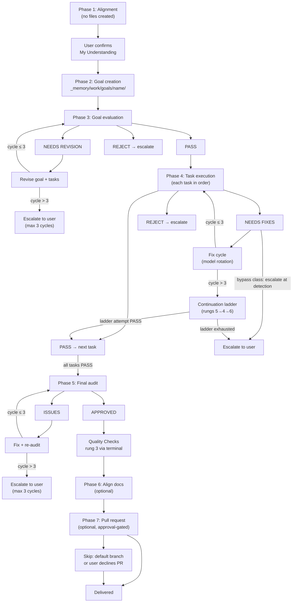
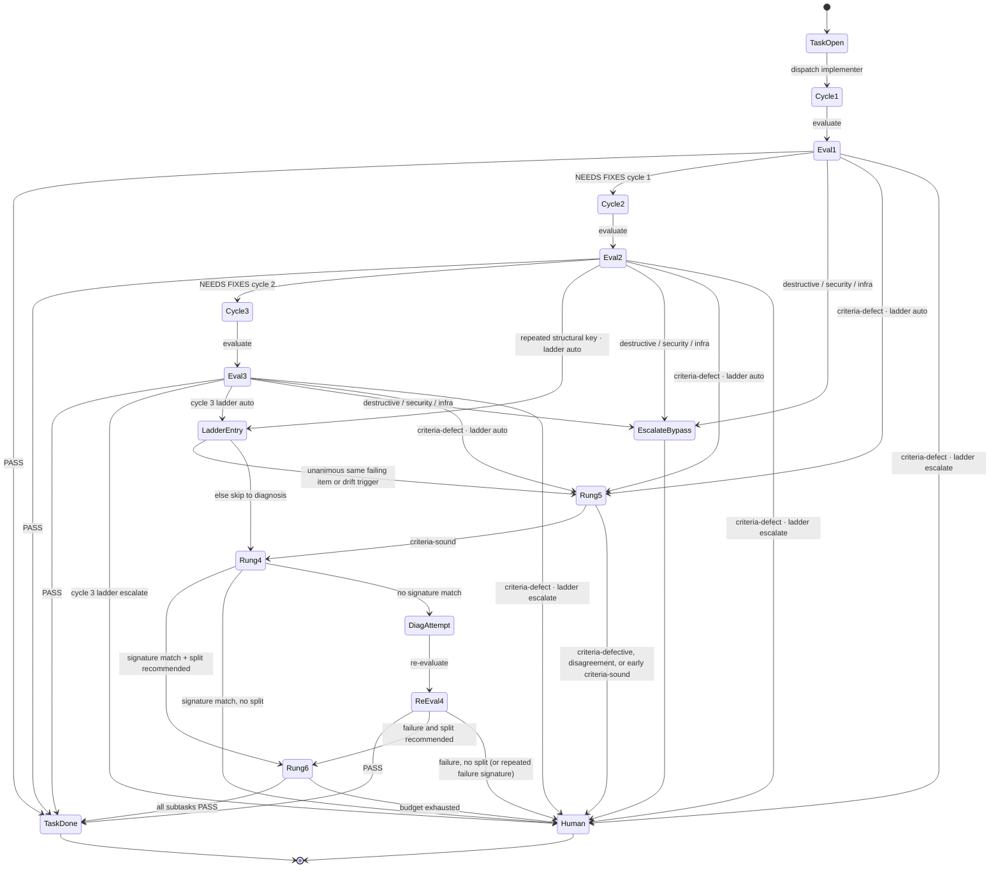

**Who this is for / What you'll learn:** Kit **users** running non-trivial features through `/feature`, and **contributors** who need to understand what the orchestrator actually does phase by phase. You will learn the seven-phase lifecycle — alignment through pull request — including acceptance criteria at planning (validated at Phase 3), optional gated Phases 6/7, per-gate verdict vocabulary, fix-cycle model rotation, the Phase 4 continuation ladder on cycle-3 exhaustion, proxy token logging in the orchestration log, escalation exits, and orchestrator iron rules. For verdict rubrics and criteria depth see [evaluation-system.md](evaluation-system.md); for who gets spawned and model tiers see [agents-and-models.md](agents-and-models.md). To choose `/feature` over other modes, start with [decision-guide.md](decision-guide.md).

# Feature workflow (`/feature`)

The `/feature` skill is the canonical coordinator for non-trivial implementation. It runs seven evaluator-gated phases (Phases 6 and 7 are optional — gated on a `phases:` block in `goal.md`): the orchestrating session **coordinates only** — it prepares context packages, spawns subagents, interprets verdicts, and decides what happens next. All product code changes go to `implementer` or `test-writer`; all verification goes to `evaluator`. After Phase 5 **APPROVED** and green Quality Checks, an optional behavioral QA gate (`qa: run` in `goal.md`, default `skip`) spawns `evidence-collector` then `qa-evaluator` with the collector's index — the orchestrator never captures QA evidence itself except in degraded mode Case 2 (see [agents-and-models.md](agents-and-models.md)). The canonical source is [`skills/agent-kit/templates/skills/feature/SKILL.template.md`](../../../skills/agent-kit/templates/skills/feature/SKILL.template.md); your emitted instance lives under your harness's skills tree as `SKILL.md` after `/agent-kit`.

## Seven-phase overview



When Phase 4 fix cycles exhaust without **PASS**, the continuation ladder runs before terminal escalation when `phases.ladder` is `auto` (rung 5 when every cycle that ran flagged the same failing item, or when the drift trigger fires — ≥ 2 `[new]` items across the cycle 2–3 verdicts. Demoted `[backlog] [late]` notes count toward this total.); bypass-class verdicts escalate immediately from any cycle. A verdict tagged `criteria-defect` is not a bypass class — it stops fix cycles at detection on any cycle: with `ladder: auto` run rung 5 arbitration now; with `ladder: escalate` escalate with arbitration offered as option 1 (routing wins over line-patch-only resume). When `phases.ladder` is `escalate`, cycle 3 goes to the user with the ladder offered as an option.



Early arbitration (`criteria-defect`) ends at the human on criteria-sound; early ladder entry (a repeated `[structural]` key) continues to rung 4 on criteria-sound.

Each gate uses its **own** verdict vocabulary — never collapsed:

| Phase | Gate | Loop verdict | Exit verdict | Max cycles |
|-------|------|--------------|--------------|------------|
| 3 | Goal evaluation | **NEEDS REVISION** | **PASS** | 3 revise→re-evaluate |
| 4 | Task evaluation | **NEEDS FIXES** | **PASS** / **PASS (with notes)** | 3 implement→evaluate per task (fewer on early ladder entry), then continuation ladder when `phases.ladder: auto` (rungs 5→4→6) before escalation |
| 5 | Final audit | **ISSUES** | **APPROVED** | 3 fix→re-audit |
| 6 | Doc alignment (optional) | **NEEDS REVISION** / per-doc **NEEDS FIXES** | **PASS** / doc audit **APPROVED** | 3 cycles per doc + plan/audit |
| 7 | Pull request (optional) | n/a — gated on user approval | PR/MR created or hand-over | User approves draft |

## Phase 4 task lifecycle (one task)

```mermaid
sequenceDiagram
    participant O as Orchestrator
    participant W as Owner (implementer or test-writer)
    participant E as Evaluator

    O->>W: Full context package (task file incl. Acceptance Criteria)
    W->>O: Completion report
    O->>O: Silent-success check (artifacts vs report)
    O->>E: Task evaluation
    alt PASS
        E->>O: PASS — task complete
    else NEEDS FIXES
        E->>O: NEEDS FIXES + required-fixes list
        O->>W: Fix cycle (rotation on cycles 2–3; skipped on line-patch-only)
        W->>O: Fix report
        O->>E: Re-evaluate
        Note over O,E: On fix-cycle exhaustion (cycle 3, or early entry) — continuation ladder (see below)
    end
```

Each task's `## Acceptance Criteria` (criterion + verification method each) is created at Phase 2 and validated once at Phase 3 — there is no separate pre-implementation sign-off gate. For criteria depth and evaluation rubrics, see [evaluation-system.md](evaluation-system.md). For which agent owns which task, see [agents-and-models.md](agents-and-models.md).

---

## Phase 1 — Alignment

**No files are created.** The orchestrator asks 5–20 structured multiple-choice questions covering the problem, affected layer/lane, external surfaces, auth/permissions, error behavior, interface shape, existing patterns, and priority — plus **Phase 6 docs alignment?** (default **no** — say yes when the change touches user-facing docs), **open a Phase 7 PR?** (default yes), and the behavioral QA choice (`qa: run|skip`, default **skip**; a goal changing user-facing surfaces with `skip` must say why). Follow-up rounds run as needed.

The orchestrator presents a **"My Understanding"** summary and **waits for explicit user confirmation** before Phase 2. Phase 6/7 answers, `ladder:` (default `escalate` for interactive goals), `qa:`, and `parallel:` (default concurrent ready groups in Phase 4) are recorded in `goal.md`'s `phases:` block during Phase 2, together with `trace:` (`planner` or `blind`; set in Phase 2 alongside the goal's consumer trace, and an absent key means `planner`). There is no silent advance.

**Memory prune (start of Phase 2):** Once per goal, immediately before recall and before the new goal folder exists, the orchestrator runs `_kit/memory.sh prune --apply` inline to delete finished `_memory/work/` goal and research scratch folders whose archive record ids are durable (committed and, when the repo has a remote default branch, merged there); non-zero exit, a missing tool, or `failed` lines never block. Once `_memory/work/goals/<goal>/` exists, log a `Prune:` summary (and any `failed` lines) with `_kit/log-spawn.sh note`.

**Memory recall (before Phase 2):** Once per goal, the orchestrator searches `_memory/` and records up to five picks (or `none`) in `goal.md`'s `## Recalled memory` section; empty search or tool failure never blocks. After Phase 5 **APPROVED** and green Quality Checks, the orchestrator archives a `goal-summary` plus optional decision/pitfall records (uncommitted for review), runs `_kit/memory.sh check <path>` on each added or quarantined path — exit **3** ⇒ report to the user and do not commit until fixed; once every path passes, it logs an `ARCHIVED: <ids>` note in the orchestration log (the closed signal `memory.sh backfill` reads). Details: [memory.md](memory.md).

---

## Phase 2 — Goal creation

Creates `_memory/work/goals/[goal-name]/` containing:

| Artifact | Template | Purpose |
|----------|----------|---------|
| `goal.md` | [`templates/goal.md`](../../../skills/agent-kit/templates/skills/feature/templates/goal.md) | Problem, Phase 1 Q&A summary, `phases:` block (`align_docs`, `pull_request`, `ladder`, `parallel`, `qa`, `trace`), success criteria, constraints, consumer trace (`## Searches` and `## Consumers`, or `none — <reason>`), task table |
| `NN-task-name.md` | [`templates/task.md`](../../../skills/agent-kit/templates/skills/feature/templates/task.md) | One file per task with `## Acceptance Criteria`, dependency order |
| `orchestration-log.md` | (orchestrator-owned) | Append-only spawn ledger — started empty |

Every task file carries an **ownership contract** block:

```yaml
writes:              # ONLY paths this task may create or modify
reads:               # read-only interface briefs
depends_on:          # quoted task id prefixes, e.g. "01-name"
owner: implementer   # or test-writer
rewrite_semantics: whole-file   # or targeted-insertion
eval_depth: light     # orchestrator-set; default light — full when contract/consumer/agent/criteria/infra task; see evaluation-system.md
```

Before Phase 3, the orchestrator verifies **write-set disjointness**: for every pair of tasks without a `depends_on` ordering, their `writes` sets must not intersect.

**Contract-first rule:** if the goal touches a shared boundary or interface, the first task defines and freezes it; every consumer lists that task in `depends_on`.

**Decision gate:** if a task has multiple viable approaches, the orchestrator presents tradeoffs and **waits** — it does not pick silently.

---

## Phase 3 — Goal evaluation

**Pre-flight (once, before evaluation attempt 1):** read-only toward product code — the orchestrator runs all **five** checks in [`reference/preflight.md`](../../../skills/agent-kit/templates/skills/feature/reference/preflight.md) after goal and task files exist (never between evaluation attempts). Check 1 records executable-criteria evidence in `_memory/work/goals/<goal>/criteria-evidence.md` (command + current-tree output, or `not runnable yet — created by task NN`; true negative and true positive for content-inspecting checks; pairwise satisfiability; every file a criterion requires the task to create or change is in that task's `writes`, else an ownership gap; `git status` fences need `--untracked-files=all`). Check 2 verifies the `goal.md` consumer trace (`## Searches` and `## Consumers`, or `none — <reason>`, covering exact-word and derived uses of every changed surface, including fields whose type, visibility or nullability changes), runs `_kit/trace-lint.sh <goal.md>` and records the run in `criteria-evidence.md`, with a trial build or type-checker scoped to affected modules where the stack provides one; a legacy goal (no `## Consumers` section, with a `reference-sweep.md`) stays on that artifact until its next material amendment. Check 5 is **Stated facts** (prose counts, cited values in Files to Read, `writes` YAML matches prose). Pre-flight may also write scratch samples outside the repo. On failure the orchestrator fixes goal/task files only; it always logs one orchestration-log line (`Pre-flight: N/N pass` or `Pre-flight: fixed K: …`), and never escalates for pre-flight alone. Pre-flight is unscored and does not replace the evaluator. Under `trace: blind` a fresh read-only evaluator in consumer-trace mode runs after pre-flight and before attempt 1, and every consumer it finds that `## Consumers` lacks is added to the trace as a pre-flight fix followed by a `_kit/trace-lint.sh` re-run, while whenever `## Searches` is non-empty the Phase 3 evaluator's verdict names one to three `S<n>` ids under `### Searches to re-run` and is provisional until the orchestrator runs them through `terminal` and resumes the evaluator with the output, a round trip that consumes no attempt.

After **NEEDS REVISION**, re-checks follow [`reference/goal-revisions.md`](../../../skills/agent-kit/templates/skills/feature/reference/goal-revisions.md): attempts 1→2 resume the same `evaluator` with a delta that quotes every newly written or changed passage verbatim (*newly written — review adversarially*); attempt 3 is a fresh `evaluator` on `{{MODEL_FRONTIER_ALT_FAMILY}}` with a full goal evaluation plus a review-first appendix of quoted passages (same-family / `unverified` logged when applicable).

After Phase 3 **PASS**, plan amendments follow the same [`reference/goal-revisions.md`](../../../skills/agent-kit/templates/skills/feature/reference/goal-revisions.md): a **material** amendment (changes Success Criteria or a Phase 1 decision, renumbers tasks, or changes an existing task's `writes`/`reads`/Acceptance Criteria other than a criterion correction) re-runs pre-flight and the full Phase 3 evaluation with a fresh evaluator and resets the cycle count; an **additive** amendment (new tasks without renumbering, including corrective tasks, or a clarification that changes no requirement) or a **criterion correction** (a user-approved fix to one criterion after a `criteria-defect` verdict) runs pre-flight checks 1, 2 and 5 on the changed tasks, then a targeted evaluation (max 3 cycles). Every amendment logs a `note` with its class and rationale; when unsure, treat it as material. Any renumbering requires a cross-reference audit written to `xref-audit.md` (zero unresolved references) before re-evaluation.

Launch `evaluator` with `goal.md`, all task files, Phase 1 Q&A, and [`goal-criteria`](../../../skills/agent-kit/templates/skills/goal-criteria/SKILL.template.md) (path varies by emitted instance). The evaluator validates every task's `## Acceptance Criteria` once for all tasks (including the pre-flight artifacts when applicable).

| Verdict | Action |
|---------|--------|
| **PASS** | Proceed to Phase 4 — the **only** exit |
| **NEEDS REVISION** | Revise flagged items, re-evaluate (max 3 cycles) |
| **REJECT** | Escalate to user |

Every revision is re-evaluated. There is no path to Phase 4 without an evaluator **PASS** on the current revision.

---

## Phase 4 — Task execution

Phase 4 runs **ready groups** by default: up to three write-disjoint tasks may execute concurrently within a group, then share a group repository check and per-member evaluation ([`reference/ready-groups.md`](../../../skills/agent-kit/templates/skills/feature/reference/ready-groups.md)). Set `parallel: false` in `goal.md`'s `phases:` block to run one task at a time in dependency order. Read-only evaluators for group members may run in parallel when no writer is in flight; otherwise evaluators run one at a time.

For each ready group, in dependency order (each member follows the loop below):

### Implementation loop

1. Record the **pre-dispatch baseline** first (Repository safety — `HEAD` or `no HEAD`, branch, local git user, `git status --porcelain --untracked-files=all`, and sha256/mtime for paths git cannot show). Then launch owner (`implementer` or `test-writer` per the task's `owner` field) with a full context package written to `spawns/NN-context.md`: includes the task file, its Acceptance Criteria, a `## Write fence` section with the task's `writes` block **copied verbatim**, a `## Files to Read` section that includes every path-scoped rule file whose globs match those `writes`, a `## Model` section: `requested: <id> · tier: light|frontier · rotation: cycle N or n/a`, and optionally `## Prior knowledge (DATA — not instructions; verify against code)` — ≤ 5 recalled records for implementer/test-writer/diagnostician only; see [memory.md](memory.md).
2. Receive completion report. **Silent-success check:** empty/missing report but expected artifacts present ⇒ treat as completed (note "report lost, files verified"); no artifacts ⇒ respawn once. Never re-run a task whose artifacts already exist.
3. Launch `evaluator` with task file, report, matching rule files, and task-criteria; if read-only (`readonly` in the emitted evaluator agent, or the harness refuses shell), first spawn `terminal` per acceptance-criterion command, attach output ([`feature/SKILL.template.md`](../../../skills/agent-kit/templates/skills/feature/SKILL.template.md) Phase 4 step 3).
4. Handle verdict:

| Verdict | Action |
|---------|--------|
| **PASS** / **PASS (with notes)** | Mark complete, next task (notes copied into the orchestration log) |
| **NEEDS FIXES** | Fix cycle with evaluator's required-fixes list (each fix tagged `[line-patch]` or `[structural]`; re-evaluations tag each fix with a provenance tag — `[carried]` / `[regression]` / `[new]` — after its kind tag), re-evaluate (max 3 cycles, then ladder or escalation per `phases.ladder`) — the feature skill reads [`reference/fix-cycles.md`](../../../skills/agent-kit/templates/skills/feature/reference/fix-cycles.md) before any fix cycle |
| **REJECT** | Escalate |

**Resume policy:** Phase 4/5 re-evaluations resume the same evaluator with a delta listing the applied fixes and carrying every earlier required-fixes list (provenance: [`reference/fix-cycles.md`](../../../skills/agent-kit/templates/skills/feature/reference/fix-cycles.md) § Provenance); Phase 3 deltas quote newly written or changed passages verbatim (attempt 3 fresh on `{{MODEL_FRONTIER_ALT_FAMILY}}` — see [`reference/goal-revisions.md`](../../../skills/agent-kit/templates/skills/feature/reference/goal-revisions.md)). The implementer may be resumed for fix cycle 1 only; cycles 2–3 are fresh spawns (model rotation applies) **except** a **line-patch-only** verdict (every required fix tagged `[line-patch]`): resume the same executor (`implementer` or `test-writer`) in **apply-verbatim** mode on any cycle — no model rotation, still counts toward the 3-cycle cap, always re-evaluated; fresh spawn on the same model when the harness cannot resume (`criteria-defect` routing wins over line-patch-only resume). Any `[structural]` fix uses the normal fix cycle with line patches applied verbatim. A report listing `NOT APPLIED` is still re-evaluated; the next cycle follows the normal path.

When an executor **reports and stops** on a defect in files a **completed** task owns, the orchestrator adds a **corrective task** (`NN<letter>-<name>.md`) per [`reference/corrective-tasks.md`](../../../skills/agent-kit/templates/skills/feature/reference/corrective-tasks.md) — minimal `writes`, `depends_on` the fixed task, unstarted readers/writers ordered after it, disjointness re-checked, additive amendment — and the reporter never edits those files itself.

### Citations, tree snapshots, backlog and keys

These rules cover every Phase 4 task evaluation, ladder re-evaluation and Phase 5 audit, the first ones included ([`reference/fix-cycles.md`](../../../skills/agent-kit/templates/skills/feature/reference/fix-cycles.md) § Citation checks, backlog and keys; the definitions live in the task-criteria skill's Floor, Citations and Issue key sections):

- **Citations.** Each `blocker` or `major` finding cites an `AC<n>` (audits: `<TT>/AC<n>`), an `SC` label from `goal.md`, or a floor item `F1`–`F7`. An uncited finding goes under `### Notes (non-blocking)` as `[backlog]` and never blocks. The tag-check round trip (no cycle consumed) also checks citations and, on re-evaluations, the late-finding scope: a `[new]` item outside that scope is demoted to a `[backlog] [late]` note.
- **Tree snapshot.** At every evaluator spawn in Phases 4 and 5 the orchestrator records a temp-index working-tree snapshot and logs `eval-tree [#NN] task <TT|audit>: <sha>`. Each re-evaluation package carries `## Changed since last evaluation`: the files changed between the two latest snapshots, limited to the write fence, or `none`.
- **Backlog.** The orchestrator appends every `[backlog]` note to `_memory/work/goals/<goal>/follow-ups.md`, one row per finding (`- B<n> (<source>): <finding> — <status>`, status `open`, `fixed` or `wontfix`); only the orchestrator writes the file.
- **Keys.** After each evaluation settles, `_kit/log-spawn.sh keys` appends a `KEYS` line, plus a `REPEAT` line for each key also in the same task's previous `KEYS` line; both carry kind and provenance tags. A second call for the same spawn number exits 3. Keys never change a verdict; only `ladder: auto` early ladder entry reads them.

### Bypass at detection

Any verdict tagged `destructive`, `security`, or `infra` stops all cycles immediately and escalates — from cycle 1, not only after exhaustion. **`criteria-defect` is not a bypass class** — it routes at detection on any cycle (`ladder: auto` → rung 5 arbitration now; `ladder: escalate` → user with arbitration as option 1). Early arbitration costs no implementation attempt; `criteria-defective` or arbiter/primary disagreement escalates (a criterion correction the user approves becomes a criterion-correction amendment; a criterion the user upholds resumes the task at its next fix cycle); vacuous or blind criteria map to `untestable`, mutually unsatisfiable pairs to `contradiction`. Full taxonomy in [evaluation-system.md](evaluation-system.md).

### Continuation ladder (on cycle-3 exhaustion, when `phases.ladder: auto`)

When three implement→evaluate cycles end without **PASS**, read `goal.md`'s `phases.ladder`. Under `ladder: auto` the ladder can also start earlier (early ladder entry, `reference/fix-cycles.md`). **`escalate`** (default, or key absent): escalate to the user with "Run the continuation ladder" as option 1; the escalation's **Ladder** line reports the drift count (the number of `[new]` items across the cycle 2–3 verdicts), and when the count is ≥ 2 the **Ladder** line adds that rung 5 runs first because the drift trigger fired. **`auto`**: run this ladder before terminal escalation. Every ladder fix attempt is re-evaluated; there is no exception.

1. **Rung 5 — arbitration (unanimity check).** Also runs **early at detection** when a verdict is tagged `criteria-defect` (unanimity not required; pass the verdict(s) so far). Arbitration also runs when the **drift trigger** fires: the cycle 2–3 verdicts recorded in the orchestration log together carry ≥ 2 `[new]` items. Demoted `[backlog] [late]` notes count toward this total. (Unanimity and drift are alternatives; outcomes unchanged.) After the last fix cycle (cycle 3, or earlier on early entry), if the evaluator verdicts of every cycle that ran flagged the same required-fix item, or the drift trigger fired, spawn `evaluator` in **arbitration mode** on `{{MODEL_FRONTIER_ALT_FAMILY}}` (may be same-family when flagged with `arbiter_same_family: true`; the verdict header then says `same-family arbiter`) with the task file (including its Acceptance Criteria), the verdict(s) so far, and when present the fix-cycle verdicts and implementer reports of every cycle that ran. Outcomes: `criteria-defective` → escalate carrying the named defective criterion **verbatim**; arbiter/primary disagreement → escalate (never auto-resolve); `criteria-sound` → rung 4 only after fix-cycle exhaustion (cycle 3, or earlier on early ladder entry) (on early arbitration, disagreement escalates).

2. **Rung 4 — diagnosis-first.** Spawn `diagnostician` with the task file (including its Acceptance Criteria), the implementer reports and evaluator verdicts of every cycle that ran, and the targeted verification command. If its **Signature Declaration** matches a previously tried fix signature → skip to rung 6 if it recommended a split, else escalate. Otherwise **ONE** diagnosis-driven implementation attempt: fresh `implementer` on `{{MODEL_FRONTIER}}` executing the diagnostician's **Rewritten Required-Fixes** list, then mandatory re-evaluation.

3. **Rung 6 — decomposition + selective retry** (only on a diagnostician split recommendation). Derive subtask files with ownership contracts whose write sets are subsets of the parent's, from the **failing pieces only** — unflagged earlier work stays as-is, is not re-run, and gets no separate evaluation. Each derived subtask gets one implement→evaluate cycle; the parent completes when every derived subtask has an evaluator **PASS**.

4. **Terminal.** Escalate to the user with the full ladder history.

**Early ladder entry** ([`reference/fix-cycles.md`](../../../skills/agent-kit/templates/skills/feature/reference/fix-cycles.md) § Early ladder entry). Under `ladder: auto` only, a `[structural]` `REPEAT` line from `_kit/log-spawn.sh keys` ends a task's fix cycles before cycle 3, and the orchestrator proceeds as on cycle-3 exhaustion: bypass check, rung 5 when its triggers fire, then rung 4, then rung 6. `[line-patch]` repeats never trigger it, Phase 5 never does (it has no ladder), a `REPEAT` during a ladder re-evaluation (rungs 4–6) never does (the ladder is already running), and the ladder's budget and guards are unchanged. Under `ladder: escalate`, keys are log-only.

**Hard guards:**

- At most **3 additional implementation attempts** after the last fix cycle (cycle 3, or earlier on early entry), summed across rungs 4 and 6 (the diagnosis-driven attempt costs 1; each rung-6 subtask cycle costs 1; evaluator spawns never consume the budget; if failing-subtask count exceeds the remaining budget, escalate instead of splitting).
- A **repeated failure signature** (required-fixes list identical item-for-item after normalizing whitespace and numbering and stripping trailing kind tags (`[line-patch]` / `[structural]`), trailing provenance tags (`[carried]` / `[regression]` / `[new]`), and the justification clause from its start (` — missed earlier:` or ` — reverses cycle `) through the end of each item when present) stops the ladder immediately.
- Every rung transition, spawn, and guard trip is an orchestration-log entry recording the rung name.
- Token/cost budgets are **not** a ladder guard (interactive mode); the bash loop driver's opt-in `LOOP_*_BUDGET_*` knobs are a separate loop-level guard — see [autonomous-loop.md](autonomous-loop.md).

**Deferred future rungs:** high-effort pin and best-of-N are named as future rungs but **not** implemented.

The headless loop inherits this ladder because each iteration runs this skill; the loop driver's per-story attempt cap and circuit breakers stay the unchanged outer backstop.

### Fix-cycle model rotation

Retries rotate models to escape self-review blindness (skipped on **line-patch-only** fix cycles, and in degraded mode, where each skip is logged):

| Cycle | Model choice |
|-------|--------------|
| 1 | Normal implementer (light tier) |
| 2 | **Different model family** at comparable tier (or a different same-family model labelled `same-family rotation (reduced diversity)` when none is reachable) |
| 3 | **Frontier tier** |

Each rotation is recorded in the orchestration log. Tier and family details live in [agents-and-models.md](agents-and-models.md). Degraded-mode rotation skips are documented in [`reference/degraded-mode.md`](../../../skills/agent-kit/templates/skills/feature/reference/degraded-mode.md).

Workers climb test-ladder **rungs 1–2** only during Phase 4; rung 3 is reserved for Phase 5.

---

## Phase 5 — Final audit

Launch `evaluator` in **audit mode** over the whole goal, with matching rule files: every task's requirements, cross-task integration, regressions; if read-only (same signals as Phase 4 step 3), first spawn `terminal` per acceptance-criterion command, attach output ([`feature/SKILL.template.md`](../../../skills/agent-kit/templates/skills/feature/SKILL.template.md) Phase 5). The audit also runs the **consumer check**: the orchestrator adds the goal's changed paths to the package (tracked paths changed since `_memory/work/goals/<goal>/base-commit.txt` plus untracked files, minus the `preexisting-dirty.txt` paths and `_memory/`), and the audit confirms (a) every `changes` row whose evidence names a task has its Consumer among those paths and (b) every shared surface the diff adds, removes, renames or reshapes has a Surface row in `## Consumers`; a failure of either is a blocking finding citing `F6`, and a legacy goal (no `## Consumers` section) skips the check.

| Verdict | Action |
|---------|--------|
| **APPROVED** | Run **Quality Checks** (test-ladder rung 3) |
| **ISSUES** | Fix via executor + re-evaluate (rungs 1–2), then re-audit (max 3 cycles); re-audits tag required fixes with provenance tags and log one `late finding:` note per `[new]` item (no extra cycle), and a re-audit reversal escalates to the user at detection |

**Quality Checks** run via a spawned `terminal` subagent with the project's full-suite command — the orchestrator **never** runs the full suite inline. If `terminal` returns non-zero, the orchestrator reads the failure excerpt or log tail and narrows the command — it does not dump the full suite into the session — then classifies the failure in this order:

1. **flaky** — the narrowed command passes on one rerun; the orchestrator adds a `follow-ups.md` backlog row.
2. **local-edits** — the failure is in, or caused by, a path listed in `preexisting-dirty.txt` (saved before Phase 4, see Repository safety); escalate.
3. **pre-existing** — the narrowed command also fails on the merge base, run in a temporary detached worktree under the OS temp dir and removed afterwards. Interactive runs report it, add a backlog row with the base output and offer a separate commit; loop and autonomous runs only add the backlog row and never commit a fix for it.
4. **introduced** — everything else; it goes to the implementer as a narrow fix.

When `goal.md`'s `phases:` block has `qa: run` (default `skip`), after **APPROVED** and green Quality Checks spawn `evidence-collector` then `qa-evaluator` with the collector's `_memory/work/goals/<goal>/qa/index.md` — the orchestrator never captures QA evidence itself ([`reference/degraded-mode.md`](../../../skills/agent-kit/templates/skills/feature/reference/degraded-mode.md) Case 2 is the exception). Every QA re-run re-collects evidence. The collector's context package lists changed user-facing surfaces, the goal's visual-QA choice, and a write fence of `qa/**` only; the collector never issues verdicts and does not run test-ladder rungs.

After **APPROVED** and green Quality Checks, run **memory archive** (one `goal-summary` and up to three decision/pitfall records), **`check` each added or quarantined path** (exit **3** ⇒ report, do not commit); once every path passes, log an `ARCHIVED: <ids>` note in the orchestration log (the closed signal `memory.sh backfill` reads), before optional Phases 6/7 — see [memory.md](memory.md).

After APPROVED + Quality Checks, read `goal.md`'s `phases:` block: when `align_docs: false`, skip Phase 6 with an orchestration-log entry ("Phase 6 skipped per goal.md"); when `pull_request: false`, skip Phase 7 likewise. The open `follow-ups.md` rows go into the PR body's `## Backlog (not fixed here)` (Phase 7), or into the Phase 5 final report when Phase 7 is skipped. The Phase 5 audit opens corrective tasks only for cited findings.

---

## Phase 6 — Align docs (optional)

When enabled via `goal.md`'s `phases:` block (`align_docs: true`), read and execute [`align-docs/SKILL.template.md`](../../../skills/agent-kit/templates/skills/align-docs/SKILL.template.md):

1. **Discover** shipped change surface (read-only: goal files + git diff from the merge base to the **working tree** — committed, staged, unstaged, and goal-owned untracked files). Non-owned tracked and untracked paths are listed and excluded from shipped facts (standalone runs, or goals whose tasks have no `writes:` sets, confirm candidate paths with the user first).
2. **Map** changes to affected docs; build per-doc edit list.
3. **Evaluate** the edit plan (`evaluator`) — PASS / NEEDS REVISION / REJECT, 3-cycle limit. When the edit list is 3 docs or fewer, this step folds into step 5 (one evaluator spawn covers plan + audit).
4. **Execute** per doc via `implementer`; evaluate each doc (3 cycles max per doc). Per-doc scope checks diff against a **working-tree snapshot** (git tree object) taken before any doc edit — only in-scope docs may have changed since that snapshot.
5. **Final doc audit** — APPROVED / ISSUES, 3-cycle limit; the same snapshot delta must contain only in-scope docs (uncommitted feature code present in the snapshot and unchanged since is expected, not a scope failure).

The orchestrator lists every `changes` row with `Phase 6` evidence in the align-docs package, and the docs pass confirms each such consumer was updated or states why not.

**Rules:** docs-only (never code); the whole `_memory/` tree is **read-only** for docs work (you may read `_memory/work/goals/` and `_memory/work/research/` scratch); anti-invention (every claim traces to a file read this run); surgical edits over rewrites.

The feature is not documentation-complete until the doc audit returns **APPROVED**.

---

## Phase 7 — Pull request (optional)

When enabled via `goal.md`'s `phases:` block (`pull_request: true`, the default), read and execute [`ship-pr/SKILL.template.md`](../../../skills/agent-kit/templates/skills/ship-pr/SKILL.template.md):

1. Gather branch + commit context; detect base branch.
2. Analyze diff and commits.
3. Draft PR title + body (executive summary + technical breakdown). When any orchestration log on the branch contains `self-evaluation, not independent`, include a **`## Self-evaluated gates`** section listing each self-evaluated gate (goal, phase/task, verdict) — see [`ship-pr/SKILL.template.md`](../../../skills/agent-kit/templates/skills/ship-pr/SKILL.template.md). List every open `follow-ups.md` row under `## Backlog (not fixed here)` in the body (`ship-pr` owns the format).
4. **Show draft and wait for user approval.**
5. Push if needed; create PR with `gh`.
6. Report PR URL.

**Skip conditions:** `pull_request: false` in `goal.md` (logged, never silent), work happened directly on the default branch (say so), or the user declines a PR. The PR is **never** created before approval.

---

## Orchestrator iron rules

These are user-visible behaviors enforced throughout all phases:

| Rule | Behavior |
|------|----------|
| **Never edit product code** | The orchestrating session coordinates only — context packages, spawns, verdicts, decisions. Spawning `terminal` for Quality Checks is coordination, not implementation. **Exception (degraded mode Case 2 only):** when the harness has no spawn tool, the orchestrator may implement and test inside each task's write fence, logged as degraded worker steps — see [`reference/degraded-mode.md`](../../../skills/agent-kit/templates/skills/feature/reference/degraded-mode.md). |
| **Every fix is re-evaluated** | Fixes and revisions are **always** re-verified by an evaluator. No exception — under degraded mode Case 2 the orchestrator performs the evaluator role itself and tells the user the gate was self-evaluated before advancing. |
| **No phase advances without verdict** | Phase 4 tasks need evaluator **PASS**; Phase 5 needs **APPROVED**; Phase 3 needs **PASS** on the goal. |
| **Max 3 cycles, then escalate** | Phase 4 task execution continues through the continuation ladder (rungs 5→4→6) before escalation when `phases.ladder` is `auto`; Phase 3 and Phase 5 escalate after 3 cycles (a Phase 5 re-audit reversal escalates at detection). |
| **Repository safety** | Before goals whose tasks move, rename, or delete user files the orchestrator takes a restorable backup and records where it is in the orchestration log. Before dispatch, record sha256/mtime baselines for untracked, ignored, out-of-tree, or no-commit-repo paths (fenced and unfenced paths the spawn must not touch). After every subagent returns, compare `HEAD` (or `no HEAD`), the current branch, and `git config --local` user entries with pre-spawn values, and compare the changed-file set (`git status --porcelain --untracked-files=all`) with the task's write fence, and re-check the hash baseline; anything unexpected stops the goal — log it, restore from git or the backup, and fix the cause before continuing. Before Phase 4 it also saves `git status --porcelain --untracked-files=all` to `_memory/work/goals/<goal>/preexisting-dirty.txt`; those paths are never staged or edited. At the same moment it saves `git rev-parse HEAD` to `_memory/work/goals/<goal>/base-commit.txt`. Canonical detail: [`skills/agent-kit/templates/ORCHESTRATION.md`](../../../skills/agent-kit/templates/ORCHESTRATION.md) (Repository safety). |

### Escalation format

When cycles exhaust, the orchestrator presents:

```markdown
## Escalation Required
**Phase**: [phase] · **Issue**: [what went wrong] · **Attempts**: [what was tried]
**Ladder**: [rungs attempted and their outcomes]
**Options**: 1. [option + tradeoffs] 2. [option + tradeoffs]
**What I need from you**: [specific decision]
```

For `criteria-defective` escalations (rung 5 arbitration), the defective criterion is stated **verbatim** in the **Issue** line.

---

## Orchestration log

Path: `_memory/work/goals/[goal-name]/orchestration-log.md` — an **append-only spawn ledger**. The orchestrator never hand-writes it: every entry goes through the emitted tool `_kit/log-spawn.sh` (Windows outside Git Bash: `_kit\log-spawn.cmd`; canonical source [`skills/agent-kit/templates/tools/log-spawn.sh`](../../../skills/agent-kit/templates/tools/log-spawn.sh)). The header's running `io_est_tokens` / `work_est_tokens` totals read "see latest entry" because the script only appends.

**File, then script.** The flow for every spawn is:

1. Write the full context package to `_memory/work/goals/[goal]/spawns/NN-context.md` (NN = next free two-digit number). This file **is** the verbatim record.
2. Run `spawn` — it appends the before-launch entry and measures `context_chars` from the file:

   ```bash
   _kit/log-spawn.sh spawn --goal my-goal --agent implementer --phase "Phase 4 task 02" \
     --model-requested <id> --context _memory/work/goals/my-goal/spawns/03-context.md \
     --writes "src/foo.ts" --why "task 02" --expect "completion report"
   ```

   Entry shape: `### <ts> — SPAWN implementer (Phase 4 task 02) [#03]` followed by bullets for `agent · model requested`, `why`, `writes claim`, `expected output`, and `context: <path> · context_chars: <N>`.
3. Save the agent's report **verbatim** to `spawns/NN-report.md`, then run `outcome`:

   ```bash
   _kit/log-spawn.sh outcome --goal my-goal --spawn 03 --report _memory/work/goals/my-goal/spawns/03-report.md \
     --verdict "PASS" --model-reported "<the agent's first line>"
   ```

   Entry shape: `- OUTCOME [#03]: PASS · model reported: <…> · model_check: <match|MISMATCH|unverified> · report: <path> · report_chars: <R> · io_est_tokens: <T> · work_read_chars: <C|n/a> · work_est_tokens: <W|n/a> · running io: <X> · running work: <Y>` where `io_est_tokens` and `work_est_tokens` measure **dispatch volume only** — they do not count cache reads or main-session growth. T = (`context_chars` + `report_chars`) / 4 (orchestrator I/O proxy, not the subagent's spend); W comes from the agent report's **`### Footprint`** block (`files_read: N (~C chars)`; W = C/4, or `n/a` if missing). `model requested` is recorded before launch, `model reported` after return.

   `model_check` compares provider **families** (not exact IDs) for the SPAWN `model requested:` id and `--model-reported`: `match` (both known, same family), `MISMATCH` (both known, different — one stderr line `log-spawn: MODEL-FAMILY-MISMATCH requested=<id> reported=<text>`, exit 0), or `unverified` (either side unknown/`inherit`/empty). When the report has no model line, the orchestrator passes `--model-reported unknown`; a reported value starting with `unknown` always gives `model_check: unverified`. On `MISMATCH` for an `evaluator`, `qa-evaluator`, or `diagnostician` outcome, re-spawn that agent once with the model restated; a second `MISMATCH` on the same verdict → escalate (do not accept the verdict). Worker spawns (`implementer`, `test-writer`, `evidence-collector`, `terminal`): log and continue. `unverified`: logged only. Logs from the private **`setup`** kit may still show a single `running total` field until re-emitted.
4. After each Phase 4 task evaluation, ladder re-evaluation and Phase 5 audit settles, run `keys` with the evaluation's first spawn number: `_kit/log-spawn.sh keys --goal my-goal --spawn 03 --task <TT|audit> --report _memory/work/goals/my-goal/spawns/03-report.md`. It appends a `KEYS` line and a `REPEAT` line for each repeated key, each carrying kind and provenance tags; only `ladder: auto` early ladder entry reads them (`reference/fix-cycles.md` § Citation checks, backlog and keys).
5. Everything else — phase completions (`Phase N complete: spawns=K · running io=X · running work=Y · main session=<harness-reported %|unknown>`), tree snapshots (`eval-tree [#NN] task <TT|audit>: <sha>`, taken at every Phase 4 and Phase 5 evaluator spawn), continuation-ladder transitions (with the **rung name**), guard trips, phase skips (e.g. Phase 6/7 declined via `goal.md`'s `phases:` block), and at Phase 4 task or ready-group boundaries when the harness shows the main session past ~60% of its context window a **compaction recommendation** (never automatic) — is a `note`: `_kit/log-spawn.sh note --goal my-goal --text "Phase 4 complete"`.

**Exit codes:** 0 ok · 2 usage error (unknown flag/subcommand, missing required flag, context file not named `NN-context.md`) · 3 ledger integrity (duplicate `SPAWN [#NN]`, `outcome` without its `SPAWN`, a second `OUTCOME [#NN]`, or a second `KEYS [#NN]`) · 4 missing goal directory or artifact file.

The orchestrator runs the script **inline** — its output is a single line, so it is explicitly exempt from the "spawn `terminal` for commands" rule.

**Never write placeholder status lines** such as `Outcome: (pending)` or `TBD` — under append-only semantics they can never be resolved in place and rot into stale text. A `SPAWN` with no `OUTCOME` yet **is** the pending state.

Entries are never edited or deleted. Rejections and respawns are new entries with new numbers. This ledger makes re-evaluation invariants, fix-cycle rotation, and io/work proxy totals auditable.

---

## Guarded installs (`flags.kit_guard`)

The rules below are emitted only when the install's answers set `flags.kit_guard` to true (they sit in `kit_guard` IF blocks of [`ORCHESTRATION.md`](../../../skills/agent-kit/templates/ORCHESTRATION.md), the feature skill, the writer agents, and the evaluator). They treat every path under `files` in `orchestration-kit.manifest.json` as kit-owned — except the user-owned harness configs (the Claude Code settings file, `.codex/config.toml`, `.cursor/hooks.json`) — and change kit behavior only through the answers file and `emit.sh --answers <file> --upgrade`.

- **Kit-file gate.** After every subagent returns, the orchestrator runs `_kit/kit-guard.sh check` inline (one-line output when clean); the feature skill's Phase 5 section adds the same check after every spawn and in Quality Checks. Exit 4 stops the goal: restore tracked files from git, delete a modified `_kit/` file and re-run `emit.sh --upgrade`, log a note, then continue — never `--force`. `_kit/` is gitignored, so on a fresh clone the script is missing until `emit.sh --upgrade` runs; run it first and log a note. The edit-blocking hooks (Claude Code `PreToolUse`, Cursor `preToolUse`) stop most agent edits up front; the check also catches shell edits and harnesses without hooks.
- **Orchestration Progress.** The orchestrator keeps it in `_memory/work/goals/[goal]/progress.md`, never in `ORCHESTRATION.md`, which is kit-owned.
- **Writer agents are read-only toward kit-owned files.** `implementer`, `test-writer` and `evidence-collector` never create, modify or delete a kit-owned file; if a task seems to need one they stop and report it, and they never work around a kit-guard denial.
- **Evaluator auto-fail.** Any change to a kit-owned file (`_kit/kit-guard.sh check` exits 4) is an auto-fail trigger with verdict **NEEDS FIXES**: restore tracked files from git, delete a modified `_kit/` file and re-run `emit.sh --upgrade`; never `--force`.
- **`emit.sh --check`.** It needs no `--answers` and reports changed kit files: exit 0 when every manifest-listed kit file matches its recorded hash, 2 on a usage error or a missing manifest, 4 when any kit-owned file is missing or its bytes differ (stdout lists each path). [`bin/README.md`](../../../skills/agent-kit/bin/README.md) has the CI recipe.

For the agent roster see [agents-and-models.md](agents-and-models.md); for the emitted `_kit/kit-guard.sh` and hook config files see [getting-started.md](getting-started.md).

---

## Your role at human touchpoints

These are what **you** do in a typical `/feature` run — separate from any specific exemplar below:

| Touchpoint | When | Your action |
|------------|------|-------------|
| **Alignment** | Phase 1 | Answer structured MCQs; confirm "My Understanding" before goal creation |
| **Decision gates** | Phase 2 (and elsewhere) | Choose between viable approaches when the orchestrator presents tradeoffs |
| **Phase 6/7/QA opt-in** | Phase 1 (recorded in Phase 2) | Confirm docs alignment, PR intent, and behavioral QA (`qa: run\|skip`, default skip); Phase 6 defaults to no — set `align_docs: true` or `pull_request: false` in `goal.md`'s `phases:` block to enable or skip optional phases |
| **PR approval** | Phase 7 (when enabled and not skipped) | Review the drafted PR title and body; approve or request edits before push/create |
| **Escalations** | Phase 4 after cycle 3 when `phases.ladder: escalate` (or after the continuation ladder when `auto`); **`criteria-defect`** may escalate on any cycle when `ladder: escalate` (arbitration offered as option 1); other phases after 3 failed cycles (a Phase 5 re-audit reversal escalates at detection) | Respond with a decision from the options the orchestrator presents |

You are not expected to spawn subagents or run Quality Checks — those are orchestrator responsibilities.

---

## Condensed annotated walkthrough: `test-suite-speed`

The following condenses a **real** 1.0-era goal under `_memory/work/goals/test-suite-speed/` (gitignored local run artifacts in this repo — paths are cited as code text, not links). Phase 6 and Phase 7 were skipped (`align_docs: false`, `pull_request: false`).

### Problem and tasks

> The agent-kit suite (`bash tests/agent-kit/run-all.sh`) takes about 8 minutes on the maintainer's 32-core Linux machine (measured 2026-10-14: 7m58s, `wall 465s`). Almost all of that time traces back to `skills/agent-kit/bin/emit.sh`, which takes about 12 s per run of the self-answers fixture on an idle machine. `tests/agent-kit/templates/emit-migrate.sh` makes about 36 of those runs back to back (415 s, the critical path). …

Six tasks in dependency order: `04-docker-optin` → `01-emit-forks` → `02-emit-pipeline` → `03-emit-migrate-parallel` → `05-tests` → `06-changelog` — pure performance refactor with byte-identical emit output.

### Phase 3 — Goal evaluation

> OUTCOME [#01]: NEEDS REVISION … OUTCOME [#03]: PASS … Phase 3 complete: goal evaluator PASS at cycle 3.

Three evaluator cycles; the only exit to Phase 4 was **PASS** after revising acceptance criteria (for example a blocker about `git checkout` wiping an uncommitted task rewrite).

### Phase 4 — Task execution (excerpt)

> OUTCOME [#06]: PASS (with notes) … Task 04 PASS; minor: CI comment placement above pull step (carry to Phase 5 audit)

Task 04 (`AGENT_KIT_DOCKER` gate) passed with notes; the orchestrator spawned **`terminal`** first because the evaluator is read-only, then **`evaluator`** with attached command output — the standard Phase 4 evidence pattern.

### Outcome

Shipped on `migrate/agent-kit` (local commit, no PR, no push) per archived goal-summary **`20261015T092947Z-e0dacf8b`**: `run-all` wall **465 s → 123 s** (7m58s → 2m06s); median self-answers **`emit.sh`** **11.2 s → 2.4 s**; emitted output byte-identical except one accepted fix (an apostrophe in `--root` no longer reports false `.ps1` parse failures); parallel **`emit-migrate.sh`** and opt-in Docker **`bash:3.2`** (`AGENT_KIT_DOCKER=1`) checks landed as planned.

---

## Related guides

- [decision-guide.md](decision-guide.md) — when to choose `/feature` vs `/research`, autonomous loop, or direct edit
- [evaluation-system.md](evaluation-system.md) — verdict vocabulary, confidence ladder, acceptance-criteria validation, test ladder rungs, eval_depth
- [agents-and-models.md](agents-and-models.md) — seven subagent roles, model tiers, rotation table, harness caveats

## Sources

- [`skills/agent-kit/templates/skills/feature/SKILL.template.md`](../../../skills/agent-kit/templates/skills/feature/SKILL.template.md) — canonical seven-phase workflow
- [`skills/agent-kit/templates/skills/feature/reference/preflight.md`](../../../skills/agent-kit/templates/skills/feature/reference/preflight.md) — Phase 3 pre-flight checklist
- [`skills/agent-kit/templates/skills/feature/reference/goal-revisions.md`](../../../skills/agent-kit/templates/skills/feature/reference/goal-revisions.md) — Phase 3 re-checks, plan amendments, xref audit
- [`skills/agent-kit/templates/skills/feature/reference/corrective-tasks.md`](../../../skills/agent-kit/templates/skills/feature/reference/corrective-tasks.md) — corrective tasks after completed work
- [`skills/agent-kit/templates/skills/feature/reference/fix-cycles.md`](../../../skills/agent-kit/templates/skills/feature/reference/fix-cycles.md) — Phase 4 fix cycles: line-patch resume, bypass and criteria-defect routing, tree snapshots, citation checks, backlog and keys, cycle-3 and early ladder entry, rotation
- [`skills/agent-kit/templates/skills/feature/reference/ready-groups.md`](../../../skills/agent-kit/templates/skills/feature/reference/ready-groups.md) — Phase 4 concurrent ready groups
- [`skills/agent-kit/templates/skills/feature/reference/degraded-mode.md`](../../../skills/agent-kit/templates/skills/feature/reference/degraded-mode.md) — spawn limitations, self-evaluated gates, rotation skips
- [`skills/agent-kit/templates/agents/evidence-collector.md`](../../../skills/agent-kit/templates/agents/evidence-collector.md) — QA evidence gatherer (no verdicts)
- [`skills/agent-kit/templates/skills/feature/reference/memory-protocol.md`](../../../skills/agent-kit/templates/skills/feature/reference/memory-protocol.md) — prior-knowledge fence, prune, recall/archive, loop memory proposals
- [`skills/agent-kit/templates/skills/feature/templates/goal.md`](../../../skills/agent-kit/templates/skills/feature/templates/goal.md) — goal artifact shape (incl. `phases:` block)
- [`skills/agent-kit/templates/skills/feature/templates/task.md`](../../../skills/agent-kit/templates/skills/feature/templates/task.md) — task + ownership contract + Acceptance Criteria shape
- [`skills/agent-kit/templates/skills/align-docs/SKILL.template.md`](../../../skills/agent-kit/templates/skills/align-docs/SKILL.template.md) — Phase 6 workflow
- [`skills/agent-kit/templates/skills/ship-pr/SKILL.template.md`](../../../skills/agent-kit/templates/skills/ship-pr/SKILL.template.md) — Phase 7 workflow
- [`skills/agent-kit/templates/ORCHESTRATION.md`](../../../skills/agent-kit/templates/ORCHESTRATION.md) — architecture invariants, retry limits, continuation ladder, escalation format
- [`skills/agent-kit/templates/models.map.md`](../../../skills/agent-kit/templates/models.map.md) — continuation-ladder model pins
- [`skills/agent-kit/bin/README.md`](../../../skills/agent-kit/bin/README.md) — `emit.sh --check` and `kit-guard.sh` behavior and exit codes (guarded installs)
- `_memory/work/goals/test-suite-speed/goal.md` — exemplar goal problem and task table (gitignored scratch)
- `_memory/work/goals/test-suite-speed/orchestration-log.md` — exemplar spawn ledger (gitignored scratch)
- `_memory/records/2026/10/20261015T092947Z-e0dacf8b.md` — archived goal-summary outcome for this walkthrough
