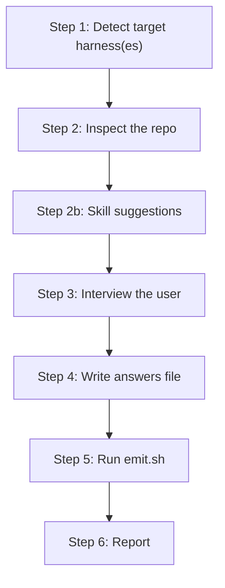

**Who this is for / What you'll learn:** Kit **users** installing the orchestrator/worker/evaluator system into their projects for the first time. You will install the `agent-kit` skill, run `/agent-kit` to compile canonical templates into your harness's native layout, understand what gets emitted for each supported harness, and know how to start your first `/feature` session. Upgrading, template editing, and workflow mechanics are covered in sibling guides — this document stays on the install-to-first-session path.

# Getting Started

This guide walks from zero to a working orchestration install. The kit ships as one installable `agent-kit` skill under [`skills/agent-kit/`](../../../skills/agent-kit/) that **compiles** a single canonical template source into each AI coding harness's native format. After install, `/agent-kit` is the compile step — it detects your harness(es), inspects the repo, suggests skills.sh skills from what it found (Step 2b), interviews you for what it cannot infer, resolves templates, emits per harness, and writes a manifest for clean upgrades. For a structural map of compile output, runtime folders, and trust boundaries, see [architecture.md](architecture.md).

## Install the agent-kit skill

The skill is published from the public [kdcllc/skills](https://github.com/kdcllc/skills) repository:

```bash
# Option A — skills CLI (any agent)
npx skills add kdcllc/skills --skill agent-kit

# Pin to a release tag
npx skills add kdcllc/skills#agent-kit/v1.1.2 --skill agent-kit

# Option B — agent-skills-cli
npx agent-skills-cli install https://github.com/kdcllc/skills.git
```

Claude Code and Copilot CLI can also install the whole pack from the marketplace: `/plugin marketplace add kdcllc/skills`, then `/plugin install kdcllc-skills@kdcllc`.

Or copy the skill in manually from a clone (any harness dir works — the skill detects and asks):

```bash
cp -r skills/agent-kit  <your-project>/.claude/skills/     # Claude Code
cp -r skills/agent-kit  <your-project>/.cursor/skills/     # Cursor
```

After any install path, open a session inside your project. The agent-kit skill lives in your harness's skills directory; invoke it with `/agent-kit` when you are ready to compile the full orchestration instance.

## Run `/agent-kit`

[`skills/agent-kit/SKILL.md`](../../../skills/agent-kit/SKILL.md) defines the compile pipeline. In order:

1. **Detect target harness(es)** — evidence from existing `.claude/`, `.cursor/`, `.github/copilot-instructions.md` or `.github/agents/`, `.codex/` or `AGENTS.md`, plus the session you are running in. Multiple harnesses is normal.
2. **Inspect the repo** — language(s), test commands, layers, user-facing surfaces, existing skills/agents/rules, external services (must be mocked in tests), **existing project agents** (name collisions and role overlaps with kit agents), and **path-scoped rules** (Claude `paths:`, Cursor `globs:` except the kit orchestration rule, Copilot `applyTo:`). Establish what you can read from code; do not ask what is already inferable.
2b. **Skill suggestions** — runs for **every project** (greenfield accept, decline, or existing repo) **once per** interactive `/agent-kit` session, after Step 2 inspect; derives queries from inspection signals, offers optional project-local skills (1000+ installs, at most 8 candidates). See [Skill suggestions (Step 2b)](#skill-suggestions-step-2b).
3. **Interview the user** — project name, execution layer order, model tiers (including same-family fix-cycle-2 rotation when no cross-family model is reachable), QA surfaces, research workflow, autonomous loop (sandbox choice persisted as `flags.loop_worktree` for `_loop/*` defaults), delivery forge, ground-truth doc — only what Steps 1–2 could not infer.
4. **Write the answers file** — `orchestration-kit.answers.json` at the repo root (`schema: 1`; bootstrap id table in [`bootstrap-ids.md`](../../../skills/agent-kit/reference/bootstrap-ids.md)). Loop `bash .claude/skills/agent-kit/bin/emit.sh --answers orchestration-kit.answers.json --check-answers` (or `.cursor/skills/agent-kit`, `.github/skills/agent-kit`) until exit 0, filling each listed bootstrap id. Each detected path-scoped rule file (Step 2) is recorded as a Critical Reference Files row and in the layer → skills map's `Rule files to cite` column so the orchestrator routes matching rule files into implementer, test-writer, and evaluator context packages; in any table cell the kit writes, escape a literal `|` as `\|`.
5. **Emit** — run the emitter (output is one line; run inline, not via `terminal`):

   ```bash
   bash .claude/skills/agent-kit/bin/emit.sh --answers orchestration-kit.answers.json
   # Windows outside Git Bash: .claude\skills\agent-kit\bin\emit.cmd --answers orchestration-kit.answers.json
   # (Cursor: .cursor/skills/agent-kit; Copilot: .github/skills/agent-kit)
   ```

   Runs on Bash 3.2+ with POSIX `awk` (no `jq`). If
   `orchestration-kit.manifest.json` already exists, run with `--dry-run` first. Exit
   code 4 lists user-modified kit files **or** pre-existing files at kit paths no
   previous emit recorded (first installs included) — confirm with `--force`. The answers
   file may set optional `flags.loop_worktree` and per-harness `fast` (fast-tier model ID;
   defaults to `light`) and `arbiter_same_family`; emit may warn when `alt_family` equals
   `light` or for same-family arbiter settings (still exit 0) and exits 3 when `best`,
   `fable`, or `claude-fable*` appears in a `loop_chain`.
6. **Report** — read the summary line (`emit: written N · unchanged M · pruned P · seeds-kept S · migrated U · warnings W · manifest orchestration-kit.manifest.json · kit <VERSION>`), delete the answers file (the manifest holds `answers`), and start with `/feature`.



**Step 2a — Greenfield gate** runs separately from the main pipeline diagram above: it executes after Step 1 and **before** Step 2 when — and only when — the workspace is empty or near-empty (sparse). See the next section; non-sparse repos skip it entirely and proceed directly to inspect; Step 2b skill suggestions still runs for them after inspect.

Everything emitted is project-specific — layer order, test commands, evaluator auto-fail triggers, and model IDs come from your codebase and interview answers, not generic placeholders. For upgrading an existing install or editing canonical templates, see [contributing.md](contributing.md) — those procedures are not repeated here.

## Greenfield gate (Step 2a)

On an empty or near-empty workspace, `/agent-kit` runs Step 2a (the greenfield gate) and **asks** before scaffolding. It **shows** a recommended project tree and **creates nothing until you confirm**. First-class layouts are **TypeScript/Node** and **Python**; other stacks get a generic `src/` + `tests/` tree. Non-sparse repos skip the scaffold offer only.

The sparse heuristic (from [`skills/agent-kit/SKILL.md`](../../../skills/agent-kit/SKILL.md) §Step 2a) treats a workspace as sparse **only if every present file** is on an allowlist (`.git/`, `.gitignore`, `LICENSE`, `README*`, `.editorconfig`, `.gitattributes`, `.DS_Store`, `Thumbs.db`, empty directories). **Any other file** — including `skills/agent-kit/SKILL.md`, anything under `tests/` or `docs/`, a language manifest, or `main.py` — means **not sparse**. Hard rule: not sparse → skip Step 2a entirely (no scaffold offer) and continue with Step 2 inspect.

When sparse, `/agent-kit` **always asks** whether to scaffold; it never silently scaffolds. If you decline, it creates no scaffold files and continues with the normal inspect → skill suggestions (Step 2b) → interview → emit path.

On the accept path:

1. Interview the stack: **TypeScript/Node**, **Python**, or **Other**.
2. Present the matching frozen tree as a list of paths — **create nothing until you explicitly confirm** that tree.
3. After confirmation, create exactly the confirmed paths (never overwrite existing paths).

Skill suggestions run in Step 2b for every project (see below).

## Skill suggestions (Step 2b)

Runs for **every project** — greenfield accept path, greenfield decline path, and
non-sparse (existing) repos — **once per** interactive `/agent-kit` session, after Step 2
inspect. Workflow reference:
[find-skills](https://www.skills.sh/vercel-labs/skills/find-skills) — the find-skills
skill itself is **not** installed. Seven inspection signals drive search:
language/runtime, web UI present, test framework, backend/web framework, infra/DevOps
files, docs surfaces, and databases/ORMs (e.g. a web UI, `pytest`, frameworks, a
`Dockerfile`, docs, database tooling). Offer a skill only if its install count is
**1000+**; present at most **8** candidates total and at most **3** per signal, ranked
by install count. You pick zero or more; install project-local with
`npx skills add <owner>/<repo> --skill <picked-skill> -y`. Never re-offer a skill
that is already installed (`.claude/skills`, `.cursor/skills`, `.agents/skills`,
`.github/skills`). Picked skills are recorded in the emitted `ORCHESTRATION.md` skills
table (`bootstrap.domain-skill-rows`) and the feature skill's layer → skills map
(`bootstrap.layer-skill-map`). A script-only `--upgrade` never runs Step 2b.

## What `/agent-kit` emits per harness

Per-harness translation (path mapping, frontmatter shape, pointer rules)
runs inside [`skills/agent-kit/bin/emit.sh`](../../../skills/agent-kit/bin/emit.sh) /
[`emit.cmd`](../../../skills/agent-kit/bin/emit.cmd) — not in LLM prose. See
[`skills/agent-kit/bin/README.md`](../../../skills/agent-kit/bin/README.md) for the full CLI contract.
Emitter files under [`skills/agent-kit/emitters/`](../../../skills/agent-kit/emitters/) are **caveats
only** (live model-check URLs, silent-fallback warnings). The table below summarizes
per-harness output paths; path mapping and translation rules live in
[`skills/agent-kit/bin/emit.sh`](../../../skills/agent-kit/bin/emit.sh) (CLI contract:
[`bin/README.md`](../../../skills/agent-kit/bin/README.md)).

| Harness | Agents | Skills | Architecture doc | Model map / pointer |
|---------|--------|--------|------------------|---------------------|
| **Claude Code** | `.claude/agents/*.md` | `.claude/skills/*` | `.claude/ORCHESTRATION.md` | `.claude/skills/agent-kit-models.map.md`; CLAUDE.md pointer appended |
| **Cursor** | `.cursor/agents/*.md` | `.cursor/skills/*` | `.cursor/ORCHESTRATION.md` | `.cursor/skills/agent-kit-models.map.md`; `.cursor/rules/orchestration.mdc` pointer rule |
| **GitHub Copilot (VS Code)** | `.github/agents/*.agent.md` | `.github/skills/<name>/SKILL.md` | `ORCHESTRATION.md` at repo root | Pointer appended to `.github/copilot-instructions.md` |
| **OpenAI Codex** | `.codex/agents/*.md` (bodies) | — (roles in TOML) | `ORCHESTRATION.md` at repo root | `.codex/config.toml` + `.codex/agents/*.toml`; short pointer appended to root `AGENTS.md` |

Worked example — Copilot + Codex (`harnesses: ["copilot","codex"]`):
`bash .claude/skills/agent-kit/bin/emit.sh --answers orchestration-kit.answers.json`
(or `.github/skills/agent-kit`). Lands: `.github/agents/*.agent.md`,
`.github/skills/<name>/SKILL.md`, `.codex/config.toml`, `AGENTS.md`.

**Cursor self-contained tree:** targeting Cursor emits a **self-contained** `.cursor/` tree — agents, skills, the architecture doc, the model map, and the pointer rule — with **no dependency on `.claude/`**. The Cursor emitter never reads or relies on an emitted `.claude/` tree; every file resolves `{{IDE_DIR}}` → `.cursor`. This matches the kit's canonical shipped behavior via [`skills/agent-kit/emitters/cursor.md`](../../../skills/agent-kit/emitters/cursor.md).

**Claude Code** is the canonical format — the emit script writes resolved templates into `.claude/` with near-1:1 paths ([`claude-code.md`](../../../skills/agent-kit/emitters/claude-code.md) caveats).

**GitHub Copilot** emits native `.github/agents/*.agent.md` files (subagent allowlists
and model fallback arrays require that format) and skills as
`.github/skills/<name>/SKILL.md` trees — the `feature` skill lands twice: as the native
agent `.github/agents/feature.agent.md` and as the full `.github/skills/feature/` tree
(`SKILL.md`, `reference/`, `templates/`)
([`copilot.md`](../../../skills/agent-kit/emitters/copilot.md) caveats; translation in
[`bin/emit.sh`](../../../skills/agent-kit/bin/emit.sh)).

**OpenAI Codex** is structurally different: role instructions live under `.codex/agents/*.md`, role config in `.codex/config.toml` and per-role `.codex/agents/*.toml`, with the full architecture doc at repo-root `ORCHESTRATION.md` (not in `AGENTS.md`, which has a size cap) ([`codex.md`](../../../skills/agent-kit/emitters/codex.md)).

Every install also gets the single-copy `_kit/` tools — `_kit/log-spawn.sh` (Windows outside Git Bash: `_kit\log-spawn.cmd`), which the `feature` skill uses to append the per-goal orchestration log (context packages and reports are stored under `_memory/work/goals/<goal>/spawns/`). `_kit/memory.sh` (Windows outside Git Bash: `_kit\memory.cmd`) provides `add` / `index` / `search` / `show` / `redact` / `check` / `rm` / `capture` / `backfill`; `_kit/memory.ps1` remains a helper for `loop.ps1` with the same subcommands except **`check`**, **`rm`**, **`capture`**, and **`backfill`**, which print a bash-only pointer and exit **2**. Emit writes `_memory/README.md` and appends store lines to `.gitignore` and `.gitattributes`: every install adds `_kit/`, `_memory/.index/`, `_memory/raw/`, and `_memory/work/` to `.gitignore`, plus `_memory/** text eol=lf` and `*.cmd -text` to `.gitattributes`; loop installs also add `_memory/loop/breaker-state.json` to `.gitignore` and `_memory/loop/LEARNINGS.md merge=union`, `_memory/loop/ESCALATIONS.md merge=union`, `*.sh text eol=lf`, and `*.ps1 text eol=lf` to `.gitattributes`. Tracked by default: `_memory/README.md`, `records/`, `quarantine/`, and (when loop is enabled) `_memory/loop/` except `breaker-state.json`. Record files appear when `_kit/memory.* add` creates them; gitignored `raw/` holds redacted capture output and distillation drafts. The emitted **`memory-capture`** skill distills captured sessions into `session-summary` records (not emitted on Codex-only installs — see [memory.md](memory.md)). Memory **pointers** (search commands only, never record bodies): **Claude Code** — `## Memory` block with marker `<!-- orchestration-kit:memory-pointer -->` appended to `CLAUDE.md`; **GitHub Copilot** — the same block appended to `.github/copilot-instructions.md`; **OpenAI Codex** — the same block appended to root `AGENTS.md`; **Cursor** — one sentence in `.cursor/rules/orchestration.mdc` (no separate `## Memory` marker block). Operator guide: [memory.md](memory.md). When the autonomous loop is enabled, all harnesses share single-copy `_loop/` drivers (`loop.sh`, `loop.ps1`, breaker helpers, `PROMPT.md`) and a seed `_memory/loop/backlog.md` (create if missing; never overwrite). Loop driver details belong in [autonomous-loop.md](autonomous-loop.md).

> **Instance note (this repo):** the kdcllc/skills repository dogfoods the kit. The emitted instance (`.claude/`, `.cursor/skills|agents|rules`, `.cursor/ORCHESTRATION.md`, `_kit/`, `_loop/`, `orchestration-kit.manifest.json`) is gitignored — not source of truth. **`_memory/records/`**, **`_memory/quarantine/`**, **`_memory/research/`**, and **`_memory/README.md`** are tracked; **`_memory/work/`** and **`_memory/loop/`** are gitignored here (along with `_memory/.index/` and `_memory/raw/`), unlike a canonical loop install where `_memory/loop/` is tracked. Files under `records/` and `quarantine/` exist only after `_kit/memory.* add` writes them. Canonical content lives under `skills/agent-kit/templates/`; re-run `/agent-kit` after template edits to refresh the local instance.

## The manifest and seed files

`/agent-kit` writes `orchestration-kit.manifest.json` at the project root. The manifest records:

- **`kitVersion`** — contents of `metadata.version` in [`skills/agent-kit/SKILL.md`](../../../skills/agent-kit/SKILL.md) at emit time (for example `1.0.0`)
- **`answers`** — snapshot of the answers file used at emit (enables `--upgrade` without re-interviewing)
- **`files`** — map of every emitted path to its SHA-256 hash
- **`seedFiles`** — paths that are seeds, not managed content (today `_memory/loop/backlog.md` when loop is enabled)
- **`harnesses`**, **`options`**, **`installedAt`** — which harnesses were targeted and which optional features were enabled

Re-running `/agent-kit` reads the manifest, diffs file hashes against the working tree to spot your local modifications, and re-emits with `bash .claude/skills/agent-kit/bin/emit.sh --upgrade` (or `.cursor/skills/agent-kit`, `.github/skills/agent-kit`; add `--answers` only when the interview changed). Manifests from the private **`setup`** kit have no embedded `answers` snapshot — see [Upgrading from the private setup kit](#upgrading-from-the-private-setup-kit). Use `--dry-run` to preview; exit 4 lists blocked paths. Unmodified files update silently.

**`seedFiles` semantics:** seeds are emitted **create-if-missing, never overwritten**. Their hash is recorded at emit time but drift is expected — it is never read as user modification and is exempt from the upgrade diff-confirm flow. When loop is enabled, the seed is `_memory/loop/backlog.md`; you own its content from first install onward.

For the full upgrade procedure (version bumps and releases, re-pulling with whichever CLI you installed with, stale-file pruning), see [contributing.md](contributing.md).

## Your first session

With `/agent-kit` complete, your project has agents, skills, an architecture doc, and (optionally) the autonomous loop — all filled in for your stack and interview answers.

**Start your first feature with `/feature`.** That invokes the seven-phase orchestrator/worker/evaluator workflow (Phases 6 and 7 are optional — gated on `goal.md`'s `phases:` block). Acceptance criteria are defined at planning and validated at Phase 3; there is no separate pre-implementation sign-off gate. Phase-by-phase mechanics, fix-cycle rotation, optional Phase 6/7 skips, and orchestration log usage are documented in [feature-workflow.md](feature-workflow.md) — not repeated here.

**Choosing a workflow:** not every change needs `/feature`. For direct edits, `/research` → `/feature`, or the autonomous loop, use [decision-guide.md](decision-guide.md) — it routes between the four modes with a decision flowchart and comparison table.

**Autonomous loop (sandbox first):** if you plan an unattended loop run, sandbox the environment before invoking the drivers. Start your first feature with `/feature`; start an unattended run (**sandboxed!**) with `_loop/loop.sh 10` (or `pwsh _loop/loop.ps1 10` — PowerShell 7+). Driver-owned dispatch, circuit breakers, slots/worktrees, and exit codes are covered in [autonomous-loop.md](autonomous-loop.md).

**Contributors:** if you are editing canonical templates, emitters, or releasing a new kit version, follow [contributing.md](contributing.md) for the self-install dogfood loop and upgrade semantics.

## Upgrading from the private setup kit

The public skill is **`agent-kit`** from [kdcllc/skills](https://github.com/kdcllc/skills). Before 1.0.0, the same kit shipped privately as the skill **`setup`**. To move an existing project:

1. **Install the new skill** — for example `npx skills add kdcllc/skills --skill agent-kit` (see [Install the agent-kit skill](#install-the-agent-kit-skill) above) and read the 1.0.0 upgrade notes in [`skills/agent-kit/CHANGELOG.md`](../../../skills/agent-kit/CHANGELOG.md).
2. **Remove old copies** — delete every `skills/setup/` tree from harness skill directories (`.claude/skills/setup`, `.cursor/skills/setup`, `.github/skills/setup`, and similar).
3. **Re-emit with `--upgrade`** — `bash .claude/skills/agent-kit/bin/emit.sh --upgrade` (or the path for your harness). If the manifest has no embedded `answers` snapshot, run `/agent-kit` Steps 1–4 once, then `bash …/bin/emit.sh --answers orchestration-kit.answers.json --upgrade`. Use `--dry-run` first; exit **4** lists user-modified kit files, pre-existing kit-path files with no previous-manifest entry, or migration target conflicts — confirm with `--force` when intentional.

**Layout migration:** `--upgrade` also moves legacy top-level **`_goals/`** and **`_research/`** into gitignored **`_memory/work/`** (`_goals/<goal>/` → `_memory/work/goals/<goal>/`; `_research/` → `_memory/work/research/`; loop files such as `_goals/backlog.md` → tracked `_memory/loop/`). Moved goal and research folders become untracked scratch; loop markdown stays tracked. The emit summary's **`migrated U`** count is non-zero when moves ran. After upgrading, run `_kit/memory.sh backfill --plan` to review import candidates. Full mapping, `--dry-run` / exit **4** / `--force` semantics, and teammate coordination warnings: [`skills/agent-kit/templates/memory/README.md`](../../../skills/agent-kit/templates/memory/README.md) § Upgrade migration.

## Sources

- [`skills/agent-kit/README.md`](../../../skills/agent-kit/README.md) — install options, greenfield gate, emission summary, first-session pointers, upgrade and seed-file semantics
- [`skills/agent-kit/SKILL.md`](../../../skills/agent-kit/SKILL.md) — `/agent-kit` workflow steps, greenfield gate (Step 2a), emit steps, manifest write
- [`skills/agent-kit/bin/README.md`](../../../skills/agent-kit/bin/README.md) — emitter CLI contract (flags, exit codes, determinism)
- [`skills/agent-kit/emitters/claude-code.md`](../../../skills/agent-kit/emitters/claude-code.md) — Claude Code caveats
- [`skills/agent-kit/emitters/cursor.md`](../../../skills/agent-kit/emitters/cursor.md) — Cursor caveats
- [`skills/agent-kit/emitters/copilot.md`](../../../skills/agent-kit/emitters/copilot.md) — Copilot VS Code caveats
- [`skills/agent-kit/emitters/codex.md`](../../../skills/agent-kit/emitters/codex.md) — Codex caveats
- `orchestration-kit.manifest.json` — example manifest shape (`kitVersion`, `files`, `seedFiles`)
- `metadata.version` in [`skills/agent-kit/SKILL.md`](../../../skills/agent-kit/SKILL.md) — kit version anchor (`1.0.0`)
