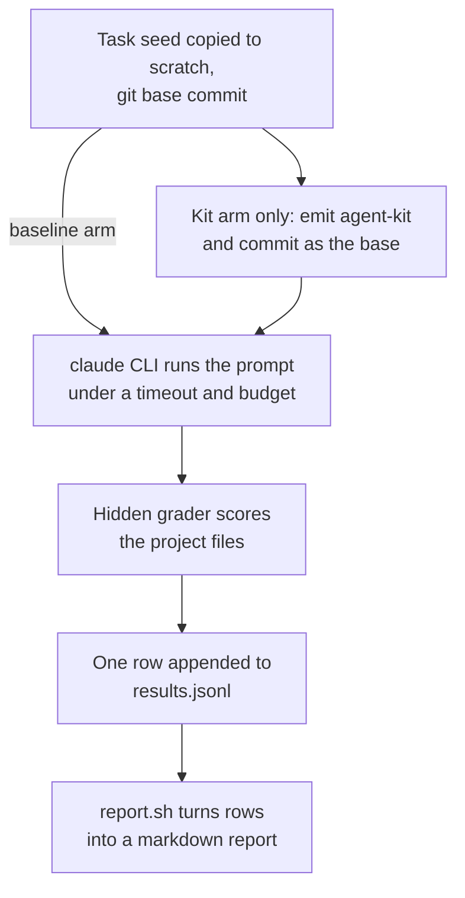

**Who this is for / What you'll learn:** Kit **contributors** who want to know whether a change to the kit makes agents deliver better work, not just whether the kit still emits the right files. You will learn what the outcome eval set measures and why, the two arms and the candidate-kit third arm, the 10 task categories, how to run the evals and read the report (including how noisy it is), how to add a task, and where the method stops being trustworthy. For how the kit's own gates verify work, see [evaluation-system.md](evaluation-system.md); for the test suites that guard the kit itself, see [contributing.md](contributing.md).

# Outcome evals

The kit's other tests check that templates and emitters produce the right files. They cannot say whether an agent working inside an emitted kit finishes small coding tasks better, or at what cost. The outcome eval set measures that. It lives under `tests/agent-kit/evals/` and compares two ways of doing the same task, then grades each result by looking only at the project files the agent left behind.

Measuring outcomes is what makes it possible to judge a kit change on evidence. A change that tightens a gate, trims a prompt, or swaps a model tier can be run as a candidate kit and compared with the current kit and with no kit at all.

Three candidate changes to the kit wait for this eval set so their effect can be measured (they are named K1, K2 and K4 in the coordination-patterns research brief): K1, changing the test-writer, which today reads the modules under test, by folding it into the implementer or pointing it at the task spec; K2, a right-sizing gate before `/feature` so small work does not pay the full orchestration cost; and K4, verifier additions, namely per-criterion structured verdicts and a stop after cycles with no new findings. Each would be built as a candidate kit and run as the third arm described below.

The full contract (task format, grader interface, runner procedure, result rows, report format, stub CLI, self-test cases) is in [`tests/agent-kit/evals/README.md`](../../../tests/agent-kit/evals/README.md). This page summarizes it and does not copy it; when the two disagree, the README wins.

## The arms

- **Baseline arm:** the Claude Code CLI gets only the task prompt, in a scratch copy of the task's seed project, plus a short fixed paragraph saying no user is available.
- **Kit arm:** the runner first emits agent-kit into the scratch copy, then gives the CLI `/feature` followed by the same prompt, a fixed headless preamble, and the task's confirmed Phase 1 answers. The preamble overrides the interactive parts of Phase 1 and Phase 7 (no waiting for confirmation, no pull request) and stops after the Phase 5 audit and quality checks.
- **Candidate kit (third arm):** the same kit arm, pointed at a kit source in another checkout with `--kit-src` and recorded under its own `--label`. The report compares it with the first label.

Each run happens in a throwaway scratch directory outside the repository. The hidden grader and the solution overlay are never copied into scratch.

## How a run flows



## The 10 categories

The two-digit prefix of a task id is the category number.

1. `01-trivial-fix`: a one-line fix; measures whether the kit adds cost to work that needs none.
2. `02-bug-fix`: find and fix a defect from a symptom; measures diagnosis.
3. `03-small-feature`: add one function or option with tests; measures plain feature delivery.
4. `04-multi-file-rename`: rename a symbol across several files; measures completeness.
5. `05-spec-edge-cases`: implement a spec whose edge cases are easy to miss; measures requirement coverage.
6. `06-write-tests`: add tests to untested code without changing it; measures test quality.
7. `07-refactor`: restructure code while keeping behaviour; measures regression safety.
8. `08-scope-trap`: a request next to tempting unrelated problems; measures staying in scope.
9. `09-signature-change`: change a function signature and update every caller; measures ripple handling.
10. `10-error-handling`: add input validation and clear errors; measures defensive behaviour.

There is one task per category, so the set has 10 tasks. Seeds are small Python 3 standard-library projects.

## Running the evals

A real run calls the model for every task and run, so it costs money, and it needs an authenticated `claude` on the path. Never run it in CI. The defaults are 3 runs per task, the model named in `run.sh` (see the README defaults), a per-run budget of 5 dollars and a per-run timeout of 1800 seconds; `--runs`, `--model`, `--budget-usd` and `--timeout` change them, and `--tasks` limits the run to some task ids.

```bash
# baseline arm
bash tests/agent-kit/evals/run.sh --arm baseline

# kit arm (the kit in this checkout)
bash tests/agent-kit/evals/run.sh --arm kit

# candidate kit from another checkout, recorded under its own label
bash tests/agent-kit/evals/run.sh --arm kit --kit-src /path/to/skills/agent-kit --label kit-k1

# compare result directories (the first directory's label is the reference)
bash tests/agent-kit/evals/report.sh _memory/work/evals/baseline-<stamp> _memory/work/evals/kit-<stamp> _memory/work/evals/kit-k1-<stamp>
```

Results land under `_memory/work/evals/<label>-<UTC stamp>/` by default (that folder is gitignored scratch); `--out` chooses another directory. Each run writes the CLI output, the grader output and a change summary next to one `results.jsonl` row. The runner exits 0 when every run was executed and graded, whether or not the grader passed it.

The runner starts the CLI with `--permission-mode acceptEdits` and an explicit `--allowedTools` list, so the agent can edit files and run commands inside scratch without a user. It does not use `--dangerously-skip-permissions`, because that would remove every permission check, including the ones that keep a run from touching files outside scratch. It also passes `--setting-sources project` and `--strict-mcp-config` so only the scratch project's settings load and no MCP servers start. The runner points the CLI's stdin at /dev/null, removes the Claude session variables from its environment so the run is not mistaken for a child of your session, and isolates git so the runner's git calls cannot reach this repository (the agent's own shell still can; see Limits). The README lists all of it under the per-run procedure.

## Reading the report

`report.sh` prints markdown with one row per task and a column group per label:

- Pass `k/n`: how many of the `n` runs of that task the grader passed.
- Mean cost in dollars, or `n/a` when the CLI gave no cost.
- Mean duration in seconds, with a totals row at the end.

With two or more labels it prints one line per further label in the form `vs <first label>: <label> wins <w>, losses <l>, ties <t>`. A win is a higher pass rate on a task than the first label, a loss a lower one, a tie an equal one, counted over tasks both labels ran. A warning line appears when a kit run recorded zero subagent spawns (the kit may not have run), and a note line when runs were stopped by the budget or the timeout.

The report always ends with a caveat line, and the caveat is the reading rule: at 10 tasks × 3 runs, differences below roughly 25 percentage points are within noise (K3: even a 24-task, three-run design hides differences under about 10 points); there are no pass/fail thresholds. Read the cost and duration columns next to the pass rate, and treat a gap smaller than the noise band as no gap.

## Adding a task

1. Create `tests/agent-kit/evals/tasks/NN-slug/` with `task.md`, `seed/`, `solution/` and `grade/grade.sh`. The format is in the README's task format section: a metadata list (`id`, `category`, `size`), a `## Prompt` section given to both arms, and a `## Decisions` section of Phase 1 answers for the kit arm. Decisions answer process questions only and must not add a requirement the prompt lacks.
2. Make the seed a Python 3 standard-library project whose own tests pass.
3. Make `solution/` an overlay that turns the seed into a passing project (a `solution/.delete` file lists paths to remove).
4. Write the grader to the interface `bash grade/grade.sh <project-dir>`: one `CHECK pass <name>` or `CHECK fail <name>` line per check, then `GRADE pass` or `GRADE fail`, exit 0, 1 or 2. Include the no-regression check, judge only seed-relative paths, and never rely on git history.
5. Run `bash tests/agent-kit/evals/selftest.sh`. It grades every seed and expects a failure (a true negative), grades every solution and expects a pass (a true positive), and runs both arms against a stub CLI, all offline. A task whose seed already passes, or whose solution does not, fails the self-test.

The self-test is in the default `run-all.sh` list and is skipped by `--quick`. It needs no network and no `claude` binary, and it ends with the summary line `PASS: <p> FAIL: <f> SKIP: <s>`.

## Limits

- **Hidden-grader leakage:** the grader is hidden only because it is not copied into scratch. The agent's shell can still read the repository if it finds the path. Treat results as a measure of ordinary behaviour, not as tamper-proof.
- **Claude Code only:** the runner drives the `claude` CLI, so it measures the Claude Code emit and no other harness.
- **Headless preamble:** the kit arm's preamble overrides Phase 1 (answers come from the task) and Phase 7 (no pull request), so the eval does not exercise those interactive phases.
- **Small sample:** 10 tasks and 3 runs per task is noisy, as the caveat line says.

## Sources

- [`tests/agent-kit/evals/README.md`](../../../tests/agent-kit/evals/README.md) — the frozen contract: layout, task format, grader interface, runner options and procedure, result rows, report, stub CLI, self-test
- [`tests/agent-kit/evals/run.sh`](../../../tests/agent-kit/evals/run.sh) — the runner and its options
- [`tests/agent-kit/evals/report.sh`](../../../tests/agent-kit/evals/report.sh) — the report format and caveat line
- [`tests/agent-kit/evals/selftest.sh`](../../../tests/agent-kit/evals/selftest.sh) — the offline self-test
- [`docs/agent-kit/guide/README.md`](README.md) — frozen conventions and document map
