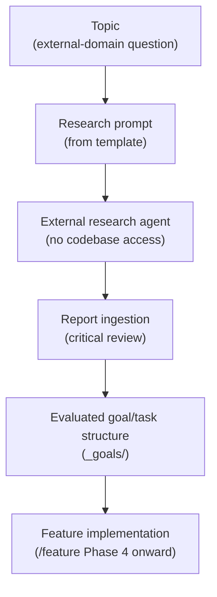
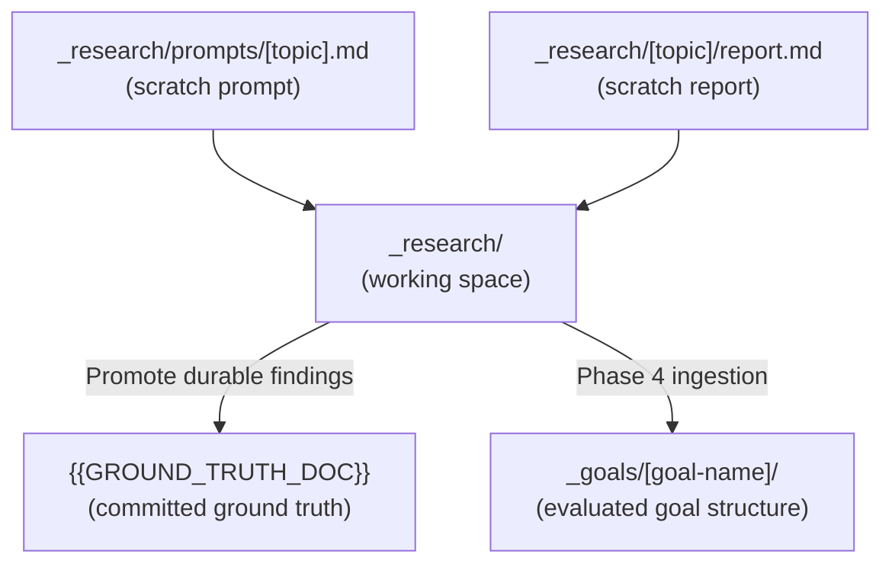
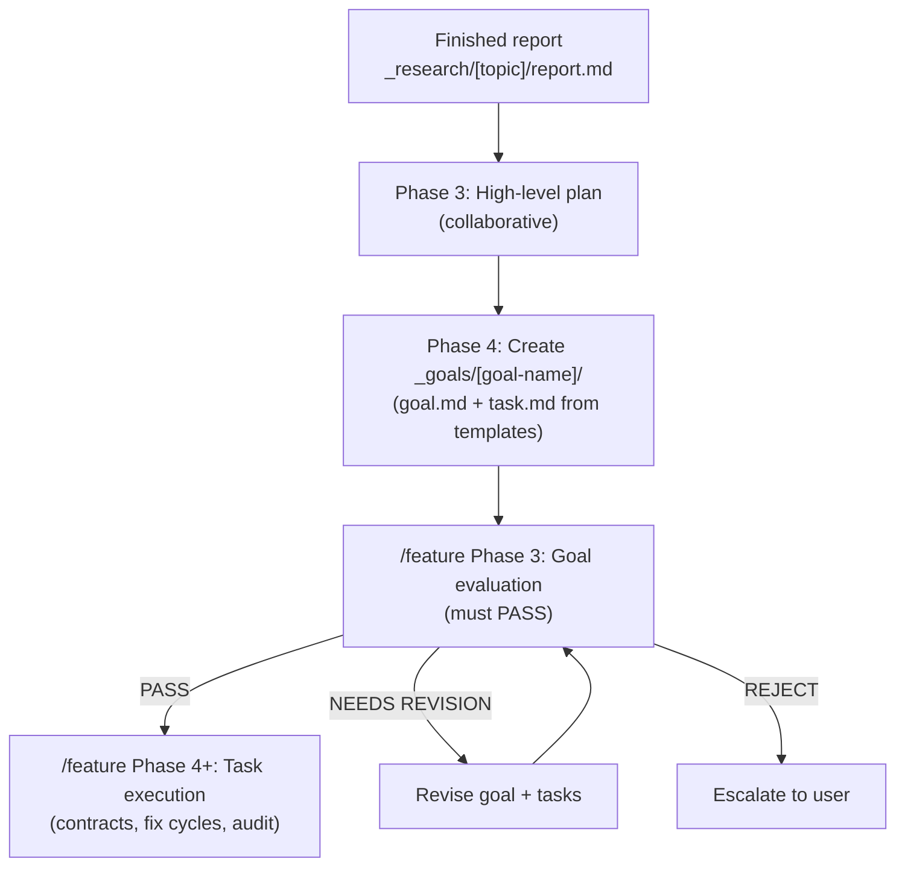

**Who this is for / What you'll learn:** Developers facing work that depends on **external-domain facts** — vendor APIs, cross-harness capabilities, regulatory constraints, or standards the team has not yet verified. You will learn why `/research` precedes implementation, how the research prompt and report artifacts are structured, where scratch research lives versus promoted ground truth, how a finished report becomes an evaluated goal, and when you can skip research and go straight to direct edit or `/feature`. For top-level mode routing (direct edit vs `/feature` vs `/research` vs the autonomous loop), see [decision-guide.md](decision-guide.md).

# Research workflow (`/research`)

The `/research` skill is a **Research → Plan** orchestrator for domain topics an external research agent must investigate **without codebase access**. As of v0.19.0, the canonical behavior is what [`skills/agent-kit/templates/skills/research/SKILL.template.md`](../../../skills/agent-kit/templates/skills/research/SKILL.template.md) emits via `/agent-kit`; installs receive it as an optional skill alongside `/feature`. The workflow produces a self-contained research prompt, ingests the returned report, plans with you, and creates a goal/task structure that hands off to `/feature` — research does not bypass evaluation.

## Research pipeline

The end-to-end path from an unanswered domain question to shipped code:

**How to read the chart:**

1. **Topic** — a domain question the team cannot answer from the repo alone (for example, "Does Cursor read `.claude/agents/` natively?" or "What idempotency guarantees does Stripe's webhook API provide?").
2. **Research prompt (from template)** — the orchestrator writes a self-contained prompt from [`research-prompt.md`](../../../skills/agent-kit/templates/skills/research/templates/research-prompt.md) so an external researcher can work without seeing your codebase.
3. **External research agent** — you copy-paste the prompt into your chosen external research tool (a separate session, a web research agent, or any tool that can fetch and cite primary sources). The kit does not run this step itself.
4. **Report ingestion** — the orchestrator saves and critically reads the returned report, flags contradictions with ground truth, and promotes durable findings.
5. **Evaluated goal/task structure** — collaborative planning produces `_goals/[goal-name]/` using the `feature` skill's templates; the goal must **PASS** Phase 3 goal evaluation before any task dispatch.
6. **Feature implementation** — once the goal passes evaluation, `/feature` runs contract-gated task execution, final audit, docs alignment, and the approval-gated pull request.

For the seven phases of `/feature` after handoff, see [feature-workflow.md](feature-workflow.md).

## Why research first

External-domain work carries a **fabrication risk** that hits both implementation and evaluation. When implementers lack verified facts, they produce confident-sounding code and documentation grounded on guesses — API behavior invented from training-data priors, vendor capabilities assumed from outdated blog posts, cross-harness quirks extrapolated from one environment. The damage is not limited to the code: **evaluators face the same gap**. Without a research report as ground truth, an evaluator cannot distinguish a correct external-domain claim from a plausible fabrication. Both sides of the orchestrator/worker/evaluator split can "PASS" work that fails on first contact with reality.

A finished research report gives the evaluator **verifiable ground truth** to check external-domain claims against. Citations, confidence distinctions, and explicit "cannot answer definitively" statements turn evaluation from guess-matching into evidence review. The kit's anti-invention rules (binding in the evaluation system) require claims to trace to read sources; `/research` is the structured path for producing those sources before goal creation.

### This repo used research before shipping

The AI Orchestration Kit dogfoods its own research workflow. Two committed studies illustrate the pattern — durable findings promoted from scratch research into linkable ground-truth documents:

| Study | What it grounded | Link |
|-------|------------------|------|
| Multi-harness upgrade | Per-harness capability claims — model tiers, fallback behavior, Copilot and Cursor caveats — before those patterns were adopted into the canonical templates and emitters | [research-multi-harness-upgrade.md](../research-multi-harness-upgrade.md) |
| Squad study | Production-hardening ideas gleaned from [bradygaster/squad](https://github.com/bradygaster/squad) — A1 fix-cycle model rotation, A2 existence checks with a confidence ladder and anti-fabrication rules — adopted at kit v0.4.0 | [research-squad-ideas.md](../research-squad-ideas.md) |

These files live under committed `docs/agent-kit/research-*.md` paths — promoted ground truth, not scratch. The `_research/` tree where prompts and raw reports are written during an active research session stays working space; durable conclusions move into the project's ground-truth reference.

## The research prompt artifact

Phase 1 of the research skill writes `_research/prompts/[topic].md` from the canonical [`research-prompt.md`](../../../skills/agent-kit/templates/skills/research/templates/research-prompt.md) template. Phase 1 also **recalls** prior `_memory/` records (`--kind research-ingest,decision`) and writes picks to `_research/<topic>/recalled-memory.md`; Phase 4 copies them into the new goal's `## Recalled memory`, and one **`research-ingest`** record is archived after the ingestion review. See [memory.md](memory.md). The prompt must be **self-contained**: the external researcher cannot see your repo, so the orchestrator includes relevant facts from the project's ground-truth doc (`{{GROUND_TRUTH_DOC}}` at install time) and the domain skill, the exact questions to answer, and the required report structure. You copy-paste the finished prompt to your external research tool.

### Required sections (research-prompt.md)

The template mandates four sections:

| Section | Purpose |
|---------|---------|
| **Context (self-contained — assume no access to our codebase)** | Project background the researcher needs: what the project does, the relevant subsystem, and established ground truth they must not contradict. |
| **Questions to Answer** | Numbered, specific, answerable questions — not vague exploration prompts. |
| **Constraints on Answers** | Cite sources (official docs preferred) for every claim; distinguish "documented behavior" from "inferred/community knowledge"; if a question cannot be answered definitively, say so explicitly. |
| **Required Report Structure** | Instruct the researcher to return markdown with: **Summary of Findings** · **Per-Question Answers (with citations)** · **Contradictions & Caveats** · **Open Questions**. |

The orchestrator fills bracket placeholders (`[topic]`, question lists, context paragraphs) from the alignment conversation; the section headings and constraints come from the template unchanged.

## The research report artifact

Phase 2 saves the returned report as `_research/[topic]/report.md`, structured per the canonical [`research-report.md`](../../../skills/agent-kit/templates/skills/research/templates/research-report.md) template. The orchestrator reads it critically: flag claims that contradict `{{GROUND_TRUTH_DOC}}` or the codebase, and list open questions back to you.

### Required sections (research-report.md)

| Section | Purpose |
|---------|---------|
| **Summary of Findings** | Three to eight bullets of the load-bearing conclusions. |
| **Per-Question Answers** | One subheading per question (`### Q1: [question]`), each answer with citations. |
| **Contradictions & Caveats** | Where sources disagreed, or where findings conflict with project ground truth. |
| **Open Questions** | What remains unanswered and what it blocks. |
| **Promotion Checklist** | A checkbox item: durable findings promoted into `{{GROUND_TRUTH_DOC}}`. |

The report header records the date and the source prompt path (`_research/prompts/[topic].md`) for traceability.

## Where artifacts live vs promoted ground truth

Understanding the two storage layers prevents treating scratch research as committed truth:

**Scratch (`_research/`):** the orchestrator writes prompts to `_research/prompts/[topic].md` and saves returned reports to `_research/[topic]/report.md`. This directory is working space — prompts you paste externally, raw reports, intermediate notes. The canonical skill states explicitly: `_research/` stays scratch.

**Promoted ground truth (`{{GROUND_TRUTH_DOC}}`):** durable findings from a report are promoted into the project's committed ground-truth reference document. At `/agent-kit` time, `{{GROUND_TRUTH_DOC}}` resolves to whatever path you configured (for example `docs/ARCHITECTURE.md` or a domain-specific reference). In **this repository (instance-specific)**, promoted research lives under committed `docs/agent-kit/research-*.md` files — the multi-harness and squad studies linked above are the pattern.

**Goals (`_goals/`):** after ingestion and planning, Phase 4 creates `_goals/[goal-name]/` with `goal.md`, task files, and eventually contracts and an orchestration log. This is executable structure, not research scratch.

> **Instance note (this repo):** `_research/` in the AI Orchestration Kit repository is gitignored along with the emitted instance tree. Canonical template paths and behavior live under `skills/agent-kit/templates/`; the committed `docs/agent-kit/research-*.md` files are the promoted ground-truth examples.

## Ingestion: report → evaluated goal

Phases 3 and 4 of the research skill bridge a finished report into executable work.

### Phase 3 — High-level plan

Collaborative planning with you (Plan Mode when available): approach options with tradeoffs, chosen direction, and affected layers (`{{EXECUTION_LAYERS}}` at install time). This is a human decision gate — the report informs choices but does not auto-select an approach.

### Phase 4 — Low-level tasks

The orchestrator creates `_goals/[goal-name]/` using the `feature` skill's [`goal.md`](../../../skills/agent-kit/templates/skills/feature/templates/goal.md) and [`task.md`](../../../skills/agent-kit/templates/skills/feature/templates/task.md) templates, derived from the ingested report and the collaborative plan. Task files declare ownership contracts (`writes`, `reads`, `depends_on`, `eval_depth`) the same way any `/feature` goal does.

### Handoff to `/feature` — evaluation still applies

The resulting goal enters the `feature` skill at **Phase 3 (goal evaluation)**. It still must **PASS** the evaluator before execution begins — research does not bypass evaluation. Phase 3 runs the full goal evaluation checklist: devil's advocate section, ownership-contract disjointness verification, acceptance criteria review, and the complete evaluator protocol described in [feature-workflow.md](feature-workflow.md) and [evaluation-system.md](evaluation-system.md).

Only after a PASS does `/feature` advance to Phase 4 (contract-gated task execution). Workers dispatched from research-derived goals follow the same fix-cycle rotation, pre-code contracts, and test-ladder rules as any other feature goal.

## When to skip research

Not every piece of work needs `/research`. Skip the research workflow when the decision-guide's external-domain gate does not apply — work you can verify entirely from the repo and your own session, with no gap in external-domain knowledge.

| Skip when | Why research adds no value | Typical route instead |
|-----------|------------------------------|----------------------|
| **In-repo refactors** | The change is fully inside the existing codebase — renaming, restructuring, extracting modules — with no external API, vendor, or standard to investigate | Direct edit (trivial) or `/feature` (non-trivial refactor spanning layers) |
| **Behavior fully specified by existing code/tests** | The desired behavior is already defined by implementation and test assertions; you are extending or fixing against a known contract, not discovering external facts | `/feature` (if non-trivial) or direct edit (if mechanical) |
| **Mechanical or trivial changes** | Typo fixes, comment updates, config tweaks, formatting — verifiable immediately without external investigation | Direct edit |

These conditions align with [decision-guide.md](decision-guide.md) routing: when the "Does it need external-domain knowledge the team lacks?" branch is **No**, proceed to `/feature`, the autonomous loop, or direct edit — not `/research`.

**Do not skip research when:** the work depends on external APIs, vendor documentation, regulatory requirements, cross-harness behavior you have not verified, or any domain fact the team cannot cite from committed ground truth or the codebase. Jumping straight to `/feature` in those cases invites the fabrication risk described above.

## Running `/research` in practice

As of v0.19.0, invoke the research skill from your harness session the same way you invoke `/feature`:

1. **Start `/research`** with your topic — the orchestrator aligns on scope and questions.
2. **Review the generated prompt** at `_research/prompts/[topic].md` — confirm questions are specific and context is self-contained.
3. **Run external research** — copy-paste the prompt to your external tool; wait for the report.
4. **Return the report** — the orchestrator ingests it to `_research/[topic]/report.md`, reviews critically, and promotes durable findings.
5. **Plan collaboratively** — Phase 3 chooses direction; Phase 4 creates the goal structure.
6. **Pass goal evaluation** — the goal enters `/feature` Phase 3; fix any evaluator findings before dispatch.
7. **Execute via `/feature`** — from Phase 4 onward, the research-derived goal follows the standard feature workflow.

The research skill coordinates four phases internally; the pipeline diagram at the top of this document shows the conceptual stage sequence from topic through feature implementation, including the external research agent step that happens outside the orchestrator session.

## Relationship to other guides

| Topic | Where to read |
|-------|---------------|
| Choosing between direct edit, `/feature`, `/research`, and the autonomous loop | [decision-guide.md](decision-guide.md) |
| Seven phases, contracts, fix cycles, worked example after research handoff | [feature-workflow.md](feature-workflow.md) |
| Evaluator verdicts, confidence ladder, anti-fabrication rules applied at goal evaluation | [evaluation-system.md](evaluation-system.md) |
| Install paths and first session | [getting-started.md](getting-started.md) |

## Sources

- [`skills/agent-kit/templates/skills/research/SKILL.template.md`](../../../skills/agent-kit/templates/skills/research/SKILL.template.md) — four research phases, prompt/report paths, ingestion handoff to feature Phase 3
- [`skills/agent-kit/templates/skills/research/templates/research-prompt.md`](../../../skills/agent-kit/templates/skills/research/templates/research-prompt.md) — prompt artifact section structure
- [`skills/agent-kit/templates/skills/research/templates/research-report.md`](../../../skills/agent-kit/templates/skills/research/templates/research-report.md) — report artifact section structure and promotion checklist
- [`skills/agent-kit/templates/skills/feature/SKILL.template.md`](../../../skills/agent-kit/templates/skills/feature/SKILL.template.md) — seven-phase feature workflow receiving research handoff at Phase 3
- [`README.md`](../../../skills/agent-kit/README.md) — kit layout, optional `skills/research` emission, `_research/` instance paths
- [`../research-multi-harness-upgrade.md`](../research-multi-harness-upgrade.md) — example promoted research grounding harness capability claims
- [`../research-squad-ideas.md`](../research-squad-ideas.md) — example study whose adopted hardening ideas fed shipped kit behavior
- [`docs/agent-kit/guide/README.md`](README.md) — suite conventions, document map scope row for this guide
