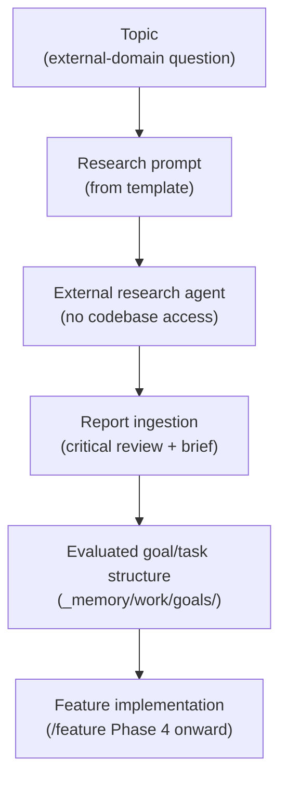
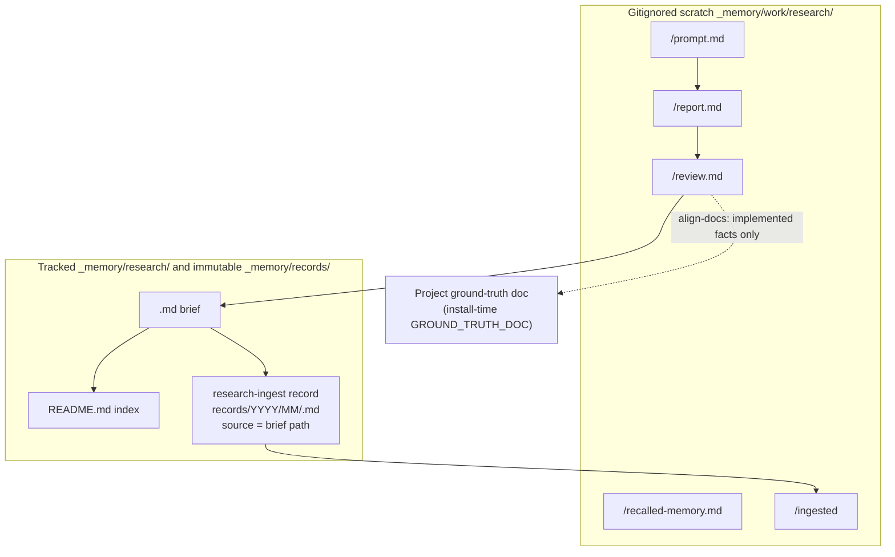
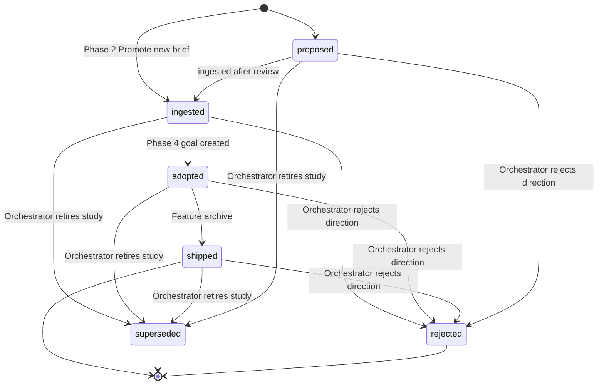
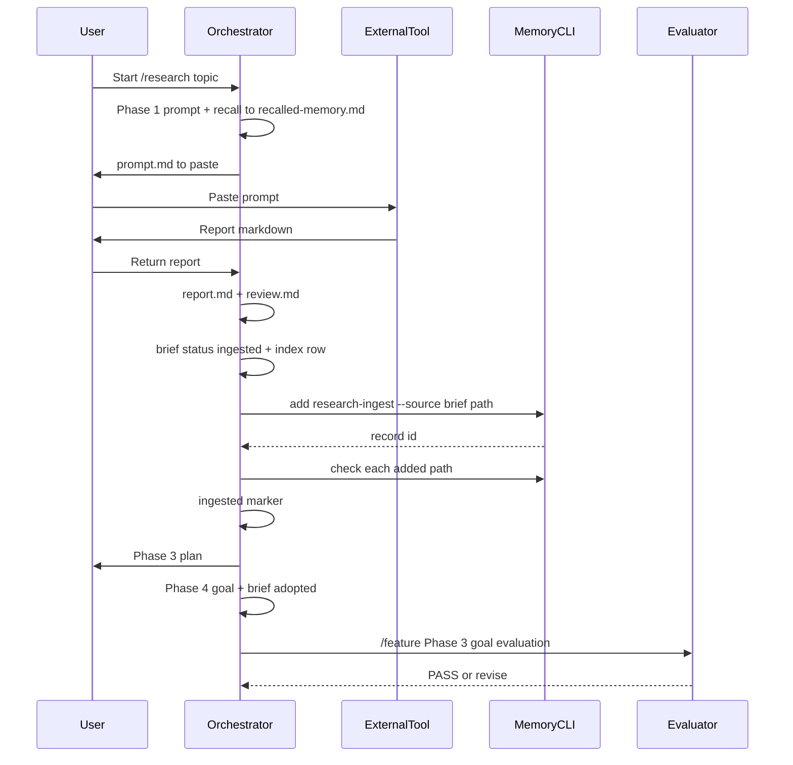
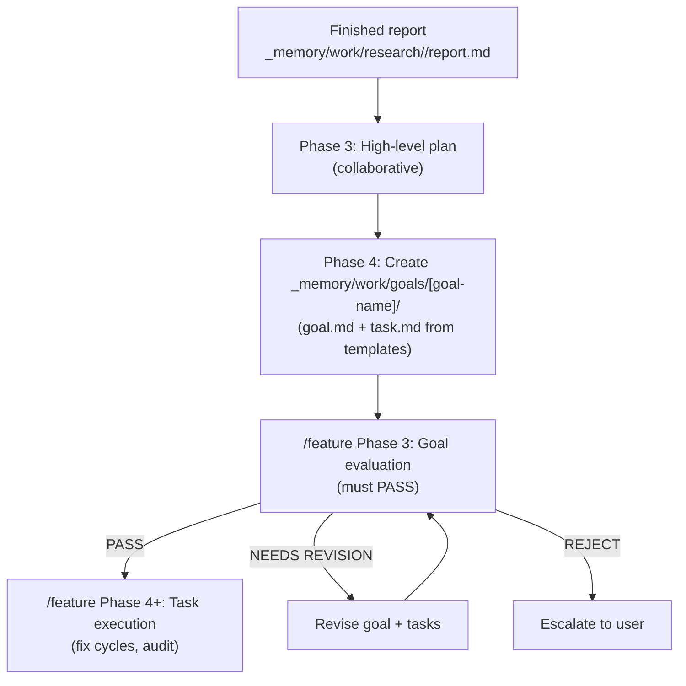

**Who this is for / What you'll learn:** Developers facing work that depends on **external-domain facts** — vendor APIs, cross-harness capabilities, regulatory constraints, or standards the team has not yet verified. You will learn why `/research` precedes implementation, how the research prompt, report, and ingestion review artifacts are structured, where scratch research lives versus tracked briefs and memory records, how a finished study becomes an evaluated goal, and when you can skip research and go straight to direct edit or `/feature`. For top-level mode routing (direct edit vs `/feature` vs `/research` vs the autonomous loop), see [decision-guide.md](decision-guide.md).

# Research workflow (`/research`)

The `/research` skill is a **Research → Plan** orchestrator for domain topics an external research agent must investigate **without codebase access**. Canonical behavior is what [`skills/agent-kit/templates/skills/research/SKILL.template.md`](../../../skills/agent-kit/templates/skills/research/SKILL.template.md) emits via `/agent-kit`; installs receive it as an optional skill alongside `/feature`. The workflow produces a self-contained research prompt, ingests the returned report into scratch and a tracked brief, plans with you, and creates a goal/task structure that hands off to `/feature` — research does not bypass evaluation.

## Research pipeline

The end-to-end path from an unanswered domain question to shipped code:

**How to read the chart:**

1. **Topic** — a domain question the team cannot answer from the repo alone (for example, "Does Cursor read native agent folders on disk?" or "What idempotency guarantees does Stripe's webhook API provide?").
2. **Research prompt (from template)** — the orchestrator writes a self-contained prompt from [`research-prompt.md`](../../../skills/agent-kit/templates/skills/research/templates/research-prompt.md) so an external researcher can work without seeing your codebase.
3. **External research agent** — you copy-paste the prompt into your chosen external research tool (a separate session, a web research agent, or any tool that can fetch and cite primary sources). The kit does not run this step itself.
4. **Report ingestion** — the orchestrator saves and critically reads the returned report, writes the ingestion review, promotes a curated brief and index row, archives a `research-ingest` record, and writes the scratch `ingested` marker.
5. **Evaluated goal/task structure** — collaborative planning produces `_memory/work/goals/[goal-name]/` using the `feature` skill's templates; the goal must **PASS** Phase 3 goal evaluation before any task dispatch.
6. **Feature implementation** — once the goal passes evaluation, `/feature` runs task execution, final audit, optional docs alignment, and the approval-gated pull request.

For the seven phases of `/feature` after handoff, see [feature-workflow.md](feature-workflow.md).

## Why research first

External-domain work carries a **fabrication risk** that hits both implementation and evaluation. When implementers lack verified facts, they produce confident-sounding code and documentation grounded on guesses — API behavior invented from training-data priors, vendor capabilities assumed from outdated blog posts, cross-harness quirks extrapolated from one environment. The damage is not limited to the code: **evaluators face the same gap**. Without a research report as ground truth, an evaluator cannot distinguish a correct external-domain claim from a plausible fabrication. Both sides of the orchestrator/worker/evaluator split can "PASS" work that fails on first contact with reality.

A finished research report gives the evaluator **verifiable ground truth** to check external-domain claims against. Citations, confidence distinctions, and explicit "cannot answer definitively" statements turn evaluation from guess-matching into evidence review. The kit's anti-invention rules (binding in the evaluation system) require claims to trace to read sources; `/research` is the structured path for producing those sources before goal creation.

### This repo used research before shipping

The AI Orchestration Kit dogfoods its own research workflow. Three committed briefs illustrate the pattern — curated findings promoted from gitignored scratch into tracked `_memory/research/` briefs (indexed in [`_memory/research/README.md`](../../../_memory/research/README.md)):

| Study | What it grounded | Link |
|-------|------------------|------|
| Multi-harness upgrade | Per-harness capability claims — model tiers, fallback behavior, Copilot and Cursor caveats — before those patterns were adopted into the canonical templates and emitters | [multi-harness-upgrade.md](../../../_memory/research/multi-harness-upgrade.md) |
| Squad study | Production-hardening ideas gleaned from [bradygaster/squad](https://github.com/bradygaster/squad) — fix-cycle model rotation, existence checks with a confidence ladder and anti-fabrication rules — adopted into shipped kit behavior | [squad-ideas.md](../../../_memory/research/squad-ideas.md) |
| Runtime language | Bash as the single script source of truth for kit automation; incremental retirement of PowerShell twins | [runtime-language.md](../../../_memory/research/runtime-language.md) |

Raw prompts and reports from active sessions stay under gitignored `_memory/work/research/<topic>/`; durable, linkable summaries live in `_memory/research/<topic>.md`. Search and recall index the distilled **`research-ingest`** record in `_memory/records/` (whose `source` label is the brief path), not the brief file itself.

## The research prompt artifact

Phase 1 of the research skill writes `_memory/work/research/<topic>/prompt.md` from the canonical [`research-prompt.md`](../../../skills/agent-kit/templates/skills/research/templates/research-prompt.md) template.

**Recall (Phase 1):** run `_kit/memory.sh search <term>… --kind research-ingest,decision` (pick **≤ 5** records per [`memory-protocol.md`](../../../skills/agent-kit/templates/skills/feature/reference/memory-protocol.md)); write picked ids or `none` to `_memory/work/research/<topic>/recalled-memory.md` so settled research is not re-litigated. Phase 4 copies those picks into the new goal's `## Recalled memory`; feature recall does **not** run again for research-born goals.

The prompt must be **self-contained**: the external researcher cannot see your repo, so the orchestrator includes relevant facts from the project's ground-truth doc (the path configured at install time as `GROUND_TRUTH_DOC` — for example `docs/ARCHITECTURE.md` or a domain reference) and the domain skill, the exact questions to answer, and the required report structure. You copy-paste the finished prompt to your external research tool.

### Required sections (research-prompt.md)

The template mandates four sections:

| Section | Purpose |
|---------|---------|
| **Context (self-contained — assume no access to our codebase)** | Project background the researcher needs: what the project does, the relevant subsystem, and established ground truth they must not contradict. |
| **Questions to Answer** | Numbered, specific, answerable questions — not vague exploration prompts. |
| **Constraints on Answers** | Cite sources (official docs preferred) for every claim; distinguish "documented behavior" from "inferred/community knowledge"; if a question cannot be answered definitively, say so explicitly. |
| **Required Report Structure** | Instruct the researcher to return markdown with: **Summary of Findings** · **Per-Question Answers (with citations)** · **Contradictions & Caveats** · **Open Questions**. |

The orchestrator fills bracket placeholders (`[topic]`, question lists, context paragraphs) from the alignment conversation; the section headings and constraints come from the template unchanged.

## The research report artifact

Phase 2 saves the returned report as `_memory/work/research/<topic>/report.md`, structured per the canonical [`research-report.md`](../../../skills/agent-kit/templates/skills/research/templates/research-report.md) template. The orchestrator reads it critically: flag claims that contradict the project's ground-truth doc or the codebase, and list open questions back to you.

### Required sections (research-report.md)

| Section | Purpose |
|---------|---------|
| **Summary of Findings** | Three to eight bullets of the load-bearing conclusions. |
| **Per-Question Answers** | One subheading per question (`### Q1: [question]`), each answer with citations. |
| **Contradictions & Caveats** | Where sources disagreed, or where findings conflict with project ground truth. |
| **Open Questions** | What remains unanswered and what it blocks. |
| **Promotion Checklist** | Checkboxes for the brief, index row, and implemented facts in the ground-truth doc. |

The report header records the date and the source prompt path (`_memory/work/research/<topic>/prompt.md`) for traceability.

## The ingestion review (`review.md`)

Still in Phase 2, the orchestrator writes the critical ingestion review to `_memory/work/research/<topic>/review.md` — contradictions with ground truth, codebase mismatches, and open questions surfaced before promotion. This file stays in gitignored scratch alongside the prompt and report; it informs the curated brief but is not committed as a brief or memory record.

## Where research is stored

Research uses three layers: gitignored scratch per topic, tracked orchestrator-owned briefs, and immutable memory records. Only implemented facts belong in the project's ground-truth doc; raw reports never leave scratch.

| Layer | Path | Mutable? | Who writes | Search / `check` |
|-------|------|----------|------------|------------------|
| **Scratch** | `_memory/work/research/<topic>/` (`prompt.md`, `report.md`, `recalled-memory.md`, `review.md`, `ingested`) | Working files | Orchestrator during `/research` | Not scanned by `memory.sh check`, `index`, or `search` |
| **Brief** | `_memory/research/<topic>.md` | Yes — orchestrator-owned | Orchestrator only (Promote, Phase 4, feature archive); **worker tasks and driver-dispatched loop slots never write here** | Not a record; discovery is via the linked `research-ingest` record |
| **Index** | `_memory/research/README.md` | Yes | Created from [`research-index.md`](../../../skills/agent-kit/templates/skills/research/templates/research-index.md) **only when missing** (replace the sample row with the first real row); updated whenever a brief is written or status changes | Same as briefs |
| **Record** | `_memory/records/YYYY/MM/<id>.md` | **No** — immutable, body ≤ 4096 bytes after normalization | Orchestrator via `_kit/memory.sh add` after Phase 2 review | `search`, `check`, `index` |

**Goals (`_memory/work/goals/`):** after ingestion and planning, Phase 4 creates `_memory/work/goals/[goal-name]/` with `goal.md`, task files, and orchestration artifacts. That tree is executable structure, not research scratch.

## The brief format

Phase 2 **Promote** writes `_memory/research/<topic>.md` from [`research-brief.md`](../../../skills/agent-kit/templates/skills/research/templates/research-brief.md) with `status: ingested`, then adds or updates the topic's row in `_memory/research/README.md`.

### Frontmatter keys

| Key | Required | Purpose |
|-----|----------|---------|
| `title` | yes | Human title of the study |
| `topic` | yes | Slug — equals the file stem and the `_memory/work/research/<topic>/` folder |
| `date` | yes | Date of the study (`YYYY-MM-DD`) |
| `status` | yes | Lifecycle status (see below) |
| `goals` | yes | Goal names born from the study (`[]` allowed) |
| `supersedes` | yes | Topics this brief replaces (`[]` allowed) |
| `memory` | yes | `research-ingest` record ids (`[]` until archive) |
| `recheck_by` | optional | Time-sensitive facts only — omit the line otherwise |
| `shipped_in` | optional | Release(s) that shipped the findings (`[]` allowed) |

Body sections (**Question**, **Load-bearing conclusions**, **Per-question findings**, **Decisions**, **Open questions**, **Sources**) follow the brief template.

### Brief status set

Allowed values (from the brief template): **`proposed`**, **`ingested`**, **`adopted`**, **`shipped`**, **`superseded`**, **`rejected`**. No kit step writes **`proposed`** — Phase 2 **Promote** creates new briefs as **`ingested`** ([`SKILL.template.md`](../../../skills/agent-kit/templates/skills/research/SKILL.template.md)). **`proposed`** remains an allowed starting state if you set it manually before Promote.

| Status | Typical writer | When |
|--------|----------------|------|
| `ingested` | Orchestrator (Phase 2 Promote) | Curated brief and index row written after ingestion review |
| `adopted` | Orchestrator (research Phase 4) | Goal appended to `goals:`; set when status was `ingested`; index row updated |
| `shipped` | Orchestrator (feature archive) | After Phase 5 **APPROVED** and green quality checks, for briefs listing that goal in `goals:` |
| `superseded` / `rejected` | Orchestrator | When retiring or rejecting a study direction — may be set from **any** prior status (update brief + index row) |

Driver-dispatched autonomous-loop slots and worker task `writes:` fences never include `_memory/research/` — brief maintenance stays orchestrator-owned in interactive `/research` and `/feature` archive paths only.

## The index

`_memory/research/README.md` is the table of all briefs: topic link, status, date, optional re-check date, and one-line summary. The research skill maintains it — one row per `_memory/research/<topic>.md`, added or updated whenever a brief is written or its status changes. On first use, the orchestrator creates the file from [`research-index.md`](../../../skills/agent-kit/templates/skills/research/templates/research-index.md) and replaces the sample row with the first real study.

## Ingestion: report → evaluated goal

Phases 2–4 bridge a finished report into executable work.

### Phase 2 — Ingest, promote, archive

1. Save `report.md` and write `review.md`.
2. **Promote** the brief (`status: ingested`) and update the index.
3. **Archive** one `research-ingest` record after the ingestion review ([`memory-protocol.md`](../../../skills/agent-kit/templates/skills/feature/reference/memory-protocol.md)): `--source` is the brief path `_memory/research/<topic>.md`; add the new id to the brief's `memory:` list.
4. Run `_kit/memory.sh check` on **each** path `add` writes (or quarantines); exit **3** ⇒ report the failing stdout line to the user and do not commit until fixed; exit **5** (quarantined) ⇒ report, run `check` on the quarantined path too.
5. Write `_memory/work/research/<topic>/ingested`: line 1 = UTC `YYYY-MM-DDTHH:MM:SSZ`, line 2 = record id(s) from this archive separated by spaces.

### Phase 3 — High-level plan

Collaborative planning with you (Plan Mode when available): approach options with tradeoffs, chosen direction, and affected layers (`EXECUTION_LAYERS` at install time). This is a human decision gate — the report informs choices but does not auto-select an approach.

### Phase 4 — Low-level tasks

The orchestrator creates `_memory/work/goals/[goal-name]/` using the `feature` skill's [`goal.md`](../../../skills/agent-kit/templates/skills/feature/templates/goal.md) and [`task.md`](../../../skills/agent-kit/templates/skills/feature/templates/task.md) templates, derived from the ingested report and the collaborative plan. Copy Phase 1 picks from `recalled-memory.md` into the goal's `## Recalled memory` and log the spawn note per memory-protocol. Append the goal name to the brief's `goals:` list; when status was `ingested`, set `status: adopted` and mirror the status in the index row.

### Handoff to `/feature` — evaluation still applies

The orchestrator **path-Reads** the emitted [`feature/SKILL.md`](../../../skills/agent-kit/templates/skills/feature/SKILL.template.md) (under the install's skill directory) and continues from **Phase 3 (goal evaluation)** there — the goal still must **PASS** the evaluator before execution begins; research does not bypass evaluation. Phase 3 runs the full goal evaluation checklist: devil's advocate section, ownership-contract disjointness verification, acceptance criteria review, and the complete evaluator protocol described in [feature-workflow.md](feature-workflow.md) and [evaluation-system.md](evaluation-system.md).

Only after a **PASS** does `/feature` advance to Phase 4 (task execution). Workers dispatched from research-derived goals follow the same fix-cycle rotation and test-ladder rules as any other feature goal.

## Shipping

When a feature goal closes successfully, research briefs tied to that work advance with it:

- **Feature archive (after Phase 5 APPROVED):** for each `_memory/research/*.md` brief whose `goals:` lists this goal, the orchestrator sets `status: shipped` and updates that topic's row in `_memory/research/README.md` ([`memory-protocol.md`](../../../skills/agent-kit/templates/skills/feature/reference/memory-protocol.md)). This runs in the interactive archive path only — not in driver-dispatched loop slots.
- **Docs alignment (Phase 6, optional):** the [`align-docs`](../../../skills/agent-kit/templates/skills/align-docs/SKILL.template.md) skill reads scratch and goal artifacts as source material and promotes **only implemented** ground truth into the project's ground-truth doc; it never writes under `_memory/`.

Immutable **`goal-summary`**, **`decision`**, and **`pitfall`** records from the same feature archive capture what shipped for cross-session search; they are separate from brief status updates.

## When to skip research

Not every piece of work needs `/research`. Skip the research workflow when the decision-guide's external-domain gate does not apply — work you can verify entirely from the repo and your own session, with no gap in external-domain knowledge.

| Skip when | Why research adds no value | Typical route instead |
|-----------|------------------------------|----------------------|
| **In-repo refactors** | The change is fully inside the existing codebase — renaming, restructuring, extracting modules — with no external API, vendor, or standard to investigate | Direct edit (trivial) or `/feature` (non-trivial refactor spanning layers) |
| **Behavior fully specified by existing code/tests** | The desired behavior is already defined by implementation and test assertions; you are extending or fixing against a known contract, not discovering external facts | `/feature` (if non-trivial) or direct edit (if mechanical) |
| **Mechanical or trivial changes** | Typo fixes, comment updates, config tweaks, formatting — verifiable immediately without external investigation | Direct edit |

These conditions align with [decision-guide.md](decision-guide.md) routing: when the "Does it need external-domain knowledge the team lacks?" branch is **No**, proceed to `/feature`, the autonomous loop, or direct edit — not `/research`.

**Do not skip research when:** the work depends on external APIs, vendor documentation, regulatory requirements, cross-harness behavior you have not verified, or any domain fact the team cannot cite from committed ground truth, a research brief, or the codebase. Jumping straight to `/feature` in those cases invites the fabrication risk described above.

## Running `/research` in practice

Invoke the research skill from your harness session the same way you invoke `/feature`:

1. **Start `/research`** with your topic — the orchestrator aligns on scope and questions.
2. **Review the generated prompt** at `_memory/work/research/<topic>/prompt.md` — confirm questions are specific and context is self-contained.
3. **Run external research** — copy-paste the prompt to your external tool; wait for the report.
4. **Return the report** — the orchestrator ingests it to `_memory/work/research/<topic>/report.md`, writes `review.md`, promotes the brief and index, archives the `research-ingest` record, and writes the `ingested` marker after `check` passes.
5. **Plan collaboratively** — Phase 3 chooses direction; Phase 4 creates the goal structure and updates the brief to `adopted` when appropriate.
6. **Pass goal evaluation** — the goal enters `/feature` Phase 3; fix any evaluator findings before dispatch.
7. **Execute via `/feature`** — from Phase 4 onward, the research-derived goal follows the standard feature workflow; after approval, archive updates brief status to `shipped` when the study grounded that goal.

The research skill coordinates four phases internally; the pipeline diagram at the top of this document shows the conceptual stage sequence from topic through feature implementation, including the external research agent step that happens outside the orchestrator session.

## Relationship to other guides

| Topic | Where to read |
|-------|---------------|
| Choosing between direct edit, `/feature`, `/research`, and the autonomous loop | [decision-guide.md](decision-guide.md) |
| Seven phases, fix cycles, worked example after research handoff | [feature-workflow.md](feature-workflow.md) |
| Evaluator verdicts, confidence ladder, anti-fabrication rules applied at goal evaluation | [evaluation-system.md](evaluation-system.md) |
| Recall, archive, search CLI, briefs vs records | [memory.md](memory.md) |
| Install paths and first session | [getting-started.md](getting-started.md) |

## Sources

- [`skills/agent-kit/templates/skills/research/SKILL.template.md`](../../../skills/agent-kit/templates/skills/research/SKILL.template.md) — four research phases, scratch and brief paths, Promote and archive, handoff to feature Phase 3
- [`skills/agent-kit/templates/skills/research/templates/research-prompt.md`](../../../skills/agent-kit/templates/skills/research/templates/research-prompt.md) — prompt artifact section structure
- [`skills/agent-kit/templates/skills/research/templates/research-report.md`](../../../skills/agent-kit/templates/skills/research/templates/research-report.md) — report artifact sections and promotion checklist
- [`skills/agent-kit/templates/skills/research/templates/research-brief.md`](../../../skills/agent-kit/templates/skills/research/templates/research-brief.md) — brief frontmatter and body sections
- [`skills/agent-kit/templates/skills/research/templates/research-index.md`](../../../skills/agent-kit/templates/skills/research/templates/research-index.md) — index table shape
- [`skills/agent-kit/templates/skills/feature/reference/memory-protocol.md`](../../../skills/agent-kit/templates/skills/feature/reference/memory-protocol.md) — recall, research archive, feature archive brief status, `ingested` marker format
- [`skills/agent-kit/templates/skills/feature/SKILL.template.md`](../../../skills/agent-kit/templates/skills/feature/SKILL.template.md) — seven-phase feature workflow receiving research handoff at Phase 3
- [`skills/agent-kit/templates/skills/align-docs/SKILL.template.md`](../../../skills/agent-kit/templates/skills/align-docs/SKILL.template.md) — Phase 6 promotion of implemented facts to the ground-truth doc
- [`skills/agent-kit/README.md`](../../../skills/agent-kit/README.md) — kit layout and optional `skills/research` emission
- [`../../../_memory/research/README.md`](../../../_memory/research/README.md) — index of committed research briefs in this repository
- [`docs/agent-kit/guide/README.md`](README.md) — suite conventions and document map
