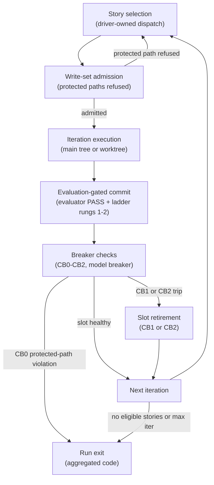

**Who this is for / What you'll learn:** Kit **users** who want to run the optional autonomous loop responsibly — and kit **contributors** who need to understand what the canonical drivers enforce. You will learn what one loop **run** is, how a single iteration moves from driver dispatch through evaluation-gated commit and breaker checks, which structural guards the drivers apply (not honor-system prose), how `LOOP_SLOTS` and `LOOP_WORKTREE` interact, what exit codes 0–5 mean, and how quarantine markers protect the repo when a slot goes wrong. When to choose the loop over `/feature` or direct edit is covered in [decision-guide.md](decision-guide.md).

# Autonomous Loop

The autonomous loop is **optional**. It drives unattended runs: the loop driver (`_loop/loop.sh` or `_loop/loop.ps1`) repeatedly dispatches the `auto-loop` skill with fresh context until the run budget is exhausted or a structural guard stops the run. **SAFETY: run inside a sandbox** (worktree/container) with minimal credentials. The drivers never push and never bypass permission prompts by themselves — the same sandbox warning appears in the root [README](../../README.md) and the loop driver header.

As of **v0.19.0**, this guide describes **canonical shipped behavior** — what `/setup` emits from `skills/setup/templates/loop/` into your project's `_loop/` tree. In **this kit repo**, the emitted instance is gitignored, so live runs here stay serial on the main tree; `LOOP_WORKTREE=1` requires a **tracked** instance (committed `_goals/backlog.md` and harness directory), which is labeled explicitly wherever it matters below.

## What a run is

One **run** is:

1. **N iterations** — the driver's `max-iterations` argument (default **10** when omitted), counting total dispatches across all active slots.
2. **One backlog story per fresh-context iteration** — each dispatch gets a clean CLI session; state lives in `_goals/backlog.md`, git, and outbox files, never in driver memory.
3. **One human-approved PR at run end** — Phase 7 (`ship-pr`) ships the branch as a single pull request with your approval. The loop never auto-pushes.

If you have not installed the loop yet, see [getting-started.md](getting-started.md) for `/setup` and the emitted `_loop/` layout.

## One iteration's lifecycle

Each iteration follows the same contract whether it runs in the main tree or a driver-managed worktree. The driver owns story selection, write-set admission, backlog transitions, and integration; the `auto-loop` skill executes exactly one story per dispatch.



**Story selection (driver-owned dispatch).** The driver reads `_goals/backlog.md`, picks the highest-priority eligible story (`passes: false`, not blocked, within attempt limits), increments `attempts` at claim time, and dispatches a prompt naming the story id and outbox directory. Slots never re-select or print `<promise>COMPLETE</promise>` in dispatched mode — that sentinel is for manual `auto-loop` runs only.

**Write-set admission.** Before dispatch, the driver checks the story's declared `writes:` globs against other in-flight claims and refuses stories that would touch **protected paths** (see below). Refused stories are skipped for this run, not silently widened.

**Iteration in main tree or worktree.** At `LOOP_WORKTREE=0` (default), every slot runs in the main checkout. At `LOOP_WORKTREE=1`, each slot gets its own git worktree under `.loop-worktrees/` after a tracked-instance preflight.

**Evaluation-gated commit.** The iteration follows `/feature` Phases 2–6 with the story's acceptance criteria replacing Phase 1 alignment. A commit lands only on evaluator PASS (or APPROVED for audits) plus green test-ladder rungs 1–2; rung 3 runs once at cycle end. Details of verdicts, contracts, and the ladder live in [evaluation-system.md](evaluation-system.md). As of v0.20.0, iterations inherit Phase 4's continuation ladder (rungs 5→4→6 on fix-cycle exhaustion, before terminal escalation) because each iteration runs the phased flow; the drivers' per-story attempt cap and circuit breakers stay the unchanged outer backstop. Ladder mechanics are documented in [feature-workflow.md](feature-workflow.md).

**Breaker checks.** After each reap, the driver evaluates per-slot circuit breakers (CB1 no-progress, CB2 repeated signatures), the model rate-limit breaker, and protected-path diffs (CB0). Trips **retire** the slot rather than stopping the whole run on first failure — unless CB0 fires (exit 4).

**Next iteration / retirement / exit.** Healthy slots refill; retired slots are not refilled. When every slot is retired, or the backlog is drained, or `max-iterations` is reached, the driver aggregates an exit code (see below).

## Structural safety guards

These guards are **structural** — enforced by `loop.sh` / `loop.ps1` and the `auto-loop` skill, not optional prose. They mirror the canonical guard table in [`skills/setup/templates/ORCHESTRATION.md`](../../skills/setup/templates/ORCHESTRATION.md).

| Guard | Driver behavior (as of v0.19.0) |
|-------|----------------------------------|
| **Protected paths** | The loop may not modify `_loop/`, kit agents/skills, `orchestration-kit.manifest.json`, or `.gitattributes`. A violation reverts the iteration and **stops the run immediately** (exit **4**); other running slots are killed. |
| **Circuit breaker (CB1 / CB2)** | **Per slot:** retire after **3 consecutive no-commit reaps** (CB1) or **5 identical failure signatures** (CB2). The run **continues** while other slots remain active. When **every slot is retired**, the run stops — exit **3** if any retirement was signature-based (CB2), else exit **2**. |
| **Model breaker** | CLOSED/OPEN/HALF-OPEN on anchored rate-limit detection; 600s cooldown, 2 successes to close; falls down the loop model chain. OPEN sleeps instead of hammering; rate-limited passes are CB1-exempt. State: `_goals/breaker-state.json`. |
| **Memory size gates** | After integrate, the driver **detects** breaches and prints a deferral — it never compacts or archives. Thresholds match the guard table: `_goals/LEARNINGS.md` ≥ **15 KB** (compact) and `_goals/ESCALATIONS.md` ≥ **20 KB** (archive resolved entries). Compaction and archival happen in a **manual** `auto-loop` iteration only; driver-dispatched slots never run these gates. |
| **Merge gate** | Evaluator PASS + green ladder rungs **1–2** before any commit; rung **3** at run end. |
| **PR gate / shipping** | The loop **never pushes**. At run end, **`ship-pr` (Phase 7)** ships the branch as **one PR**, with the user approving the draft. |
| **Per-story attempt cap** | **3** attempts, then `blocked: true` plus an escalation entry. |
| **Sandbox** | Run in a worktree/container with minimal credentials; never skip permission prompts outside a sandbox. |

Known failure mode: loops can burn large budgets without converging — prefer more, smaller backlog stories (each sized to one context window) and let the circuit breakers stop a drifting run early.

## Driver knobs

Both drivers honor the same environment variables. **`loop.ps1` is a behaviorally identical twin of `loop.sh`** — same defaults, guards, and exit codes; any divergence is a bug.

### `LOOP_WORKTREE`

| Value | Meaning |
|-------|---------|
| **0** (default) | Every iteration runs in the **main tree** — today's serial behavior. |
| **1** | Each iteration runs in its own git worktree under `.loop-worktrees/`. |

When `LOOP_WORKTREE=1`, the driver runs a **tracked-instance preflight** immediately after `git worktree add`: the worktree must contain a tracked `_goals/backlog.md` and a tracked harness directory (`{{IDE_DIR}}` at install time). If either is missing — typical when the loop instance is gitignored — the driver removes the worktree, deletes the branch, prints a loud error, and exits **5**. There is **no fallback to the main tree**.

### `LOOP_SLOTS`

| Fact | Value |
|------|-------|
| Default | **2** |
| Clamped range | **[1, 3]** |
| Honored when | **`LOOP_WORKTREE=1` only** (worktree isolation makes concurrent slots sound) |
| At `LOOP_WORKTREE=0` | **Effective concurrency clamps to 1** regardless of requested slots |

**N>1-iff-worktree rule:** `LOOP_SLOTS>1` is honored **if and only if** `LOOP_WORKTREE=1`. Without per-slot worktree isolation, concurrent slots would share one working tree and stomp each other's checkout state.

**Stderr note (explicit request only):** when `LOOP_SLOTS>1` was **explicitly requested** (`LOOP_SLOTS` set in the environment) but `LOOP_WORKTREE≠1`, the driver prints to stderr:

```text
LOOP_SLOTS>1 requires LOOP_WORKTREE=1 (worktree isolation); running with 1
```

This note fires **only** when `LOOP_SLOTS>1` was explicitly set — not on every default run (avoids warning fatigue when the default is 2 but worktree mode is off).

For parallel-dispatch design rationale (slot accounting, worktree lifecycle, write-set admission, integrator), see [Parallel dispatch design](../design-parallel-dispatch.md).

## Exit codes

Exit codes are **driver-aggregated across slots** with precedence **4 > 3 > 2 > 1 > 0** — the most severe cause wins. Exit **4 short-circuits** the aggregation table: protected-path violations stop immediately and kill other running slots. Exit **5** is a setup/integration failure and also short-circuits outside the aggregation funnel.

| Code | Meaning |
|------|---------|
| **0** | **Backlog complete** — the driver's own backlog re-scan found no eligible story **and no branch was quarantined this run**. Under driver-owned dispatch, a slot-emitted `<promise>COMPLETE</promise>` is an ITERATION-mismatch (contract violation), never a completion signal. |
| **1** | **Stopped without completing the backlog** — `max-iterations` reached with eligible stories remaining, **or** no eligible story remains but **quarantined branches were retained** this run (inspect them before trusting the backlog). |
| **2** | **Circuit breaker — all slots retired on no-progress** — each retired slot hit CB1 (3 consecutive no-commit reaps). |
| **3** | **Circuit breaker — all slots retired with at least one CB2 retirement** — at least one slot retired on 5 consecutive identical failure signatures. |
| **4** | **Protected-path modification** — iteration reverted; run stops immediately; every other running slot is killed. |
| **5** | **Setup or integration failure** — includes: `LOOP_WORKTREE=1` tracked-instance preflight failure; missing/unreadable `_goals/backlog.md`; `PROMPT.md` missing a required substitution point; rebase-then-ff integration hitting a non-fast-forward. Loud stops with **no silent fallback** to the main tree (preflight removes its worktree; non-ff retains worktree and branch for inspection). |

**Per-slot retirement vs run-fatal stop.** CB1 and CB2 trips **retire the slot** (no refill) while the run may continue on remaining active slots. Only when **all slots are retired** does the run exit **2** or **3** — not on the first no-progress or signature match.

**Drained completion.** Exit **0** requires both an empty eligible backlog **and** zero quarantined branches retained this run. If quarantined branches remain, exit **1** even when no eligible stories are left.

Shell-propagated **126/127** (command-not-found / not-executable) are standard shell edge cases, not loop-owned codes; the PowerShell twin exits **127** for both cases — a stated platform difference.

## Quarantine markers

When `LOOP_WORKTREE=1`, a slot whose branch cannot be integrated — ITERATION-mismatch, abnormal exit, write-subset violation, or killed when another slot hit a protected path — leaves a quarantine marker instead of silently dropping work.

| Fact | Value |
|------|-------|
| Path | `.loop-worktrees/QUARANTINE-<branch>.md` |
| Branch naming | Slashes in the branch name become **dashes** |
| Content order | `QUARANTINE`, `story:`, `slot:`, `branch:`, `status:`, `reason:` (`mismatch` \| `abnormal` \| `subset` \| `killed`), `dirty_paths:`, blank line, `--- dispatched prompt ---`, then the dispatched prompt verbatim |

Quarantined branches block a "clean" exit **0** — inspect markers and branches before trusting the backlog.

## Backlog stories

Stories live in **`_goals/backlog.md`**. Each entry requires `priority` (lower number picked first), `passes`, `attempts`, `blocked`, `writes` (comma-separated path globs — disjoint globs allow concurrent slots; absent/empty `writes` serializes the story), a description that replaces Phase 1 alignment, and concrete acceptance criteria. Loop-suitable stories are **small, well-specified, and independently verifiable** — sized to one context window with observable outcomes a skeptical evaluator can check without asking you mid-run. Whether your work belongs in the loop at all — versus `/feature`, `/research`, or a direct edit — is a mode choice; see [decision-guide.md](decision-guide.md).

## Starting a run

After `/setup` emits `_loop/` and `_goals/backlog.md`, start an unattended run from the repository root:

```bash
_loop/loop.sh 10
```

```powershell
pwsh _loop/loop.ps1 10
```

(PowerShell **7+** required.) The numeric argument is `max-iterations` (default **10** when omitted). Override the CLI with `LOOP_CLI` (for example `LOOP_CLI="claude -p"` or `LOOP_CLI="codex exec"`). Example with worktree isolation and two slots:

```bash
LOOP_WORKTREE=1 LOOP_SLOTS=2 _loop/loop.sh 10
```

At run end, review commits on the branch and run **`ship-pr`** (Phase 7) once to open a single approval-gated pull request — the loop never pushes for you.

## Related guides

| Topic | Guide |
|-------|-------|
| When to choose the loop | [decision-guide.md](decision-guide.md) |
| Evaluator PASS, contracts, test ladder | [evaluation-system.md](evaluation-system.md) |
| Install and first `/setup` | [getting-started.md](getting-started.md) |
| Parallel-dispatch design depth | [design-parallel-dispatch.md](../design-parallel-dispatch.md) |

## Sources

- [`skills/setup/templates/loop/loop.sh`](../../skills/setup/templates/loop/loop.sh) — driver truth: knobs, exit codes, aggregation, quarantine, worktree preflight
- [`skills/setup/templates/loop/loop.ps1`](../../skills/setup/templates/loop/loop.ps1) — PowerShell twin (parity contract)
- [`skills/setup/templates/loop/breaker.sh`](../../skills/setup/templates/loop/breaker.sh) — model circuit breaker state machine
- [`skills/setup/templates/loop/SKILL.md`](../../skills/setup/templates/loop/SKILL.md) — one-iteration contract, dispatch modes, protected paths
- [`skills/setup/templates/loop/PROMPT.md`](../../skills/setup/templates/loop/PROMPT.md) — dispatched prompt shape
- [`skills/setup/templates/loop/backlog.md`](../../skills/setup/templates/loop/backlog.md) — canonical backlog story format
- [`skills/setup/templates/ORCHESTRATION.md`](../../skills/setup/templates/ORCHESTRATION.md) — autonomous loop guard table
- [`README.md`](../../README.md) — loop feature summary, sandbox warning, knob overview
- [`docs/design-parallel-dispatch.md`](../design-parallel-dispatch.md) — bounded-concurrency dispatch design (Status block and shipped sections)
