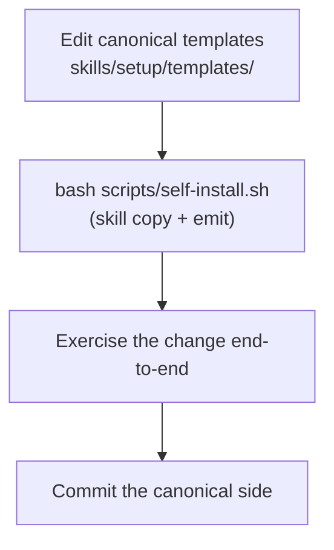

**Who this is for / What you'll learn:** Kit **contributors and maintainers** working on the AI Orchestration Kit itself — not end users installing into their projects. You will understand the repo's three-layer anatomy (canonical source, gitignored emitted instance, tracked docs), the self-install dogfood loop for exercising template changes locally, how to edit templates and emitters safely, what the harness matrix and manifest are for, how VERSION bumps and install upgrades flow, and how to run the tracked test harnesses before committing canonical changes. For install paths, `/setup` compile flow, and first-session usage, see [getting-started.md](getting-started.md).

# Contributing to the Kit

The kit keeps **one canonical template source** under `skills/setup/` and compiles it per harness via `/setup`. Contributors, as of v0.19.0, edit that canonical side only; the emitted instance in this repo is gitignored and never source of truth. User-side install and compile mechanics live in [getting-started.md](getting-started.md); harness research ground truth lives in [../research-multi-harness-upgrade.md](../research-multi-harness-upgrade.md); the full install story and layout tree are in [../../README.md](../../README.md).

## Repo anatomy: three layers

Every path in the kit repo belongs to one of three layers. Treat them differently: commit canonical and doc changes; treat instance paths as disposable output.

| Layer | Role | Key paths (tracked unless noted) |
|-------|------|----------------------------------|
| **CANONICAL** | Source of truth — what `/setup` reads and compiles | `skills/setup/templates/` (Claude Code format), `skills/setup/bin/` (`emit.sh` + `emit.ps1` — deterministic emit), `skills/setup/fixtures/` (`self-answers.json` for dogfood), `skills/setup/emitters/` (per-harness caveats), `skills/setup/reference/` (`harness-matrix.md`, `bootstrap-ids.md`), `skills/setup/VERSION` (kit version written into each install's manifest) |
| **INSTANCE** | Emitted by `/setup` and self-install in **this repo only** — gitignored, re-runnable, never committed | Entire `.claude/`; **partial** `.cursor/` only — `.cursor/skills/`, `.cursor/agents/`, `.cursor/rules/`, `.cursor/ORCHESTRATION.md` (the rest of `.cursor/` is **not** gitignored); `.agents/skills/` (self-install `--symlink` canonical tree); `.loop-worktrees/` (loop driver scratch); `_goals/`, `_loop/`, `_research/`; `orchestration-kit.manifest.json` |
| **REPO DOCS** | Tracked documentation for users and contributors | `README.md`, root `ORCHESTRATION.md` (architecture **pointer**), `docs/` (including this guide suite) |

**Instance-specific note:** In consumer projects, `/setup` emits into harness-native directories (`.claude/`, `.cursor/`, `.github/`, `.codex/`, root `ORCHESTRATION.md`, etc.) per the emitters. This repo dogfoods the kit: its `.gitignore` lists only the instance paths above so local dogfood output never reaches git.

### Root ORCHESTRATION.md is a pointer

The tracked root [`ORCHESTRATION.md`](../../ORCHESTRATION.md) is **not** the architecture source. It states:

> Edit the template in the skill's `templates/` directory only; this file is just a pointer.

The canonical architecture template lives at [`skills/setup/templates/ORCHESTRATION.md`](../../skills/setup/templates/ORCHESTRATION.md). `/setup` compiles it into each harness's native location (for example `.claude/ORCHESTRATION.md` or `.cursor/ORCHESTRATION.md` as of v0.19.0). Never edit emitted instance copies when changing kit behavior — edit templates and re-run `/setup` locally to refresh the instance.

## The dogfood loop

When you change canonical kit content, exercise the full path before committing tracked files:



1. **Edit** templates (and `bin/emit.*` when translation logic changes; emitters or reference docs when harness caveats change).
2. **Self-install** copies top-level skills into harness skill directories and emits the instance from `skills/setup/fixtures/self-answers.json` (unless `--no-emit`).
3. **Exercise** the change — run workflows, spot-check emitted files, run the test harnesses below.
4. **Commit** only canonical and repo-doc paths; instance output stays gitignored.

If you also changed emitter mappings or `skills/setup/SKILL.md`, include those tracked paths in the commit. Bump `skills/setup/VERSION` when kit behavior changes (see [VERSION, manifest, and upgrades](#version-manifest-and-upgrades)).

## Self-install scripts

[`scripts/self-install.sh`](../../scripts/self-install.sh) and [`scripts/self-install.ps1`](../../scripts/self-install.ps1) are **kit-repo-only** first-mile helpers that, as of v0.19.0, are twins with identical defaults, guards, and exit codes.

### What they copy

They discover every immediate child of `skills/` that contains a `SKILL.md` (non-recursive — nested paths like `skills/setup/templates/skills/feature/SKILL.md` are not skills). For each skill name they install into:

| Mode | Destinations |
|------|----------------|
| **Default (copy)** | `.claude/skills/<name>/` and `.cursor/skills/<name>/` — overwrite-copy from the working tree |
| **`--symlink`** | Canonical real tree at `.agents/skills/<name>/`; `.claude/skills/<name>` and `.cursor/skills/<name>` become symlinks pointing there |

Run from repo root:

```bash
bash scripts/self-install.sh
```

On Windows or when the `.ps1` lacks execute permission (PowerShell 7+):

```powershell
pwsh -NoProfile -File scripts/self-install.ps1
```

### Flags

| Flag | Semantics |
|------|-----------|
| `--dry-run` | Prints planned destination paths to stdout; writes nothing; exits 0. Combined with `--symlink`, prints the symlink plan. When emit runs, passes `--dry-run` to `emit.sh` (action lines only; no writes). |
| `--symlink` | Places the canonical real tree at `.agents/skills/<name>/` and makes `.claude/skills/<name>` and `.cursor/skills/<name>` symlinks pointing there. Fails loudly on symlink failure; **never** falls back to copy. |
| `--force` | Accepted and ignored — overwrite is already the default. |
| `--no-emit` | Copy skills only; skip emit (legacy behaviour). |
| `--force-emit` | Pass `--force` to `emit.sh` (overwrite user-modified instance files). |

### What self-install emits

After copying skills, self-install runs `skills/setup/bin/emit.sh --answers skills/setup/fixtures/self-answers.json` unless `--no-emit`. That produces the full gitignored instance (agents, loop drivers, manifest, project-specific resolved content) with zero LLM involvement. Consumer projects still use `/setup` Steps 1–6 in a session; self-install is kit-repo dogfood only.

Nothing the self-install scripts write reaches git — all destination paths are listed in [`.gitignore`](../../.gitignore).

## Editing templates

All canonical orchestration content lives under [`skills/setup/templates/`](../../skills/setup/templates/) in Claude Code format. As of v0.27.0, `skills/setup/bin/emit.*` resolves and translates templates deterministically.

### Template grammar (authoring)

- **`{{TOKEN}}`** — replaced from `answers.tokens` (and derived keys such as `{{IDE_DIR}}` resolved per harness).
- **`<!-- BOOTSTRAP[id]: … -->`** — `id` matches `^[a-z0-9]+(-[a-z0-9]+)*$`; the whole comment is replaced by `answers.bootstrap[id]` verbatim; `""` deletes silently; missing keys warn and appear in `--check-answers` output. Whole-line comments collapse to ≤1 blank between neighbours. Class-d instruction comments use the `kit-` prefix and are always deleted.
- **`<!-- IF flag -->` … `<!-- ENDIF flag -->`** (and `!flag`) — keep or drop the span; nesting allowed; mismatch ⇒ exit 6. Flags include `research`, `loop`, `greenfield`, `lint`, `typecheck`, `models_pinned`, per-target `is_*`, and harness-membership `want_*`.

Resolution order: IF → BOOTSTRAP[id] → `{{TOKEN}}`. Id table:
[`skills/setup/reference/bootstrap-ids.md`](../../skills/setup/reference/bootstrap-ids.md). Verify greps emitted files for stray `{{…}}`, `<!-- BOOTSTRAP`, and `<!-- IF` — zero hits required.

The full placeholder reference table lives in [`skills/setup/SKILL.md`](../../skills/setup/SKILL.md) (Step 4). Read it before adding or renaming tokens.

### Where harness-specific logic belongs

| Concern | Location |
|---------|----------|
| Canonical prose and structure | `skills/setup/templates/` |
| Harness-agnostic tool twins (`log-spawn.sh` / `log-spawn.ps1`, no tokens) | `skills/setup/templates/tools/` — emitted single-copy to `_kit/log-spawn.sh` / `_kit/log-spawn.ps1` (`_kit/` is gitignored in this repo) |
| Per-harness translation (frontmatter shape, path mapping, pointer rules) | `skills/setup/bin/emit.sh` / `emit.ps1` — see [`bin/README.md`](../../skills/setup/bin/README.md) |
| Harness caveats (live model-check URLs, silent-fallback warnings) | `skills/setup/emitters/` |
| Verified harness capabilities and friction points | `skills/setup/reference/harness-matrix.md` |

When live vendor docs contradict the harness matrix, trust the live docs for emission, then **update the matrix** with a new verified-on date. The matrix is the kit's ledger of verified facts; `bin/emit.*` implements translation on top of it.

## Emitters (caveats only)

As of v0.27.0, per-harness translation runs in [`skills/setup/bin/emit.sh`](../../skills/setup/bin/emit.sh) /
[`emit.ps1`](../../skills/setup/bin/emit.ps1). Emitter files under
[`skills/setup/emitters/`](../../skills/setup/emitters/) hold **caveats only** — live
model-list check URLs, silent-fallback warnings, and similar harness friction — not
translation tables. Full CLI contract: [`skills/setup/bin/README.md`](../../skills/setup/bin/README.md).

| Emitter file | Target harness | Caveats cover |
|--------------|----------------|---------------|
| [`claude-code.md`](../../skills/setup/emitters/claude-code.md) | Claude Code (`.claude/`) | Live model list URL; inherit/unpinned behaviour |
| [`cursor.md`](../../skills/setup/emitters/cursor.md) | Cursor (self-contained `.cursor/`) | Silent fallback to Composer; live model list URL |
| [`copilot.md`](../../skills/setup/emitters/copilot.md) | GitHub Copilot VS Code (`.github/`) | Cost-ceiling policy; model fallback arrays |
| [`codex.md`](../../skills/setup/emitters/codex.md) | OpenAI Codex (`AGENTS.md` + `.codex/`) | Role config in TOML; `AGENTS.md` size cap |

When you change a canonical template file, update `bin/emit.*` if translation paths
change — emitters no longer carry Emit tables. The Cursor emitter, as of v0.19.0, is
order-independent relative to Claude Code (self-contained emission).

## VERSION, manifest, and upgrades

### VERSION

[`skills/setup/VERSION`](../../skills/setup/VERSION) holds the kit version (as of v0.27.0, **0.27.0**). Bump it when changing kit behavior that installs should pick up. Docs-only changes in this repo do not require a VERSION bump.

### Manifest shape

`/setup` writes `orchestration-kit.manifest.json` at the project root. The manifest, as of v0.19.0, records:

- `kit`, `kitVersion` (from VERSION), `installedAt`, `harnesses`, `options`
- `files`: map of emitted path → SHA-256 hash
- `seedFiles`: paths created-if-missing, never overwritten on upgrade

As of v0.27.0, it also records `answers` (snapshot of the answers file used at emit),
`primary` (primary harness id), and flat `options` flags (`"forge": "<detected>"` plus
optional `forgeHost`; see [`skills/setup/SKILL.md`](../../skills/setup/SKILL.md) Upgrading).

In this repo the manifest is gitignored (instance layer). See the live example shape in `orchestration-kit.manifest.json` after a local `/setup` run.

### Upgrade flow

For installed projects (including dogfood in this repo):

1. **Re-pull** the kit — for example `npx skills add kdcllc/skills` again, or `npx agent-skills-cli update` (run `npx agent-skills-cli check` first to see installed skills).
2. **Re-emit** — `bash .claude/skills/setup/bin/emit.sh --upgrade` (or `.cursor/skills/setup`, `.github/skills/setup`; answers come from the manifest; add `--answers` only when the interview changed). Pre-v0.27.0 installs have no embedded `answers` — run `/setup` Steps 1–4 once, then `--answers … --upgrade`. Exit 4 lists user-modified files; confirm with `--force`. Use `--dry-run` to preview.

**Hash diff protects local modifications:** Unmodified emitted files update silently; modified files require confirmation before overwrite.

**`seedFiles` semantics (as of v0.27.0):** The manifest lists `_goals/backlog.md` in `seedFiles` only (not in `files`). Seeds are created only when missing, never overwritten on upgrade, and are exempt from the hash-diff overwrite flow.

**Stale-file pruning (as of v0.19.0):** After regeneration, paths in the old manifest but absent from the new emit set are deleted if unmodified, or reported for manual removal if the user edited them.

## Running tests

Contributors should run the tracked harnesses before committing canonical changes.

### Loop and self-install harness

```bash
bash tests/loop-harness/run.sh
```

This is the tracked **behavioral** test suite (test-ladder rung 3 territory — run manually or in CI; not wired into the gitignored instance checks). Coverage, as of v0.19.0 per the script header and [README](../../README.md) layout section, includes:

- **Breaker state machine** — canonical `breaker.sh` assertions with injected timestamps (no wall-clock reads)
- **Rate-limit detection** — live `detect_rate_limit` extracted from canonical `loop.sh`
- **Re-emitted instance stub** — end-to-end `_loop/loop.sh` run inside a throwaway repo when `_loop/` exists in this repo
- **Structural guards** — PowerShell parity, emitter/SKILL text coverage, SIGPIPE regressions, checks J/K mutation proofs, and related story additions
- **Self-install block** — runs **without** requiring `_loop/`: exercises `scripts/self-install.sh` and `self-install.ps1` (copy mode, overwrite, `--force`, `--dry-run`, `--symlink`, rollback, `.gitignore` dest-lines, bash/ps1 parity, and related assertions)

When `_loop/` is absent (fresh clone before `/setup`), loop-instance assertions are skipped in aggregate — self-install assertions still run.

### Standalone template guards

Tracked structural guards live under `tests/templates/` — [`cursor-isolation.sh`](../../tests/templates/cursor-isolation.sh), [`invocation-flags.sh`](../../tests/templates/invocation-flags.sh), [`escalation-ladder.sh`](../../tests/templates/escalation-ladder.sh) (added with the v0.20.0 continuation-ladder goal), [`template-currency.sh`](../../tests/templates/template-currency.sh) (added with the v0.21.0 template-currency goal; locks the six template-currency claims — research handoff at Phase 3, escalation **Ladder** line, closer-task rung-3 carve-out, loop dispatch/exit-funnel/merge-gate — with SKIP-when-absent instance-mirror assertions), [`skill-slimming.sh`](../../tests/templates/skill-slimming.sh), [`forge-adapter.sh`](../../tests/templates/forge-adapter.sh), [`model-enforcement.sh`](../../tests/templates/model-enforcement.sh) (v0.24.0 policy strings), [`log-spawn.sh`](../../tests/templates/log-spawn.sh) (v0.25.0: runs the canonical `log-spawn` twins against a mktemp fixture — entries, measured fields, io/work running totals (v0.26.0: Footprint ingestion, `--work-chars`, pre-v0.26 fallback), exit codes, twin parity when `pwsh` is present — plus the `_kit/` emit wiring), and `tests/templates/emit-determinism.sh` (v0.27.0: byte-identical re-emit and twin parity when `pwsh` is present). The escalation-ladder guard locks the Phase 4 continuation-ladder subsection, failure-class taxonomy identity across canonical templates, diagnostician template and dual-instance emission wiring, and `{{MODEL_FRONTIER_ALT_FAMILY}}` documentation. Run any guard directly with `bash tests/templates/<name>.sh`; they are not invoked by `tests/loop-harness/run.sh`.

### Documentation suite checker

```bash
bash tests/docs-link-check.sh
```

Added by the developer-guide-docs goal: validates the finished `docs/guide/` suite against the conventions frozen in [README.md](README.md). Run this after editing any guide document. This contributing doc describes purpose and run command only — the check implementations are owned by the goal's dedicated test task.

## Documentation conventions

If you add or revise guide content under `docs/guide/`, follow the frozen conventions in [README.md](README.md): Mermaid rules (core types only, `flowchart TD` default, no init directives, quoted punctuation labels), relative file-level cross-links resolved from the linking file's directory, opener blocks, Sources sections, version anchoring (version-sensitive kit-behavior claims anchored at the kit version where the behavior shipped — for example "as of v0.19.0" or "as of v0.20.0"), and canonical-vs-instance labeling.

Install and user-side usage topics belong in [getting-started.md](getting-started.md), not here.

## Quick reference

| Task | Command or path |
|------|-----------------|
| Copy skills for local dogfood | `bash scripts/self-install.sh` |
| Preview self-install plan | `bash scripts/self-install.sh --dry-run` |
| Symlink mode (single canonical tree) | `bash scripts/self-install.sh --symlink` |
| Full instance emit | `bash scripts/self-install.sh` (copy + emit from fixture) or `/setup` in a consumer project |
| Emitter CLI contract | `skills/setup/bin/README.md` |
| Edit architecture template | `skills/setup/templates/ORCHESTRATION.md` |
| Placeholder reference | `skills/setup/SKILL.md` |
| Harness verified facts | `skills/setup/reference/harness-matrix.md` |
| Behavioral tests | `bash tests/loop-harness/run.sh` |
| Structural template guards | `bash tests/templates/escalation-ladder.sh` (and siblings) |
| Guide suite integrity | `bash tests/docs-link-check.sh` |
| Harness research ground truth | [../research-multi-harness-upgrade.md](../research-multi-harness-upgrade.md) |

## Sources

- [`docs/guide/README.md`](README.md) — frozen document map, Mermaid/link/opener conventions, glossary
- [`README.md`](../../README.md) — layout tree, self-install section, upgrading, editing templates
- [`ORCHESTRATION.md`](../../ORCHESTRATION.md) — root architecture pointer and v0.18.0–v0.21.0 capability summary
- [`.gitignore`](../../.gitignore) — instance paths gitignored in this repo
- [`skills/setup/SKILL.md`](../../skills/setup/SKILL.md) — `/setup` workflow, placeholder reference, manifest and upgrade semantics
- [`skills/setup/bin/README.md`](../../skills/setup/bin/README.md) — emitter CLI contract (flags, exit codes, determinism)
- [`skills/setup/reference/bootstrap-ids.md`](../../skills/setup/reference/bootstrap-ids.md) — bootstrap id and flag table
- [`skills/setup/emitters/claude-code.md`](../../skills/setup/emitters/claude-code.md) — Claude Code caveats
- [`skills/setup/emitters/cursor.md`](../../skills/setup/emitters/cursor.md) — Cursor caveats
- [`skills/setup/emitters/copilot.md`](../../skills/setup/emitters/copilot.md) — Copilot VS Code caveats
- [`skills/setup/emitters/codex.md`](../../skills/setup/emitters/codex.md) — Codex caveats
- [`skills/setup/reference/harness-matrix.md`](../../skills/setup/reference/harness-matrix.md) — verified per-harness capability ledger
- [`scripts/self-install.sh`](../../scripts/self-install.sh) — bash self-install flags and copy/symlink logic
- [`scripts/self-install.ps1`](../../scripts/self-install.ps1) — PowerShell twin
- [`tests/loop-harness/run.sh`](../../tests/loop-harness/run.sh) — behavioral harness header and coverage scope
- `orchestration-kit.manifest.json` — manifest shape and `seedFiles` (instance file; gitignored in this repo)
