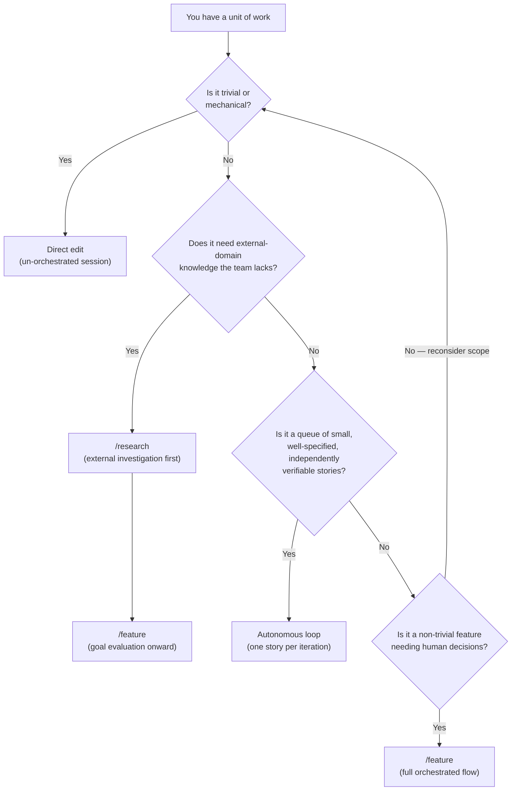

# Which workflow when

**Who this is for / What you'll learn:** Developers who have a piece of work in mind and need to route it correctly. You will learn how to choose between **direct edit** (an un-orchestrated session change), **`/feature`**, **`/research` → `/feature`**, and the **autonomous loop** — using a decision flowchart, a mode comparison table, worked scenarios, and anti-patterns to avoid.

## Four ways to work

The kit ships three orchestrated workflows plus the option to edit without invoking any of them. All orchestrated paths share the same architecture: an orchestrator coordinates, fresh-context workers execute, and skeptical evaluators gate progression. As of v0.21.0, the canonical behavior is what `skills/setup/templates/` emits via `/setup`; this document compares modes only — mechanics of each workflow live in the linked guides below.

| Mode | When to choose it | Deep dive |
|------|-------------------|-----------|
| **Direct edit** | Trivial or mechanical change; no goal, contracts, or evaluator cycle needed | — |
| **`/feature`** | Any **non-trivial** feature needing human alignment and decision gates | [feature-workflow.md](feature-workflow.md) |
| **`/research` → `/feature`** | Work touching an **external domain** the team must investigate before planning | [research-workflow.md](research-workflow.md) |
| **Autonomous loop** | A **backlog** of small, well-specified, independently verifiable stories | [autonomous-loop.md](autonomous-loop.md) |

## Decision flowchart

Start with one unit of work — a bug fix, a feature idea, a research topic, or a backlog story — and follow the branches below.

**How to read the chart:**

- **Direct edit** — typo fixes, comment updates, one-line mechanical changes, or config tweaks you can verify yourself in the same session. The `/feature` skill is invoked to start **any non-trivial feature**; it is not the right path for a one-line mechanical fix.
- **`/research` → `/feature`** — the research skill covers domain topics an external research agent must investigate **before** implementation. It produces a verifiable report and goal structure, then hands off to `/feature` at goal evaluation (Phase 3 onward).
- **`/feature`** — full orchestrated feature flow with human decision gates throughout. See [feature-workflow.md](feature-workflow.md).
- **Autonomous loop** — one backlog story per fresh-context iteration from `_goals/backlog.md`. Each story's acceptance criteria replace Phase 1 alignment; if a story is too ambiguous to derive a goal from, it is treated as **blocked**, not loop-suitable.

## Mode comparison

| Dimension | Direct edit | `/feature` | `/research` + `/feature` | Autonomous loop |
|-----------|-------------|------------|--------------------------|-----------------|
| **Human involvement** | You edit and verify in one session; no orchestrator phases | Orchestrator asks structured alignment questions; you confirm understanding and approve decision gates, PR draft, and escalations | Same human gates as `/feature`, plus collaborative planning after the external report is ingested | Minimal per-iteration involvement; backlog stories pre-specify acceptance criteria; human ships one PR at run end |
| **Context freshness** | Single continuous session — context accumulates | Fresh-context subagents per task and evaluation; orchestrator retains session history | Same fresh-context model as `/feature`; research report is a durable artifact before coding | One story, one fresh context per iteration; all state lives in files and git |
| **Verification guarantees** | Whatever checks you run yourself — no evaluator PASS requirement | Evaluator PASS (or APPROVED for audits) required before every phase advance; fixes always re-evaluated | Research report reviewed critically before goal creation; then full evaluator gates through `/feature` | Evaluator PASS + green ladder rungs before each story commit; same re-evaluate invariants as `/feature` Phases 2–6 |
| **Artifacts produced** | Git diff only | `_goals/<name>/` (goal, tasks, contracts, orchestration log); optional QA evidence | `_research/prompts/`, `_research/<topic>/report.md`, then `_goals/<name>/` | `_goals/backlog.md` entries, per-story commits, `_goals/LEARNINGS.md`, `_goals/ESCALATIONS.md` on failure |
| **Typical work size** | One file or a few lines; verifiable immediately | Multi-task features spanning layers; needs decomposition and contracts | Features whose design depends on external facts, APIs, or standards not yet verified | Many small stories, each sized to one context window and one commit |
| **Failure mode when misused** | Shipping unreviewed changes to complex behavior; skipping tests on non-trivial edits | Running `/feature` for a typo — heavy process, wasted evaluator cycles | Skipping research and coding against unverified external claims — confident fabrication | Running the loop on ambiguous stories — blocked iterations, wasted evaluator cycles |

## Why research first

External-domain work — unfamiliar APIs, vendor capabilities, regulatory constraints, or cross-harness behavior you have not verified — carries a fabrication risk. Implementation grounded on **unverified external claims** produces confident-sounding code and docs that fail on first contact with reality. The kit's evaluation principles treat anti-invention as binding: claims must trace to read sources.

The `/research` workflow exists to produce a **verifiable report before goal creation**.

For the full prompt/report/ingestion flow, see [research-workflow.md](research-workflow.md).

**Real example:** [Multi-harness upgrade research](../research-multi-harness-upgrade.md) grounded harness capability claims — model tiers, fallback behavior, Copilot and Cursor caveats — before those patterns were adopted into the canonical templates. That report is the kind of durable evidence `/research` is meant to produce; durable findings promote into the project's ground-truth reference while `_research/` stays scratch.

## Worked scenarios

Each scenario states a concrete piece of work, the chosen mode, and why that mode fits the skill sources.

### 1. Typo in a guide paragraph → direct edit

**Work:** Fix a spelling error in one sentence of an existing markdown file.

**Route:** Direct edit.

**Rationale:** The change is trivial and mechanical — no new behavior, no cross-layer impact, no external-domain investigation, and no backlog queue. Invoking `/feature` would create a full goal, contracts, and evaluator cycles for work you can verify by reading the diff. The feature skill applies to **non-trivial** features, not one-line fixes.

### 2. New subsystem calling an unfamiliar payment API → `/research` then `/feature`

**Work:** Add a billing integration against a third-party payment provider the team has never used; sandbox docs exist but no in-repo ground truth.

**Route:** `/research` → `/feature`.

**Rationale:** The research skill covers domain topics an external research agent must investigate **without codebase access**. You need to verify external facts about webhooks, idempotency keys, and error semantics before goal creation — otherwise implementers will fabricate API behavior. After the report is ingested, `/feature` with the goal already created provides full evaluator gates and human decision gates for tradeoffs the report left open.

### 3. Backlog of ten hardening stories → autonomous loop

**Work:** Ten independent stories in `_goals/backlog.md` — each adds input validation, a mocked unit test, and a doc note — with explicit acceptance criteria and disjoint `writes:` sets.

**Route:** Autonomous loop (`auto-loop` skill, invoked repeatedly by `_loop/loop.sh` or `_loop/loop.ps1`).

**Rationale:** The loop consumes **one story per iteration** from the backlog. Stories are already well-specified with acceptance criteria that replace Phase 1 alignment. Each story commits independently after evaluator PASS and doc alignment. This is the intended shape: many small, independently verifiable units — not one large feature session.

### 4. Multi-layer feature with user-facing UI and API → `/feature`

**Work:** Add a settings page, REST endpoints, and persistence for a new user preference — touches frontend, backend, and tests; several design choices need your input.

**Route:** `/feature`.

**Rationale:** Non-trivial, multi-layer work spanning UI, API, and persistence — it needs human alignment and decision gates throughout, not a pre-specified backlog queue. This is a single cohesive feature, not a collection of loop-sized stories, and there is no external-domain knowledge gap that requires `/research` first.

## Anti-patterns

These misuses waste time, burn budget, or ship unverified work. Each traces to the skill sources listed in [Sources](#sources).

### Running the loop on ambiguous or underspecified stories

The auto-loop skill states that if a story is **too ambiguous to derive a goal from**, it is **blocked**, not loop-suitable.

### Skipping `/research` for external-domain-heavy work

When work depends on external APIs, vendor docs, or standards the team has not verified, jumping straight to `/feature` invites implementation grounded on guesses. The research skill exists precisely for topics needing external investigation **before** implementation. Use `/research` to produce a report you can evaluate, then hand off to `/feature`.

### Using `/feature` for a one-line mechanical fix

The feature skill description says to invoke it to start **any non-trivial feature**. A typo, import reorder, or single-line config tweak does not need seven phases, contracts, or an orchestration log. Edit directly, run targeted checks, and commit.

### Marking orchestrated work complete without an evaluator PASS

Across `/feature`, `/research` handoff, and the autonomous loop, no phase or task advances without the required evaluator verdict — **PASS** for goals and tasks, **APPROVED** for final audits and doc audits. A worker completion report alone is not done. Fixes must be re-evaluated; there is no path to "complete" without an evaluator PASS (or APPROVED where applicable). This invariant is binding in the canonical architecture doc.

## Where to go next

- [feature-workflow.md](feature-workflow.md) — seven-phase flow, contracts, fix cycles, orchestration log
- [research-workflow.md](research-workflow.md) — prompt/report artifacts, ingestion, goal handoff
- [autonomous-loop.md](autonomous-loop.md) — drivers, backlog format, iteration lifecycle, safety guards

## Sources

Claims in this document trace to these canonical files (paths relative to `docs/guide/`):

- [`../../skills/setup/templates/skills/feature/SKILL.md`](../../skills/setup/templates/skills/feature/SKILL.md) — `/feature` applicability ("any non-trivial feature"), orchestrator/evaluator invariants, phase structure
- [`../../skills/setup/templates/skills/research/SKILL.md`](../../skills/setup/templates/skills/research/SKILL.md) — `/research` purpose (external-domain investigation before implementation), report → goal handoff at feature Phase 3
- [`../../skills/setup/templates/loop/SKILL.md`](../../skills/setup/templates/loop/SKILL.md) — one story per iteration, backlog selection, ambiguous-story blocking, feature Phases 2–6 substitution
- [`../../skills/setup/templates/ORCHESTRATION.md`](../../skills/setup/templates/ORCHESTRATION.md) — architecture: fresh context, evaluator gates, autonomous loop guards, mandatory re-evaluate invariants
- [`../../README.md`](../../README.md) — kit overview, feature list phrasing, workflow summaries as of v0.21.0
- [`../research-multi-harness-upgrade.md`](../research-multi-harness-upgrade.md) — example research artifact grounding external harness claims
