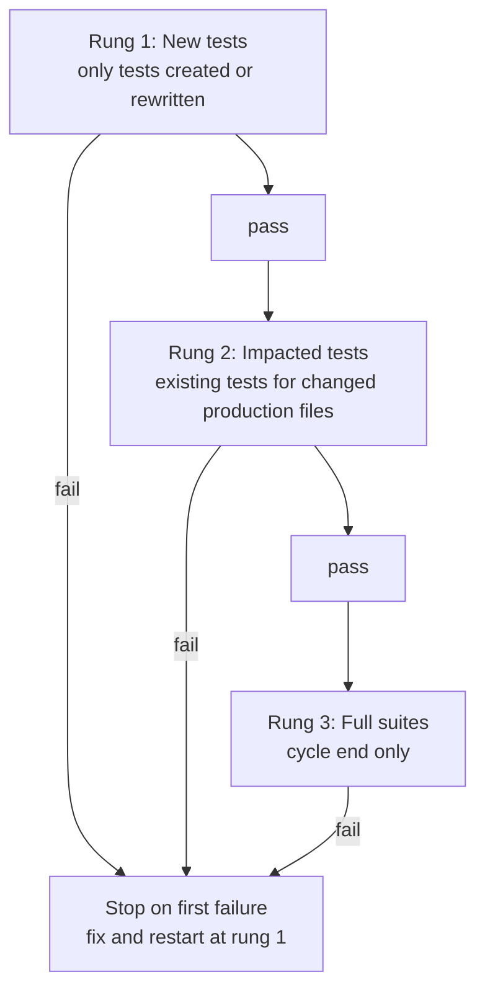
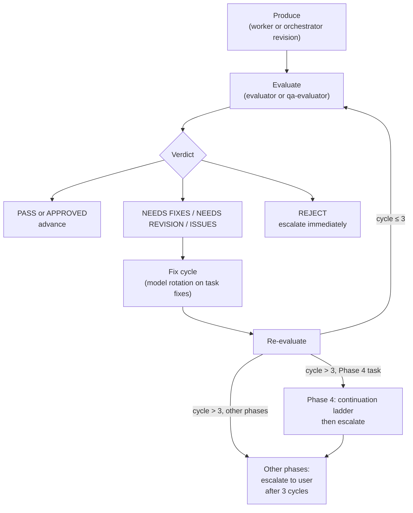

**Who this is for / What you'll learn:** Kit **users** and **contributors** who need to understand how the kit verifies work before it advances — not just *that* evaluators gate progression, but *how* they score, what each verdict means, and what evidence they require. You will learn the per-gate verdict vocabulary, the failure-class taxonomy, arbitration mode (rung 5), the confidence ladder and anti-fabrication rules, devil's advocate, pre-code contracts with two-party sign-off, `eval_depth` routing, the staged test ladder, and the orchestration log as an append-only audit trail. For where these gates sit in the seven phases, see [feature-workflow.md](feature-workflow.md); for who runs evaluation and model tiers, see [agents-and-models.md](agents-and-models.md).

# Evaluation system

The kit separates execution from verification: workers produce artifacts; evaluators read, verify, and return verdicts. This document **explains** the criteria skills and evaluator agent files — it is not a normative fork. When anything here disagrees with a canonical source, the source wins. Each section below points at its binding file under [`skills/setup/templates/`](../../skills/setup/templates/).

Phase-by-phase orchestration narrative (alignment through pull request) belongs in [feature-workflow.md](feature-workflow.md). Here we stay inside the index scope row: verdict machinery, contracts, test ladder, and audit trail.

**Canonical vs instance:** Behavior described here is what [`skills/setup/templates/`](../../skills/setup/templates/) emits via `/setup`. Your harness writes an **instance** tree (agents, skills, `ORCHESTRATION.md`) into the target project — in this repo that instance is gitignored (e.g. `.claude/`) and is not source of truth. Paths below use the canonical template location unless labeled as instance-specific.

## Per-gate verdict vocabulary

Every gate has its **own** verdict set. Never collapse them into one triple.

| Gate | Phase / context | Verdicts | Binding source |
|------|-----------------|----------|----------------|
| **Goal evaluation** | Phase 3 — goal + task files | **PASS**, **NEEDS REVISION**, **REJECT** | [`goal-criteria/SKILL.md`](../../skills/setup/templates/skills/goal-criteria/SKILL.md) |
| **Task evaluation** | Phase 4 — completed task work | **PASS**, **NEEDS FIXES**, **REJECT** | [`task-criteria/SKILL.md`](../../skills/setup/templates/skills/task-criteria/SKILL.md) |
| **Final audit** | Phase 5 — whole goal | **APPROVED**, **ISSUES** | [`feature/SKILL.md`](../../skills/setup/templates/skills/feature/SKILL.md) (Phase 5); lifecycle in [`ORCHESTRATION.md`](../../skills/setup/templates/ORCHESTRATION.md) |
| **Align-docs plan evaluation** | Phase 6.3 — doc edit plan | **PASS**, **NEEDS REVISION**, **REJECT** | [`align-docs/SKILL.md`](../../skills/setup/templates/skills/align-docs/SKILL.md) |
| **Doc audit** | Phase 6.5 — whole doc change set | **APPROVED**, **ISSUES** | [`align-docs/SKILL.md`](../../skills/setup/templates/skills/align-docs/SKILL.md) |
| **QA gate** (optional behavioral) | After Phase 5 approval, user-facing surfaces | **PASS**, **ISSUES FOUND**, **REJECT** | [`qa-criteria/SKILL.md`](../../skills/setup/templates/skills/qa-criteria/SKILL.md) |
| **Arbitration (rung 5)** | Phase 4 continuation ladder — orchestrator-invoked on unanimous same-item failure across fix cycles 1–3 (as of v0.20.0) | **criteria-sound**, **criteria-defective** (never PASS/NEEDS FIXES/REJECT) | [`agents/evaluator.md`](../../skills/setup/templates/agents/evaluator.md) § Arbitration mode |

### Source precedence: `ISSUES` vs `ISSUES FOUND`

The Phase 5 final audit unhappy path is **ISSUES** — not `ISSUES FOUND`. **`ISSUES FOUND`** belongs to the QA gate only ([`qa-criteria/SKILL.md`](../../skills/setup/templates/skills/qa-criteria/SKILL.md)).

The canonical [`ORCHESTRATION.md`](../../skills/setup/templates/ORCHESTRATION.md) progress-checklist placeholder `[APPROVED/ISSUES FOUND]` (workflow state tracking) is **not** final-audit vocabulary. The lifecycle diagram in that file correctly shows **APPROVED** / **ISSUES** for Phase 5. On apparent conflict, the feature skill and criteria skills win.

## Failure-class taxonomy (as of v0.20.0)

Every non-PASS task verdict carries `failure_class:` from this closed set ([`task-criteria/SKILL.md`](../../skills/setup/templates/skills/task-criteria/SKILL.md) § Failure-class taxonomy, [`agents/evaluator.md`](../../skills/setup/templates/agents/evaluator.md) § Verdict format): `implementation` (default) · `criteria-defect` · `destructive` · `security` · `infra`.

- **`implementation`** — default when the work is wrong or incomplete but the criteria themselves are sound; fix and retry.
- **`criteria-defect`** — the acceptance criteria or signed contract is defective; route to arbitration (ladder rung 5) or human escalation, not blind retry.
- **`destructive`** — would corrupt data, delete irrecoverable state, or cause irreversible harm.
- **`security`** — credential exposure, auth bypass, injection, or other security violation.
- **`infra`** — environment, tooling, or external dependency failure outside the implementer's control.

**Bypass consequence:** tagging `destructive`, `security`, or `infra` stops **all** retrying immediately — any cycle, not only after fix-cycle exhaustion — and escalates to the human. The evaluator tags at detection; it does not wait for the ladder to run out of attempts.

## Arbitration mode (rung 5, as of v0.20.0)

Orchestrator-invoked only — the evaluator does not self-trigger this mode ([`agents/evaluator.md`](../../skills/setup/templates/agents/evaluator.md) § Arbitration mode).

**Trigger** — unanimous same-item failure across fix cycles 1–3: every evaluator flagged the same required-fix item and it still fails after three implement→evaluate cycles.

**Model** — `{{MODEL_FRONTIER_ALT_FAMILY}}` (frontier tier, different family from the primary evaluator). Per the kit's Cursor silent-fallback caveat, the arbiter states in its verdict which model actually produced it ([`agents/evaluator.md`](../../skills/setup/templates/agents/evaluator.md) § Arbitration mode).

**Scope** — evaluates the **criteria**, never the code. Reads no diffs and scores no implementation. Execute-before-score does not apply; arbiter evidence is contract-line citation only.

**Inputs** — the task file, the signed contract, the three fix-cycle evaluator verdicts, and the three implementer reports.

**Output** — exactly one of (`criteria-sound` / `criteria-defective` — not PASS, NEEDS FIXES, or REJECT):

- **`criteria-sound`** — the criterion is well-formed; the orchestrator continues the continuation ladder at rung 4 (diagnosis-first).
- **`criteria-defective`** — name the specific criterion, state the defect type (`contradiction` / `unsatisfiable` / `untestable` / `ambiguous`), cite the contract line (e.g. acceptance criterion N in the signed contract), and escalate carrying the defect verbatim.

**Dual-evaluator rule** — if the arbiter's view of the criteria conflicts with the primary evaluator's applied interpretation, the orchestrator escalates to the human. Arbitration never auto-overrides the primary evaluator and never rewrites the contract itself.

Single stateless spawn — no cross-spawn memory. The four defect types are defined with examples in [`task-criteria/SKILL.md`](../../skills/setup/templates/skills/task-criteria/SKILL.md) § Arbitration rubric.

## Scoring stance: verdicts start unearned

Evaluators begin skeptical. Per [`goal-criteria/SKILL.md`](../../skills/setup/templates/skills/goal-criteria/SKILL.md) and the evaluator stance in [`agents/evaluator.md`](../../skills/setup/templates/agents/evaluator.md), scoring **starts at 2/5** and must be **earned** — evidence moves it up; absence keeps it down. "Looks right" is not evidence.

The QA evaluator uses the same baseline ([`agents/qa-evaluator.md`](../../skills/setup/templates/agents/qa-evaluator.md)).

## Hard per-criterion threshold (gates, not averages)

Dimensions in each criteria skill are **gates, not averages** — one failing dimension caps the verdict no matter how strong the rest are:

| Evaluation type | One failing dimension caps at |
|-----------------|------------------------------|
| Goal evaluation | **NEEDS REVISION** |
| Task evaluation | **NEEDS FIXES** |
| QA evaluation | **ISSUES FOUND** |

Sources: [`goal-criteria/SKILL.md`](../../skills/setup/templates/skills/goal-criteria/SKILL.md), [`task-criteria/SKILL.md`](../../skills/setup/templates/skills/task-criteria/SKILL.md), [`qa-criteria/SKILL.md`](../../skills/setup/templates/skills/qa-criteria/SKILL.md).

## Confidence ladder and anti-fabrication

Evaluators mark every checked claim on the confidence ladder defined in [`agents/evaluator.md`](../../skills/setup/templates/agents/evaluator.md):

| Mark | Meaning |
|------|---------|
| **✅ Verified** | You checked it yourself |
| **⚠️ Unverified** | No way to check — say so |
| **❌ Contradicted** | Evidence disagrees |
| **🔍 Needs investigation** | Unclear; needs follow-up |

### Existence checks

Any "X exists" claim must be **checked, never assumed**: file paths exist in the repo, function/type signatures match source, package versions exist, URLs resolve, quoted text is verbatim, config keys are real.

- No tool or access to verify ⇒ **⚠️ Unverified, never ✅**.
- Never invent numbers, benchmarks, or "production results".
- Any **❌ Contradicted** claim caps the task verdict at **NEEDS FIXES**.

Task evaluation applies the ladder per requirement ([`task-criteria/SKILL.md`](../../skills/setup/templates/skills/task-criteria/SKILL.md)): one **⚠️ Unverified** requirement caps at **NEEDS FIXES**; any **❌ Contradicted** claim does too.

### Execute before you score

Evaluators must **run** targeted tests and commands before writing a verdict. Reading the report or diff alone is insufficient. If the verdict's "What I verified" section shows no execution evidence (a command run plus its output), the verdict is invalid ([`agents/evaluator.md`](../../skills/setup/templates/agents/evaluator.md)). As of v0.20.0, arbitration mode is the exception: no code is under review, so execute-before-score does not apply; arbiter evidence is contract-line citation only ([`agents/evaluator.md`](../../skills/setup/templates/agents/evaluator.md) § Arbitration mode).

### Calibration exemplars (as of v0.19.0)

Introduced in kit v0.18.0, the evaluator agent file includes two **illustrative shape** exemplars — not verbatim scripts to copy:

1. **NEEDS FIXES exemplar** — resists the "talk-yourself-into-a-PASS" pattern: an edge-case failure is found, the temptation is to soften it, but the issue stays in the Issues found list and the verdict remains **NEEDS FIXES**.
2. **PASS exemplar** — every requirement maps to a proving command; each is **✅ Verified** with the command shown.

See [`agents/evaluator.md`](../../skills/setup/templates/agents/evaluator.md) § Calibration exemplars.

## Devil's advocate (goal evaluation)

Every goal evaluation includes a mandatory devil's advocate section ([`goal-criteria/SKILL.md`](../../skills/setup/templates/skills/goal-criteria/SKILL.md) §6). Produce all five parts — informative, **never a veto on its own**:

1. **Steelman the strongest alternative approach** — the strongest version, not a strawman.
2. **Load-bearing assumptions** — things the goal treats as fixed that are actually choices.
3. **30-day pre-mortem** — "it's a month later and this shipped and failed; what happened?"
4. **At least one concrete alternative sketch** — so the chosen direction is a *chosen* direction.
5. **Risk acceptance** — which surfaced risks the goal implicitly accepts.

A DA finding forces **NEEDS REVISION** **only** when it reveals an **unaddressed risk** that a success criterion or task should cover — not merely because an alternative exists.

## Pre-code contracts

As of v0.19.0, every v0.18.0+ goal task passes through a **contract gate** before implementation dispatch ([`feature/SKILL.md`](../../skills/setup/templates/skills/feature/SKILL.md) Phase 4).

### Why contracts precede implementation

Contracts are proposed in **contract mode** before any implementation spawn. Contract mode **never reviews code**. The contract is the testable expansion of the task file — not a second scope source. The orchestrator refuses dispatch until both parties sign off.

### Contract template shape

Per [`feature/templates/contract.md`](../../skills/setup/templates/skills/feature/templates/contract.md), each contract file includes:

| Section | Purpose |
|---------|---------|
| `task_id` | Must match the task file id exactly |
| `done_definition` | One paragraph: what "done" looks like, verifiable unaided |
| `acceptance_criteria` | Numbered list; each criterion has an explicit **verification method** (unit test, integration test, command output, live interaction, screenshot) |
| `verification_environment` | CLI, API, browser, or library |
| `out_of_scope` | Explicit exclusions |
| `signoff` YAML | `worker` + `evaluator`, each with `agreed`, `timestamp`, `note`; `revision` 0–2 |

Both `signoff.worker.agreed: true` and `signoff.evaluator.agreed: true` are required before implementation dispatch.

### Max-2-round contract gate

Contract review is bounded to **max 2 rounds** — each round is a single stateless spawn. A 3rd round is **never** attempted; the orchestrator tiebreaks or escalates to the user. Sign-offs are appended to the orchestration log as their own entries.

Task evaluation under v0.18.0+ goals also verifies the signed contract exists and every acceptance criterion is addressed ([`task-criteria/SKILL.md`](../../skills/setup/templates/skills/task-criteria/SKILL.md) § Contract verification).

## Evaluation depth (`eval_depth: full|light`)

As of v0.19.0, every v0.18.0+ task file declares `eval_depth: full` or `eval_depth: light` in its ownership block ([`goal-criteria/SKILL.md`](../../skills/setup/templates/skills/goal-criteria/SKILL.md) § Evaluation depth).

| Rule | Detail |
|------|--------|
| Who sets it | Orchestrator at planning time only — workers never set it |
| `light` is never a skip | Every task still ends in a real verdict: **PASS** / **NEEDS FIXES** / **REJECT** |
| Unexplained `light` | A **NEEDS REVISION** finding at goal evaluation |
| Missing field | Fails closed to `full` — flag in output; do not reject the goal for omission alone |
| Stated reason | Required in the task file or goal Discovery Summary when `light` is assigned |

### Light rubric (shortened, not skipped)

Under `eval_depth: light` ([`task-criteria/SKILL.md`](../../skills/setup/templates/skills/task-criteria/SKILL.md) § Light evaluation rubric):

**Runs in full (gate the verdict):**

- Requirements walk (dimension 1)
- Test evidence (dimension 4)
- Write fence (dimension 5)
- Contract verification (hard gate regardless of depth)

**Deep review skipped:**

- Correctness (dimension 2)
- Reuse & patterns (dimension 3)

Auto-fail triggers still apply.

## Ownership-contract verification (goal evaluation)

At goal evaluation, the evaluator verifies write-set disjointness ([`goal-criteria/SKILL.md`](../../skills/setup/templates/skills/goal-criteria/SKILL.md) §3). Seven checks — summarized here, not reproduced verbatim:

1. **Declarations complete** — non-empty `writes`; `reads` are interface briefs unless `depends_on` orders after the producer; `depends_on` names every consumed producer; rewrite semantics stated; `owner` is `implementer` or `test-writer`.
2. **Coverage** — union of all `writes` equals the goal's intended file set; no orphan edits, no unplanned owned paths.
3. **Pairwise disjointness** — tasks without ordering between them have non-intersecting `writes`.
4. **Single owner** — no file in more than one task's `writes` unless tasks are strictly ordered.
5. **Acyclic dependencies** — the `depends_on` graph is a DAG.
6. **Contracts first** — shared interfaces/schemas frozen in an earlier task than consumers.
7. **Hotspots** — shared high-traffic files owned by one task or serialized by dependency; never concurrently written.

**Orchestrator-owned carve-out:** `_goals/` artifacts (goal files, orchestration log, contracts) and Phase 6 doc surfaces listed in the align-docs map sit **outside** the task write-set union — coverage and single-owner apply to task-owned product files only.

Any violation of the seven checks is **NEEDS REVISION**. A missing ownership block is also **NEEDS REVISION** (fail closed).

## Staged test ladder

The [`test-ladder/SKILL.md`](../../skills/setup/templates/skills/test-ladder/SKILL.md) skill governs when tests run. Workers climb rungs 1–2 mid-cycle; rung 3 runs once at cycle end.

### Who runs each rung

| Role | Allowed rungs |
|------|---------------|
| `implementer` | 1 then 2. Rung 3 only on a goal's **designated closer task** with a written mandate in its task file. |
| `test-writer` | 1 then 2. Same closer-task carve-out. |
| `evaluator` | Requires evidence of rungs 1–2. Does **not** fail a task for skipping rung 3 (unless the closer task's own requirements mandate it). |
| Feature orchestrator | After final audit **APPROVED**: delegates rung 3 by spawning **`terminal`** — never runs the full suite inline in the orchestrator session. |
| `terminal` | Executes the spawned command; returns only the requested result shape. Rung 3 is always a `terminal` spawn. |

A spawned `terminal` is **not** a designated closer task — the carve-out requires a worker (`implementer`/`test-writer`) with a task file that names the full-suite run. Phase 5 Quality Checks still run at cycle end regardless.

## Evaluation loop (produce → evaluate → fix)

Around each unit of work (goal, task, audit), the same loop applies. Max **3 cycles** before escalation — as of v0.20.0, Phase 4 task execution enters the **continuation ladder** (rungs 5→4→6) on exhaustion before terminal escalation ([`ORCHESTRATION.md`](../../skills/setup/templates/ORCHESTRATION.md) § Continuation ladder); a bypass-class verdict (`destructive`, `security`, or `infra`) stops all retrying at detection from any cycle. All other loops (goal evaluation, final audit, align-docs) still escalate directly after 3 cycles. See [feature-workflow.md](feature-workflow.md) for rung mechanics.

### Fix-cycle model rotation

On task **NEEDS FIXES**, fix cycles rotate models ([`feature/SKILL.md`](../../skills/setup/templates/skills/feature/SKILL.md)) — a model blind to its own mistake rarely fixes it on retry:

- **Cycle 1** — re-run the implementer normally.
- **Cycle 2** — pin a **different model family** at comparable tier.
- **Cycle 3** — pin the **frontier tier** (see the model map's rotation table).

Each rotation is recorded in the orchestration log. For who evaluates and tier details, see [agents-and-models.md](agents-and-models.md).

### Re-evaluation invariants

Fixes and revisions are **always** re-evaluated — there is no exception ([`feature/SKILL.md`](../../skills/setup/templates/skills/feature/SKILL.md), [`ORCHESTRATION.md`](../../skills/setup/templates/ORCHESTRATION.md) § Mandatory Re-Evaluate Invariants). The orchestration log makes these invariants and rotations **auditable**.

## Orchestration log (append-only audit trail)

Each goal maintains `_goals/[goal-name]/orchestration-log.md` ([`feature/SKILL.md`](../../skills/setup/templates/skills/feature/SKILL.md) § Orchestration log).

**Entry-before-launch** — append before every subagent spawn:

- Timestamp, agent, model (and any rotation/fallback)
- Why this agent was routed
- The task's `writes` claim (allowed-paths fence)
- Expected outputs

**Outcome-after** — when the agent returns, append the outcome (report received, files verified, verdict) as a **new line under that entry**. Never write placeholder pending lines (`"Outcome: (pending)"`, `"TBD"`) — an entry with no outcome line yet **is** the pending state.

**Append-only:** never edit or delete entries. Rejections and respawns are new entries.

The ledger is what makes re-evaluation invariants and fix-cycle model rotation **verifiable** after the fact — maintainers compare logged verdicts against what actually happened afterward when tuning criteria skills ([`agents/evaluator.md`](../../skills/setup/templates/agents/evaluator.md) tuning note).

## QA behavioral gate (optional)

After Phase 5 **APPROVED** and Quality Checks, the orchestrator may capture behavioral evidence and launch `qa-evaluator` ([`feature/SKILL.md`](../../skills/setup/templates/skills/feature/SKILL.md) Phase 5 optional QA gate, [`ORCHESTRATION.md`](../../skills/setup/templates/ORCHESTRATION.md) § QA Evaluation).

The QA evaluator evaluates **observed user-facing behavior**, not code ([`agents/qa-evaluator.md`](../../skills/setup/templates/agents/qa-evaluator.md)). Evidence not provided = behavior not tested = an issue. Verdicts: **PASS**, **ISSUES FOUND**, **REJECT** per [`qa-criteria/SKILL.md`](../../skills/setup/templates/skills/qa-criteria/SKILL.md). QA never fixes — fixes flow through implementer + evaluator, then QA re-runs.

## Where to go next

- **Phase placement** — [feature-workflow.md](feature-workflow.md) maps each gate to Phases 3–6 and shows the contract gate inside Phase 4.
- **Who evaluates** — [agents-and-models.md](agents-and-models.md) covers `evaluator`, `qa-evaluator`, the `diagnostician` (rung 4 diagnosis), evaluator arbitration mode, model tiers, and spawn boundaries.
- **Index and conventions** — [README.md](README.md) document map and frozen link/Mermaid rules.

## Sources

Canonical template paths (relative to repo root):

- [`skills/setup/templates/skills/goal-criteria/SKILL.md`](../../skills/setup/templates/skills/goal-criteria/SKILL.md) — goal dimensions, devil's advocate, ownership checks, `eval_depth`, goal verdicts
- [`skills/setup/templates/skills/task-criteria/SKILL.md`](../../skills/setup/templates/skills/task-criteria/SKILL.md) — task dimensions, light rubric, contract verification, task verdicts, failure-class taxonomy, arbitration rubric
- [`skills/setup/templates/skills/qa-criteria/SKILL.md`](../../skills/setup/templates/skills/qa-criteria/SKILL.md) — QA gate criteria and **ISSUES FOUND** vocabulary
- [`skills/setup/templates/skills/align-docs/SKILL.md`](../../skills/setup/templates/skills/align-docs/SKILL.md) — Phase 6.3 plan evaluation and Phase 6.5 doc audit verdicts
- [`skills/setup/templates/skills/feature/SKILL.md`](../../skills/setup/templates/skills/feature/SKILL.md) — contract gate, fix-cycle rotation, orchestration log, Phase 5 **APPROVED** / **ISSUES**
- [`skills/setup/templates/skills/test-ladder/SKILL.md`](../../skills/setup/templates/skills/test-ladder/SKILL.md) — rung definitions and role ownership
- [`skills/setup/templates/skills/feature/templates/contract.md`](../../skills/setup/templates/skills/feature/templates/contract.md) — contract template shape and sign-off fields
- [`skills/setup/templates/agents/evaluator.md`](../../skills/setup/templates/agents/evaluator.md) — stance, confidence ladder, anti-fabrication, execute-before-score, calibration exemplars, failure-class taxonomy, arbitration mode
- [`skills/setup/templates/agents/qa-evaluator.md`](../../skills/setup/templates/agents/qa-evaluator.md) — behavioral-evidence stance
- [`skills/setup/templates/ORCHESTRATION.md`](../../skills/setup/templates/ORCHESTRATION.md) — lifecycle diagram, continuation ladder (Phase 4), retry limits by phase table, re-evaluation invariants, QA section
- [`docs/guide/README.md`](README.md) — frozen conventions and document map
