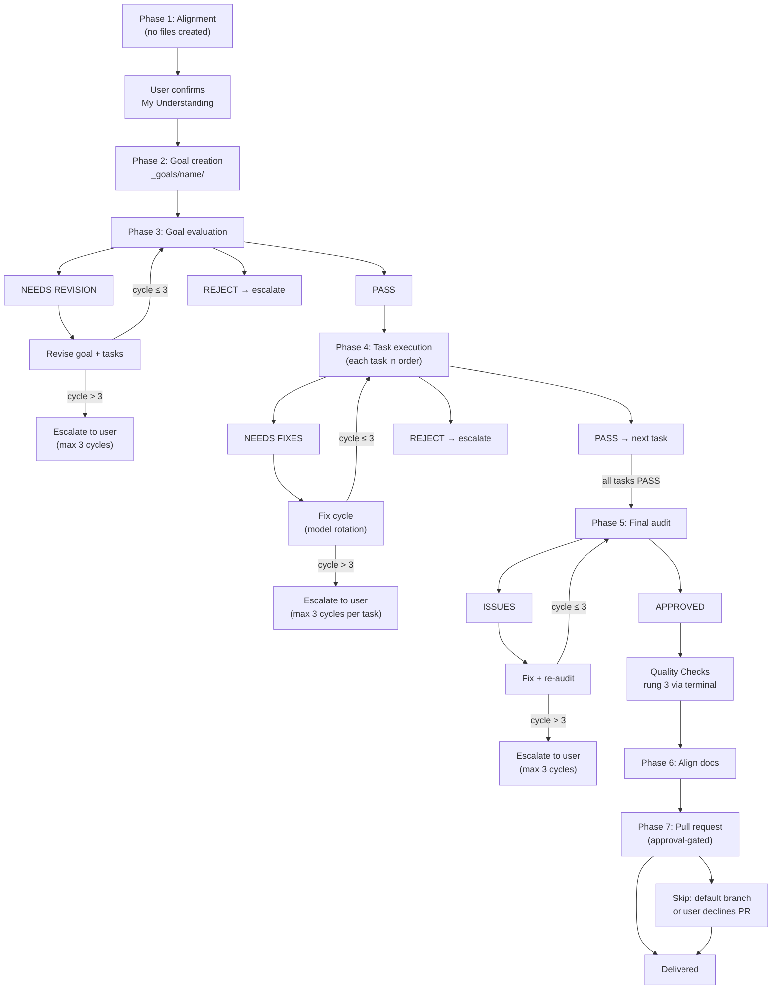
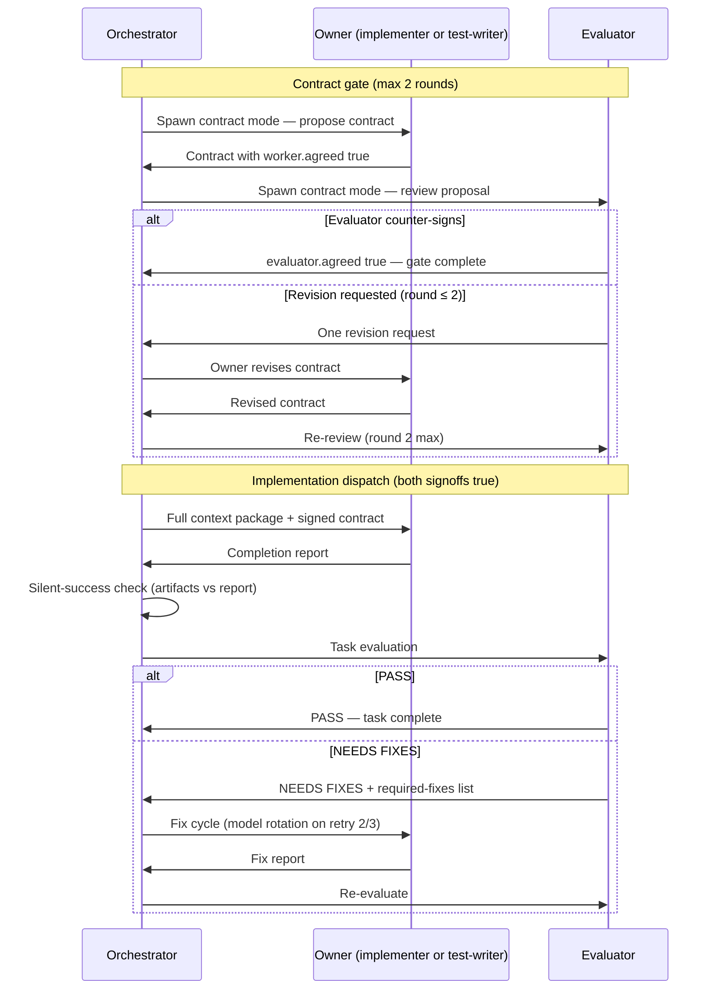

**Who this is for / What you'll learn:** Kit **users** running non-trivial features through `/feature`, and **contributors** who need to understand what the orchestrator actually does phase by phase. You will learn the seven-phase lifecycle — alignment through pull request — including the contract gate, per-gate verdict vocabulary, fix-cycle model rotation, escalation exits, the orchestration log, and orchestrator iron rules. For verdict rubrics and criteria depth see [evaluation-system.md](evaluation-system.md); for who gets spawned and model tiers see [agents-and-models.md](agents-and-models.md). To choose `/feature` over other modes, start with [decision-guide.md](decision-guide.md).

# Feature workflow (`/feature`)

The `/feature` skill is the canonical coordinator for non-trivial implementation. As of v0.19.0, it runs seven evaluator-gated phases: the orchestrating session **coordinates only** — it prepares context packages, spawns subagents, interprets verdicts, and decides what happens next. All product code changes go to `implementer` or `test-writer`; all verification goes to `evaluator` (and optionally `qa-evaluator` after Phase 5). The canonical source is [`skills/setup/templates/skills/feature/SKILL.md`](../../skills/setup/templates/skills/feature/SKILL.md); your emitted instance lives under your harness's skills tree after `/setup`.

## Seven-phase overview



Each gate uses its **own** verdict vocabulary — never collapsed:

| Phase | Gate | Loop verdict | Exit verdict | Max cycles |
|-------|------|--------------|--------------|------------|
| 3 | Goal evaluation | **NEEDS REVISION** | **PASS** | 3 revise→re-evaluate |
| 4 | Task evaluation | **NEEDS FIXES** | **PASS** | 3 implement→evaluate per task |
| 5 | Final audit | **ISSUES** | **APPROVED** | 3 fix→re-audit |

Phase 4 also has a **contract gate** (max 2 propose→review rounds) before implementation dispatch — see below.

## Phase 4 task lifecycle (one task)



Contract gate details: both `signoff.worker.agreed` and `signoff.evaluator.agreed` must be `true` before step 1 (implementation). If round 2 ends without agreement, the orchestrator tiebreaks or escalates — never proceeds on an unresolved contract. For contract sign-off schema and criteria depth, see [evaluation-system.md](evaluation-system.md). For which agent owns which task, see [agents-and-models.md](agents-and-models.md).

---

## Phase 1 — Alignment

**No files are created.** The orchestrator asks 5–20 structured multiple-choice questions covering the problem, affected layer/lane, external surfaces, auth/permissions, error behavior, interface shape, existing patterns, and priority. Follow-up rounds run as needed.

The orchestrator presents a **"My Understanding"** summary and **waits for explicit user confirmation** before Phase 2. There is no silent advance.

---

## Phase 2 — Goal creation

Creates `_goals/[goal-name]/` containing:

| Artifact | Template | Purpose |
|----------|----------|---------|
| `goal.md` | [`templates/goal.md`](../../skills/setup/templates/skills/feature/templates/goal.md) | Problem, Phase 1 Q&A summary, success criteria, constraints, task table |
| `NN-task-name.md` | [`templates/task.md`](../../skills/setup/templates/skills/feature/templates/task.md) | One file per task, dependency order |
| `orchestration-log.md` | (orchestrator-owned) | Append-only spawn ledger — started empty |

Every task file carries an **ownership contract** block:

```yaml
writes:              # ONLY paths this task may create or modify
reads:               # read-only interface briefs
depends_on:          # quoted task id prefixes, e.g. "01-name"
owner: implementer   # or test-writer
rewrite_semantics: whole-file   # or targeted-insertion
eval_depth: full     # orchestrator-set; see evaluation-system.md
```

Before Phase 3, the orchestrator verifies **write-set disjointness**: for every pair of tasks without a `depends_on` ordering, their `writes` sets must not intersect.

**Contract-first rule:** if the goal touches a shared boundary or interface, the first task defines and freezes it; every consumer lists that task in `depends_on`.

**Decision gate:** if a task has multiple viable approaches, the orchestrator presents tradeoffs and **waits** — it does not pick silently.

---

## Phase 3 — Goal evaluation

Launch `evaluator` with `goal.md`, all task files, Phase 1 Q&A, and [`goal-criteria`](../../skills/setup/templates/skills/goal-criteria/SKILL.md) (path varies by emitted instance).

| Verdict | Action |
|---------|--------|
| **PASS** | Proceed to Phase 4 — the **only** exit |
| **NEEDS REVISION** | Revise flagged items, re-evaluate (max 3 cycles) |
| **REJECT** | Escalate to user |

Every revision is re-evaluated. There is no path to Phase 4 without an evaluator **PASS** on the current revision.

---

## Phase 4 — Task execution

For each task in dependency order:

### Contract gate (once per task, before implementation)

1. Owner agent (`implementer` or `test-writer` per the task's `owner` field) proposes `_goals/[goal]/contracts/NN-task-name.contract.md` from [`templates/contract.md`](../../skills/setup/templates/skills/feature/templates/contract.md).
2. `evaluator` in **contract mode** counter-signs or returns exactly one revision request.
3. Bounded to **max 2 rounds** (stateless spawns).
4. Implementation dispatch is refused until both `signoff.worker.agreed` and `signoff.evaluator.agreed` are `true`.

For trivial tasks, the orchestrator may draft the contract directly.

### Implementation loop

1. Launch owner with full context package (includes signed contract).
2. Receive completion report. **Silent-success check:** empty/missing report but expected artifacts present ⇒ treat as completed (note "report lost, files verified"); no artifacts ⇒ respawn once. Never re-run a task whose artifacts already exist.
3. Launch `evaluator` with task file, report, and task-criteria.
4. Handle verdict:

| Verdict | Action |
|---------|--------|
| **PASS** | Mark complete, next task |
| **NEEDS FIXES** | Fix cycle with evaluator's required-fixes list, re-evaluate (max 3 cycles) |
| **REJECT** | Escalate |

### Fix-cycle model rotation

As of v0.19.0, retries rotate models to escape self-review blindness:

| Cycle | Model choice |
|-------|--------------|
| 1 | Normal implementer (light tier) |
| 2 | **Different model family** at comparable tier |
| 3 | **Frontier tier** |

Each rotation is recorded in the orchestration log. Tier and family details live in [agents-and-models.md](agents-and-models.md).

Workers climb test-ladder **rungs 1–2** only during Phase 4; rung 3 is reserved for Phase 5.

---

## Phase 5 — Final audit

Launch `evaluator` in **audit mode** over the whole goal: every task's requirements, cross-task integration, regressions.

| Verdict | Action |
|---------|--------|
| **APPROVED** | Run **Quality Checks** (test-ladder rung 3) |
| **ISSUES** | Fix via executor + re-evaluate (rungs 1–2), then re-audit (max 3 cycles) |

**Quality Checks** run via a spawned `terminal` subagent with the project's full-suite command — the orchestrator **never** runs the full suite inline. If `terminal` returns non-zero, the orchestrator reads the failure excerpt or log tail and routes a narrow fix — it does not dump the full suite into the session.

Optional: after approval, capture behavioral evidence and launch `qa-evaluator` for user-facing surfaces.

---

## Phase 6 — Align docs

Read and execute [`align-docs/SKILL.md`](../../skills/setup/templates/skills/align-docs/SKILL.md):

1. **Discover** shipped change surface (read-only: goal files + git diff).
2. **Map** changes to affected docs; build per-doc edit list.
3. **Evaluate** the edit plan (`evaluator`) — PASS / NEEDS REVISION / REJECT, 3-cycle limit.
4. **Execute** per doc via `implementer`; evaluate each doc (3 cycles max per doc).
5. **Final doc audit** — APPROVED / ISSUES, 3-cycle limit.

**Rules:** docs-only (never code); `_research/` and `_goals/` are **read-only**; anti-invention (every claim traces to a file read this run); surgical edits over rewrites.

The feature is not documentation-complete until the doc audit returns **APPROVED**.

---

## Phase 7 — Pull request

Read and execute [`ship-pr/SKILL.md`](../../skills/setup/templates/skills/ship-pr/SKILL.md):

1. Gather branch + commit context; detect base branch.
2. Analyze diff and commits.
3. Draft PR title + body (executive summary + technical breakdown).
4. **Show draft and wait for user approval.**
5. Push if needed; create PR with `gh`.
6. Report PR URL.

**Skip conditions:** work happened directly on the default branch (say so), or the user declines a PR. The PR is **never** created before approval.

---

## Orchestrator iron rules

These are user-visible behaviors enforced throughout all phases:

| Rule | Behavior |
|------|----------|
| **Never edit product code** | The orchestrating session coordinates only — context packages, spawns, verdicts, decisions. Spawning `terminal` for Quality Checks is coordination, not implementation. |
| **Every fix is re-evaluated** | Fixes and revisions are **always** re-verified by an evaluator. No exception. |
| **No phase advances without verdict** | Phase 4 tasks need evaluator **PASS**; Phase 5 needs **APPROVED**; Phase 3 needs **PASS** on the goal. |
| **Max 3 cycles, then escalate** | Goal evaluation, task execution, and final audit each cap at 3 evaluation cycles. Contract gate caps at 2 rounds. |

### Escalation format

When cycles exhaust, the orchestrator presents:

```markdown
## Escalation Required
**Phase**: [phase] · **Issue**: [what went wrong] · **Attempts**: [what was tried]
**Options**: 1. [option + tradeoffs] 2. [option + tradeoffs]
**What I need from you**: [specific decision]
```

---

## Orchestration log

Path: `_goals/[goal-name]/orchestration-log.md` — an **append-only spawn ledger**.

**Before every subagent launch**, append an entry with:

- Timestamp
- Agent (+ model / rotation if applicable)
- Routing reason
- Task's `writes` claim (allowed-paths fence)
- Expected outputs

**After the subagent returns**, append the outcome (report received, files verified, verdict) as a **new line under that entry**.

**Never write placeholder status lines** such as `Outcome: (pending)` or `TBD` — under append-only semantics they can never be resolved in place and rot into stale text. An entry with no outcome line yet **is** the pending state.

Entries are never edited or deleted. Rejections and respawns are new entries. This ledger makes re-evaluation invariants and fix-cycle rotation auditable.

---

## Your role at human touchpoints

These are what **you** do in a typical `/feature` run — separate from any specific exemplar below:

| Touchpoint | When | Your action |
|------------|------|-------------|
| **Alignment** | Phase 1 | Answer structured MCQs; confirm "My Understanding" before goal creation |
| **Decision gates** | Phase 2 (and elsewhere) | Choose between viable approaches when the orchestrator presents tradeoffs |
| **PR approval** | Phase 7 (when it runs) | Review the drafted PR title and body; approve or request edits before push/create |
| **Escalations** | Any phase after 3 failed cycles | Respond with a decision from the options the orchestrator presents |

You are not expected to spawn subagents, write contracts, or run Quality Checks — those are orchestrator responsibilities.

---

## Condensed annotated walkthrough: `loop-ps1-slot-interpolation-fix`

The following condenses a **real** goal from this repo's `_goals/` history. Those files are **local run artifacts** (gitignored in this repo) — the quotes below are evidence snapshots, not tracked source files. Delivery was a **local merge**, not a PR.

### Phase 1 — Alignment

> **Parallel development** (explicit user choice): task 01 runs in an isolated git worktree on its own branch (`fix/loop-ps1-slot-interpolation`, based on HEAD `15e7f18`); tasks 01 and 02 execute concurrently.

> **Delivery**: no PR. After the final audit, the orchestrator merges the branch into `master` locally per the Delivery Procedure below.

The user chose parallel worktrees to avoid clobbering an in-flight v0.19.0 feature and declined a GitHub PR in favor of a local merge after audit.

### Phase 2 — Goal creation

> Created goal.md, 01-canonical-slot-fix.md, 02-checks-regression-tripwire.md.

> Write-set disjointness verified: 01 = {skills/setup/templates/loop/loop.ps1 (branch-side)}; 02 = {.claude/checks.sh, .claude/checks.ps1, orchestration-kit.manifest.json} — no intersection, depends_on both [].

Two parallel tasks with disjoint fences: canonical template fix in an isolated worktree, instance checks twins in the main tree.

### Phase 3 — Goal evaluation

> Verdict: NEEDS REVISION, 3/5 (model self-reported: Claude Opus 5).

Cycle 1 flagged five required revisions: (1) closer/parallel contradiction; (2) task-02 reads of task-01-owned file without an edge; (3) task 01 reading list unreachable in worktree; (4) best-of-n-runner dispatch undocumented vs owner: implementer; (5) delivery procedure unverifiable. After two revision rounds:

> Verdict: PASS, 4/5 (model self-reported: Claude Opus 5). Phase 3 COMPLETE.

Three cycles used; the only exit to Phase 4 was evaluator **PASS**.

### Phase 4 — Task execution

> CONTRACT GATE COMPLETE for both tasks: 01 rev 0 (worker+evaluator true), 02 rev 1 (worker+evaluator true).

Contract gate ran before parallel dispatch — task 01's contract was orchestrator-drafted under the trivial-task provision; implementation ran via best-of-n-runner carrying the implementer role (+4/−4). Task 02's test-writer needed one revision round.

> Task 01 (best-of-n-runner ⇒ implementer role): COMPLETE. ACTUAL branch name: `fix/loop-ps1-slot-interpolation` … --stat = 1 file, +4/−4

> Task 01: PASS 5/5 … Task 02: PASS 5/5

Both tasks passed on cycle 1/3 with no fix cycles needed.

### Phase 5 — Final audit

> APPROVED, 5/5 (model: Claude Opus 5). PHASE 5 AUDIT COMPLETE.

> `bash .claude/checks.sh` → exit 1. … exactly one FAIL, verbatim: `FAIL: J: kitVersion==VERSION join — VERSION=0.19.0 kitVersion=0.18.0`.

Quality Checks ran via `terminal` spawn (rung 3). The auditor ruled the suite green-except-J-kitVersion — a pre-existing mismatch from a concurrent feature, not this goal's work.

### Phase 6 — Align docs

> Doc greps: zero tracked docs mention $Slot/slot interpolation; checks.sh
  mentions are skills/setup/SKILL.md:278 (twin pattern — still accurate) and
  docs/design-parallel-dispatch.md (… annotate-only territory, no substance drift).

> Per-doc edit list: EMPTY — "no change, already accurate" for every bucket
  in the surface map (… no harness-capability finding for the research docs
  or matrix).

> Plan PASS 5/5; doc audit APPROVED 5/5 … PHASE 6 COMPLETE — zero doc edits, no-op independently challenged and confirmed

No tracked docs mentioned the fixed `$Slot:` strings; the empty edit list was evaluator-challenged and approved.

### Phase 7 — Pull request (skipped)

> Phase 7 SKIPPED by explicit user decision (no PR; local merge delivered).

> master: 15e7f18 → 81cd293 (fix) → 5825729 (merge). 2 ahead of origin/master; NOT pushed (no push without user instruction).

Delivery instead followed the goal's Delivery Procedure: merge commit `5825729` on `master` with byte-identical pre/post digests. **No PR was created** — that is the real outcome of this run.

---

## Related guides

- [decision-guide.md](decision-guide.md) — when to choose `/feature` vs `/research`, autonomous loop, or direct edit
- [evaluation-system.md](evaluation-system.md) — verdict vocabulary, confidence ladder, contract sign-off, test ladder rungs, eval_depth
- [agents-and-models.md](agents-and-models.md) — five subagent roles, model tiers, rotation table, harness caveats

## Sources

- [`skills/setup/templates/skills/feature/SKILL.md`](../../skills/setup/templates/skills/feature/SKILL.md) — canonical seven-phase workflow
- [`skills/setup/templates/skills/feature/templates/goal.md`](../../skills/setup/templates/skills/feature/templates/goal.md) — goal artifact shape
- [`skills/setup/templates/skills/feature/templates/task.md`](../../skills/setup/templates/skills/feature/templates/task.md) — task + ownership contract shape
- [`skills/setup/templates/skills/feature/templates/contract.md`](../../skills/setup/templates/skills/feature/templates/contract.md) — pre-code contract shape
- [`skills/setup/templates/skills/align-docs/SKILL.md`](../../skills/setup/templates/skills/align-docs/SKILL.md) — Phase 6 workflow
- [`skills/setup/templates/skills/ship-pr/SKILL.md`](../../skills/setup/templates/skills/ship-pr/SKILL.md) — Phase 7 workflow
- [`skills/setup/templates/ORCHESTRATION.md`](../../skills/setup/templates/ORCHESTRATION.md) — architecture invariants, retry limits, escalation format
- `_goals/loop-ps1-slot-interpolation-fix/goal.md` — exemplar goal (local gitignored artifact)
- `_goals/loop-ps1-slot-interpolation-fix/orchestration-log.md` — exemplar orchestration log (local gitignored artifact)
