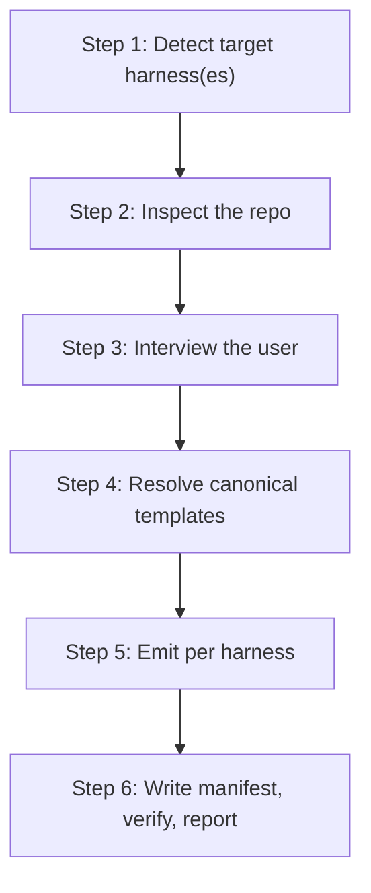

**Who this is for / What you'll learn:** Kit **users** installing the orchestrator/worker/evaluator system into their projects for the first time. You will install the `setup` skill, run `/setup` to compile canonical templates into your harness's native layout, understand what gets emitted for each supported harness, and know how to start your first `/feature` session. Upgrading, template editing, and workflow mechanics are covered in sibling guides — this document stays on the install-to-first-session path.

# Getting Started

This guide walks from zero to a working orchestration install. The kit ships as one installable `setup` skill under [`skills/setup/`](../../skills/setup/) that **compiles** a single canonical template source into each AI coding harness's native format. After install, `/setup` is the compile step — it detects your harness(es), inspects the repo, interviews you for what it cannot infer, resolves templates, emits per harness, and writes a manifest for clean upgrades.

## Install the setup skill

A public repo is NOT required — both CLIs install from this private repo as long as the machine has git access to it:

```bash
# Option A — skills CLI: clones with your LOCAL git credentials (SSH or gh auth),
# so private repos work today (vercel-labs/skills#381; see src/git.ts). Caveats
# from that thread: private repos are never indexed on skills.sh, and
# `npx skills update` is currently unreliable for private repos.
npx skills add kdcllc/skills

# Option B — agent-skills-cli: first-class private-repo support
# (SSH auto-detected; HTTPS via --token=... or GH_TOKEN=...; GitLab/Bitbucket too).
npx agent-skills-cli install git@github.com:kdcllc/skills.git
```

Or copy the skill in manually (any harness dir works — the skill detects and asks):

```bash
cp -r skills/setup  <your-project>/.claude/skills/     # Claude Code
cp -r skills/setup  <your-project>/.cursor/skills/     # Cursor
```

**Option A caveats (private repos):** the skills CLI clones with your local git credentials (SSH or `gh auth`), so private repos work today. Private repos are never indexed on [skills.sh](https://skills.sh/), and `npx skills update` is currently unreliable for private repos.

**Option B (private-repo support):** SSH is auto-detected; HTTPS works via `--token=...` or `GH_TOKEN=...`.

After any install path, open a session inside your project. The setup skill lives in your harness's skills directory; invoke it with `/setup` when you are ready to compile the full orchestration instance.

## Run `/setup`

[`skills/setup/SKILL.md`](../../skills/setup/SKILL.md) defines the compile pipeline. In order:

1. **Detect target harness(es)** — evidence from existing `.claude/`, `.cursor/`, `.github/copilot-instructions.md` or `.github/agents/`, `.codex/` or `AGENTS.md`, plus the session you are running in. Multiple harnesses is normal.
2. **Inspect the repo** — language(s), test commands, layers, user-facing surfaces, existing skills/agents/rules, external services (must be mocked in tests). Establish what you can read from code; do not ask what is already inferable.
3. **Interview the user** — project name, execution layer order, model tiers, QA surfaces, research workflow, autonomous loop, GitHub/`gh` availability, ground-truth doc — only what Steps 1–2 could not infer.
4. **Resolve the canonical templates** — in a scratch copy, replace every `{{TOKEN}}` and act on + delete every `<!-- BOOTSTRAP: ... -->` comment under [`skills/setup/templates/`](../../skills/setup/templates/).
5. **Emit per harness** — follow each target's emitter ([`claude-code.md`](../../skills/setup/emitters/claude-code.md), [`cursor.md`](../../skills/setup/emitters/cursor.md), [`copilot.md`](../../skills/setup/emitters/copilot.md), [`codex.md`](../../skills/setup/emitters/codex.md)).
6. **Write manifest, verify, report** — write `orchestration-kit.manifest.json`, run emitter verify steps, report what was emitted and how to start.



**Step 2a — Greenfield gate** runs separately from the main pipeline diagram above: it executes after Step 1 and **before** Step 2 when — and only when — the workspace is empty or near-empty (sparse). See the next section; non-sparse repos skip it entirely and proceed directly to inspect.

Everything emitted is project-specific — layer order, test commands, evaluator auto-fail triggers, and model IDs come from your codebase and interview answers, not generic placeholders. For upgrading an existing install or editing canonical templates, see [contributing.md](contributing.md) — those procedures are not repeated here.

## Greenfield gate (Step 2a)

On an empty or near-empty workspace, `/setup` runs Step 2a (the greenfield gate) and **asks** before scaffolding. It **shows** a recommended project tree and **creates nothing until you confirm**. First-class layouts are **TypeScript/Node** and **Python**; other stacks get a generic `src/` + `tests/` tree. After you confirm, it can optionally offer **skills.sh** stack skills with **1000+** installs — you pick which ones, installed **into this project**. **Existing projects are unchanged:** non-sparse repos skip the greenfield gate entirely.

The sparse heuristic (from [`skills/setup/SKILL.md`](../../skills/setup/SKILL.md) §Step 2a) treats a workspace as sparse **only if every present file** is on an allowlist (`.git/`, `.gitignore`, `LICENSE`, `README*`, `.editorconfig`, `.gitattributes`, `.DS_Store`, `Thumbs.db`, empty directories). **Any other file** — including `skills/setup/SKILL.md`, anything under `tests/` or `docs/`, a language manifest, or `main.py` — means **not sparse**. Hard rule: not sparse → skip Step 2a entirely (no scaffold offer, no skills.sh install step) and continue with Step 2 inspect.

When sparse, `/setup` **always asks** whether to scaffold; it never silently scaffolds. If you decline, it creates no scaffold files, does not run the skills.sh step, and continues with the normal inspect → interview → emit path.

On the accept path:

1. Interview the stack: **TypeScript/Node**, **Python**, or **Other**.
2. Present the matching frozen tree as a list of paths — **create nothing until you explicitly confirm** that tree.
3. After confirmation, create exactly the confirmed paths (never overwrite existing paths).
4. Optionally offer skills.sh stack skills (1000+ install floor) for the chosen stack; install project-local with `npx skills add <owner>/<repo> --skill <picked-skill> -y`.

## What `/setup` emits per harness

Each harness has an emitter under [`skills/setup/emitters/`](../../skills/setup/emitters/) that maps resolved templates into that harness's native layout. The table below summarizes destinations; paths trace to the emitter Emit sections.

| Harness | Agents | Skills | Architecture doc | Model map / pointer |
|---------|--------|--------|------------------|---------------------|
| **Claude Code** | `.claude/agents/*.md` | `.claude/skills/*` | `.claude/ORCHESTRATION.md` | `.claude/skills/setup-models.map.md`; CLAUDE.md pointer appended |
| **Cursor** | `.cursor/agents/*.md` | `.cursor/skills/*` | `.cursor/ORCHESTRATION.md` | `.cursor/skills/setup-models.map.md`; `.cursor/rules/orchestration.mdc` pointer rule |
| **GitHub Copilot (VS Code)** | `.github/agents/*.agent.md` | `.github/skills/` when supported | `ORCHESTRATION.md` at repo root | Pointer appended to `.github/copilot-instructions.md` |
| **OpenAI Codex** | `.codex/agents/*.md` (bodies) | — (roles in TOML) | `ORCHESTRATION.md` at repo root | `.codex/config.toml` + `.codex/agents/*.toml`; short pointer appended to root `AGENTS.md` |

**Cursor self-contained tree (as of v0.19.0):** targeting Cursor emits a **self-contained** `.cursor/` tree — agents, skills, the architecture doc, the model map, and the pointer rule — with **no dependency on `.claude/`**. The Cursor emitter never reads or relies on an emitted `.claude/` tree; every file resolves `{{IDE_DIR}}` → `.cursor`. This matches the kit's canonical shipped behavior via [`skills/setup/emitters/cursor.md`](../../skills/setup/emitters/cursor.md).

**Claude Code** is the canonical format — its emitter is mostly a copy of resolved templates into `.claude/` ([`claude-code.md`](../../skills/setup/emitters/claude-code.md)).

**GitHub Copilot** emits native `.agent.md` files because subagent allowlists and model fallback arrays require that format ([`copilot.md`](../../skills/setup/emitters/copilot.md)). Skills land under `.github/skills/` when the current VS Code build supports them; otherwise content may inline into agent bodies.

**OpenAI Codex** is structurally different: role instructions live under `.codex/agents/*.md`, role config in `.codex/config.toml` and per-role `.codex/agents/*.toml`, with the full architecture doc at repo-root `ORCHESTRATION.md` (not in `AGENTS.md`, which has a size cap) ([`codex.md`](../../skills/setup/emitters/codex.md)).

When the autonomous loop is enabled, all harnesses share single-copy `_loop/` drivers (`loop.sh`, `loop.ps1`, breaker helpers, `PROMPT.md`) and a seed `_goals/backlog.md` (create if missing; never overwrite). Loop driver details belong in [autonomous-loop.md](autonomous-loop.md).

> **Instance note (this repo):** the AI Orchestration Kit dogfoods its own skill. The emitted instance (`.claude/`, `.cursor/`, `_goals/`, `_loop/`, `orchestration-kit.manifest.json`) in **this repository** is gitignored — it is not source of truth. Canonical content lives under `skills/setup/templates/`; re-run `/setup` after template edits to refresh the local instance.

## The manifest and seed files

`/setup` writes `orchestration-kit.manifest.json` at the project root. The manifest records:

- **`kitVersion`** — contents of [`skills/setup/VERSION`](../../skills/setup/VERSION) at emit time (currently `0.19.0`)
- **`files`** — map of every emitted path to its SHA-256 hash
- **`seedFiles`** — paths that are seeds, not managed content (today `_goals/backlog.md`)
- **`harnesses`**, **`options`**, **`installedAt`** — which harnesses were targeted and which optional features were enabled

Re-running `/setup` reads the manifest, diffs file hashes against the working tree to spot your local modifications, regenerates from templates, and shows a diff before overwriting anything you edited. Unmodified files update silently.

**`seedFiles` semantics:** seeds are emitted **create-if-missing, never overwritten**. Their hash is recorded at emit time but drift is expected — it is never read as user modification and is exempt from the upgrade diff-confirm flow. Today the only seed is `_goals/backlog.md`; you own its content from first install onward.

For the full upgrade procedure (VERSION bumps, re-pulling with whichever CLI you installed with, stale-file pruning), see [contributing.md](contributing.md).

## Your first session

With `/setup` complete, your project has agents, skills, an architecture doc, and (optionally) the autonomous loop — all filled in for your stack and interview answers.

**Start your first feature with `/feature`.** That invokes the seven-phase orchestrator/worker/evaluator workflow. The phase-by-phase mechanics, contract gate, fix-cycle rotation, and orchestration log usage are documented in [feature-workflow.md](feature-workflow.md) — not repeated here.

**Choosing a workflow:** not every change needs `/feature`. For direct edits, `/research` → `/feature`, or the autonomous loop, use [decision-guide.md](decision-guide.md) — it routes between the four modes with a decision flowchart and comparison table.

**Autonomous loop (sandbox first):** if you plan an unattended loop run, sandbox the environment before invoking the drivers. Start your first feature with `/feature`; start an unattended run (**sandboxed!**) with `_loop/loop.sh 10` (or `pwsh _loop/loop.ps1 10` — PowerShell 7+). Driver-owned dispatch, circuit breakers, slots/worktrees, and exit codes are covered in [autonomous-loop.md](autonomous-loop.md).

**Contributors:** if you are editing canonical templates, emitters, or bumping `skills/setup/VERSION`, follow [contributing.md](contributing.md) for the self-install dogfood loop and upgrade semantics.

## Sources

- [`README.md`](../../README.md) — install options, greenfield gate, emission summary, first-session pointers, upgrade and seed-file semantics
- [`skills/setup/SKILL.md`](../../skills/setup/SKILL.md) — `/setup` workflow steps, greenfield gate (Step 2a), emit steps, manifest write
- [`skills/setup/emitters/claude-code.md`](../../skills/setup/emitters/claude-code.md) — Claude Code emit destinations
- [`skills/setup/emitters/cursor.md`](../../skills/setup/emitters/cursor.md) — Cursor self-contained `.cursor/` emit destinations
- [`skills/setup/emitters/copilot.md`](../../skills/setup/emitters/copilot.md) — GitHub Copilot emit destinations
- [`skills/setup/emitters/codex.md`](../../skills/setup/emitters/codex.md) — OpenAI Codex emit destinations
- `orchestration-kit.manifest.json` — example manifest shape (`kitVersion`, `files`, `seedFiles`)
- [`skills/setup/VERSION`](../../skills/setup/VERSION) — kit version anchor (`0.19.0`)
