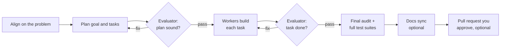

# AI Orchestration Kit (`agent-kit`)

**Turn your AI coding assistant into a disciplined engineering team.**

`agent-kit` installs a complete orchestrator/worker/evaluator system into your project: a
planner that breaks work into tasks, focused workers that build them in fresh contexts, and
skeptical evaluators that check every result before anything moves forward. It works with
**Claude Code, Cursor, GitHub Copilot (VS Code), and OpenAI Codex**, from one skill and one
command.

Nothing is marked done until an independent evaluator says so.

## Quick start

```bash
# 1. Add the skill to your project
npx skills add kdcllc/skills --skill agent-kit

# 2. In a session inside the project, compile the kit for your harness(es)
/agent-kit

# 3. Ship your first orchestrated feature
/feature
```

That's it. `/agent-kit` reads your repo, asks only what it can't infer, and writes agents,
skills, and an architecture doc tailored to your stack.

## Why agent-kit

A single long AI session that plans, builds, and checks its own work fails in three
predictable ways. It stops after partial progress and says it's finished, it grades its
own work too kindly, and it drifts away from the original goal as the conversation grows
and gets compacted. Anthropic's Claude Code team calls these
[agentic laziness, self-preferential bias, and goal drift](https://claude.dev/blog/a-harness-for-every-task-dynamic-workflows-in-claude-code/).
`agent-kit` answers each one with structure:

- **Stopping early: nothing is done until an evaluator says so.** Every task is checked
  against acceptance criteria written at planning time, before any code exists.
  Evaluators run the code, check that cited files and functions actually exist, and fail
  any completion claim the evidence contradicts. Failed work goes back for a fix and is
  evaluated again, with a hard limit on retries and a clear escalation when it's stuck.
- **Grading its own work: the reviewer never wrote the code.** A separate, skeptical
  evaluator with no stake in the result gates the plan, every task, and the final audit.
  Its score starts low and has to be earned with evidence. Retries rotate to a different
  model, and a task that stays stuck can go to an arbiter from another model family when
  your harness offers one.
- **Drifting from the goal: the goal lives on disk, not in the chat.** The goal, its
  tasks, and their acceptance criteria are files that every worker and evaluator receives
  fresh, so a constraint agreed at planning still binds the last task. Every fix is
  re-evaluated against those files, and the orchestrator tells you when its own session
  is getting long enough to need compaction or a fresh start.

It also gives you:

- **The right model for each job.** Frontier models plan and review; lighter models
  implement and write tests; a fast model runs shell commands and returns only the answer.
  You get frontier-quality reviewing without paying frontier prices for every keystroke.
- **Fresh context for every task.** Workers start clean with a precise context package, so
  quality doesn't degrade as a feature grows.
- **Built for your codebase, not a template.** Layer order, test commands, review rules,
  and model IDs come from your repo and your answers.
- **One source, every harness.** Mix Claude Code, Cursor, Copilot, and Codex in the same
  repo. Each gets native files compiled from the same canonical templates.
- **It remembers.** A git-tracked memory store keeps what each feature learned, and the
  orchestrator searches it before planning the next one.
- **It can run unattended.** An optional autonomous loop works through a backlog story by
  story and hands you one pull request to approve at the end. It follows the rules in
  Anthropic's
  [Building effective agent automations](https://claude.dev/blog/building-effective-agent-automations/):
  it resumes from backlog state instead of a time window, reports a failed read loudly
  instead of as "nothing to do", checks each slot's actual commits before integrating
  them, and keeps its own rules out of the agent's reach.
- **Upgrades are safe.** Every generated file is hashed. Re-running the kit never
  overwrites a file you changed without asking first.

## How a feature flows



## What you get

- **A seven-phase feature workflow** (`/feature`): alignment, goal creation, goal
  evaluation, task execution, final audit, optional docs alignment, and an optional
  approval-gated pull request. Acceptance criteria are set during planning and checked at
  every gate. No phase advances without an evaluator verdict, and every fix is evaluated
  again (up to three cycles, then a structured continuation ladder takes over).
- **Seven specialist subagents with tiered models**:

  | Agent | Role | Tier |
  |-------|------|------|
  | `evaluator`, `qa-evaluator` | Skeptical reviewers of plans, tasks, and user-facing behavior | frontier |
  | `diagnostician` | Root-cause analysis when fixes keep failing; never edits code | frontier |
  | `implementer`, `test-writer` | Focused workers that build one task or one fix at a time | light |
  | `evidence-collector` | Gathers behavioral QA evidence; never issues verdicts | light |
  | `terminal` | Runs Bash or PowerShell and returns only the result you asked for | fast |

  Every spawn names its model explicitly and every report states which model produced it,
  so you always know who did what.
- **Reviewing that resists shortcuts**: existence checks with a confidence scale, a
  required devil's-advocate pass on every plan, a different model on each fix cycle, and
  "run it before you score it". A blocking finding must cite a specific acceptance
  criterion, goal criterion, or quality-floor rule, so feedback stays actionable. Findings
  that cite nothing go to a backlog listed in the pull request body instead of stalling
  the work. Patterns adapted from
  [bradygaster/squad](https://github.com/bradygaster/squad); mechanics in
  [evaluation-system.md](https://github.com/kdcllc/skills/blob/master/docs/agent-kit/guide/evaluation-system.md).
- **A continuation ladder** for stuck tasks instead of endless retries: a check on
  whether the criteria themselves are wrong, root-cause diagnosis, splitting the task and
  retrying only the failing part, and a clear hand-off to you when nothing else works. The research behind it is in
  [autonomous-escalation.md](https://github.com/kdcllc/skills/blob/master/_memory/research/autonomous-escalation.md).
- **A full audit trail**: an append-only orchestration log per goal, with every context
  package and every verbatim report saved under `_memory/work/goals/<goal>/spawns/`.
  Token estimates per spawn show where the effort went.
- **A staged test ladder** (`test-ladder`): new tests first, then impacted tests during a
  fix cycle, then full suites once at the end. Fast feedback without skipping the full run.
- **An optional autonomous loop** (`auto-loop` + `_loop/loop.sh`; `_loop\loop.cmd` on
  Windows): one backlog story per fresh-context iteration, evaluation-gated commits,
  circuit breakers enforced in the driver itself, optional parallel slots in separate
  worktrees, iteration timeouts and token or dollar budgets, a run ledger, a backlog lint,
  and a single pull request for you to approve at the end.
  Details in
  [autonomous-loop.md](https://github.com/kdcllc/skills/blob/master/docs/agent-kit/guide/autonomous-loop.md).
- **Optional research workflow** (`/research`): investigate a topic first, then turn the
  report into an evaluated plan.
- **A git-tracked memory store** (`_memory/` + `_kit/memory.sh`, `_kit\memory.cmd` on
  Windows): recall before planning, archive when a goal closes, searchable records, and
  session summaries distilled from your chat transcripts. See
  [memory.md](https://github.com/kdcllc/skills/blob/master/docs/agent-kit/guide/memory.md).
- **A deterministic emitter** (`bin/emit.sh`; `bin\emit.cmd` on Windows): the same
  answers always produce the same agent files and scripts, so installs are reproducible
  and reviewable in a diff.

## Documentation

Developer guide: [docs/agent-kit/guide/README.md](https://github.com/kdcllc/skills/blob/master/docs/agent-kit/guide/README.md).

| Guide | Description |
|-------|-------------|
| [architecture.md](https://github.com/kdcllc/skills/blob/master/docs/agent-kit/guide/architecture.md) | How the kit is built: components, emit pipeline, folder ownership, state machines |
| [getting-started.md](https://github.com/kdcllc/skills/blob/master/docs/agent-kit/guide/getting-started.md) | Install paths, `/agent-kit` compile flow, greenfield gate, multi-harness emission, manifest basics |
| [decision-guide.md](https://github.com/kdcllc/skills/blob/master/docs/agent-kit/guide/decision-guide.md) | Choosing direct edit, `/feature`, `/research` → `/feature`, or autonomous loop; flowchart, mode comparison, anti-patterns |
| [feature-workflow.md](https://github.com/kdcllc/skills/blob/master/docs/agent-kit/guide/feature-workflow.md) | Seven phases in depth, acceptance criteria at planning, optional Phases 6/7, fix-cycle rotation, escalation, orchestration log, condensed worked example |
| [research-workflow.md](https://github.com/kdcllc/skills/blob/master/docs/agent-kit/guide/research-workflow.md) | Why research precedes implementation, prompt/report artifacts, ingestion into a goal, when to skip |
| [autonomous-loop.md](https://github.com/kdcllc/skills/blob/master/docs/agent-kit/guide/autonomous-loop.md) | Drivers, backlog stories, iteration lifecycle, circuit breakers, slots/worktrees, exit codes, quarantine |
| [agents-and-models.md](https://github.com/kdcllc/skills/blob/master/docs/agent-kit/guide/agents-and-models.md) | Seven subagent roles and boundaries, model tiers, `models.map.md` anatomy, fallback chains, harness caveats |
| [evaluation-system.md](https://github.com/kdcllc/skills/blob/master/docs/agent-kit/guide/evaluation-system.md) | Verdict vocabulary, confidence ladder, anti-fabrication, devil's advocate, acceptance criteria validation, `eval_depth`, test ladder, orchestration log audit trail |
| [contributing.md](https://github.com/kdcllc/skills/blob/master/docs/agent-kit/guide/contributing.md) | Repo anatomy (canonical vs instance vs generated), self-install dogfood loop, templates/emitters, harness matrix, manifest + upgrades, test harness |
| [memory.md](https://github.com/kdcllc/skills/blob/master/docs/agent-kit/guide/memory.md) | `_memory/` store, recall and archive per workflow, search CLI, redaction, `check` gate, transcript capture, loop proposals, harness pointers |

## Install into a project

```bash
# Option A — skills CLI (any agent)
npx skills add kdcllc/skills --skill agent-kit

# Pin to a release tag (see https://github.com/kdcllc/skills/tags)
npx skills add kdcllc/skills#agent-kit/v<version> --skill agent-kit

# Option B — agent-skills-cli
npx agent-skills-cli install https://github.com/kdcllc/skills.git
```

Claude Code and Copilot CLI users can also install the whole pack with
`/plugin marketplace add kdcllc/skills` and `/plugin install kdcllc-skills@kdcllc`.

Or copy the skill in manually (any harness folder works; the skill detects it):

```bash
cp -r skills/agent-kit  <your-project>/.claude/skills/     # Claude Code
cp -r skills/agent-kit  <your-project>/.cursor/skills/     # Cursor
```

Then, in a session inside that project, run `/agent-kit`. It detects which harnesses to
target (several at once is normal), inspects the repo (stack, test commands, layers,
user-facing surfaces, existing agents), interviews you only for what it can't infer
(project name, model tiers, QA surfaces, research workflow, autonomous loop, opt-in-only
skills, kit-file guard, delivery forge), writes `orchestration-kit.answers.json`, and runs
the emitter:

```bash
bash .claude/skills/agent-kit/bin/emit.sh --answers orchestration-kit.answers.json
# Windows outside Git Bash (Git for Windows required; forward slashes in path args):
# .claude\skills\agent-kit\bin\emit.cmd --answers orchestration-kit.answers.json
# (Cursor: .cursor/skills/agent-kit; Copilot: .github/skills/agent-kit)
```

If a manifest already exists, run with `--dry-run` first. See [bin/README.md](bin/README.md)
for flags and exit codes.

**Starting from scratch?** On an empty or near-empty folder, `/agent-kit` offers to
scaffold a project first. It shows the recommended tree and creates nothing until you
confirm. **TypeScript/Node** and **Python** get first-class layouts; other stacks get a
generic `src/` + `tests/` tree.

**Skill suggestions (Step 2b):** after inspecting your repo, `/agent-kit` recommends
popular [skills.sh](https://skills.sh) skills that match what it found (web UI, test
framework such as `pytest`, backend frameworks, infra files, docs, databases). Only skills
with **1000+** installs are offered, at most **8**, and nothing installs unless you pick it.
Picked skills install project-local with
`npx skills add <owner>/<repo> --skill <picked-skill> -y` and are wired into the feature
workflow, so workers use them on the right layers.

### What gets generated

| Generated | Purpose |
|-----------|---------|
| `agents/evaluator`, `agents/qa-evaluator` | Skeptical reviewers on the frontier tier |
| `agents/diagnostician` | Root-cause analysis after repeated fix failures, frontier tier, no code writes |
| `agents/implementer`, `agents/test-writer` | Workers on the light tier |
| `agents/evidence-collector` | QA evidence for the optional QA gate, light tier, no verdicts |
| `agents/terminal` | Command runner on the fast tier |
| `skills/feature` | The seven-phase workflow with goal/task templates, orchestration log, and memory protocol |
| `skills/research` | Research → Plan workflow (optional) |
| `skills/memory-capture` | Turns finished chat sessions into searchable session summaries |
| `skills/{goal,task,qa}-criteria` | Evaluation checklists (goal evaluation includes devil's advocate) |
| `skills/test-ladder` | New → impacted tests mid-cycle; full suites at cycle end |
| `skills/align-docs` | Phase 6: evaluator-gated sync of all docs to shipped code |
| `skills/ship-pr` | Phase 7: approval-gated delivery to GitHub, Azure DevOps, GitLab, or a hand-over |
| `skills/auto-loop` + `_loop/` + `_memory/loop/backlog.md` | The autonomous loop (optional) |
| `skills/agent-kit-models.map.md` | The model map, the only place model IDs live |
| `_kit/log-spawn.sh`, `_kit/memory.sh`, `_kit/trace-lint.sh` (+ `.cmd` launchers) | Orchestration-log writer, memory store CLI, and consumer-trace lint |
| `_kit/kit-guard.sh` (+ `.cmd`) | Optional guard that stops agents from editing kit-owned files, with Claude Code and Cursor hook configs |
| `_kit/hook-log.sh` (+ `.cmd`) | Optional stop and subagent-stop telemetry for Claude Code and Cursor, logged to `_memory/work/hooks/events.jsonl` |
| `_memory/` | Tracked memory records plus gitignored scratch space |
| `ORCHESTRATION.md` | The architecture doc, filled in for your project |
| `orchestration-kit.manifest.json` | File hashes and your embedded answers, for clean upgrades |

Everything is generated with project-specific content: layer order, test commands,
evaluator auto-fail triggers, and model IDs come from your codebase and your answers.

Targeting Cursor emits a self-contained `.cursor/` tree (agents, skills, architecture doc,
and model map) with no dependency on `.claude/`.

Start your first feature with `/feature`, or start an unattended run with
`_loop/loop.sh 10` (bash, Git Bash on Windows) or `_loop\loop.cmd 10` from cmd or
PowerShell (Git for Windows required).

## Model tiers

Three tiers map to the three kinds of work: **frontier** for the orchestrator, evaluators,
and diagnostician; **light** for the implementer, test-writer, and evidence-collector; and
**fast** for terminal (installs without a `fast` pin run terminal on light).
`models.map.md` is the single place model IDs live, including per-tier fallback chains
that never fall back *up* to a pricier tier, the fix-cycle rotation table, and a cost-ceiling
policy. When providers rename models, re-run `/agent-kit` and you're current. The research
behind the split is in
[multi-harness-upgrade.md](https://github.com/kdcllc/skills/blob/master/_memory/research/multi-harness-upgrade.md).

## Upgrading an installed project

1. **Re-pull the kit** with whichever CLI you installed with:
   `npx skills add kdcllc/skills --skill agent-kit` again, or `npx agent-skills-cli update`.
2. **Re-emit from the manifest.** Your answers are embedded in
   `orchestration-kit.manifest.json`, so there's no interview to repeat:

   ```bash
   bash .claude/skills/agent-kit/bin/emit.sh --upgrade
   # add --answers orchestration-kit.answers.json only when the interview changed
   # (Cursor: .cursor/skills/agent-kit; Copilot: .github/skills/agent-kit)
   ```

   If you've edited a kit file, the upgrade stops and lists it (exit code 4) instead of
   overwriting your change; confirm with `--force`. Use `--dry-run` to preview. Seed files
   like `_memory/loop/backlog.md` are never overwritten.

Coming from the earlier private `setup` skill? The upgrade notes in
[CHANGELOG.md](CHANGELOG.md) walk you through the move. Manifest semantics and stale-file
pruning are in
[contributing.md](https://github.com/kdcllc/skills/blob/master/docs/agent-kit/guide/contributing.md).

## What's in this folder

| Path | What it is |
|------|------------|
| `SKILL.md` | The `/agent-kit` workflow (detect → greenfield gate → inspect → skill suggestions → interview → emit) and the placeholder table |
| `bin/` | `emit.sh` + `emit.cmd` (Windows launcher), the deterministic emitter ([bin/README.md](bin/README.md)) |
| `templates/` | The canonical source: architecture doc, `models.map.md`, seven agents, the skills, the loop scripts, and the `_kit/` tools |
| `emitters/` | Per-harness notes (live model-check URLs, fallback warnings) |
| `reference/` | `harness-matrix.md` (verified harness facts) and `bootstrap-ids.md` (answers-file id table) |
| `CHANGELOG.md` | Release history and upgrade notes |

Maintainer material (the developer guide, research briefs, test suites, and the dogfood
installer) lives in the [kdcllc/skills](https://github.com/kdcllc/skills) repository,
outside this folder, so it never ships with the skill.

## Editing the templates

Templates use `{{TOKEN}}` placeholders, `<!-- BOOTSTRAP[id]: … -->` comments (replaced
from `answers.bootstrap[id]`), and `<!-- IF flag -->` … `<!-- ENDIF flag -->` spans. The
placeholder reference lives in `SKILL.md`. All canonical content lives under `templates/`;
per-harness translation is implemented in `bin/emit.sh` (`bin/emit.cmd` is its Windows
launcher); harness notes live in `emitters/` and verified facts in
`reference/harness-matrix.md`. Kit changes are made in the
[kdcllc/skills](https://github.com/kdcllc/skills) repository; see its CONTRIBUTING.md for
the dogfood loop and release steps.
