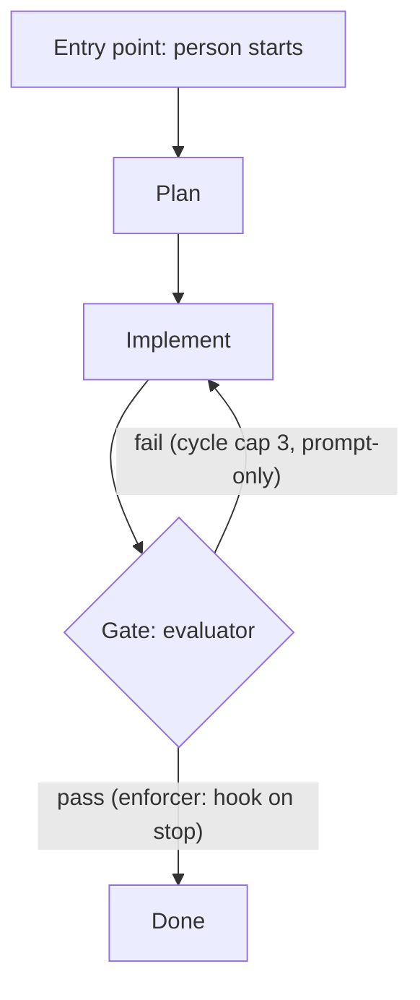

# Audit mode: Map and Decide

Audit mode only. Use this file when the user chose to audit an existing setup. [../SKILL.md](../SKILL.md) Step 4 (Map) points here for the procedure, and Step 5 (Decide) points here for the audit rules. Design mode does not read this file.

Every statement about the current system cites the file it came from (a path, and a line or heading where it helps). A statement with no file behind it is marked "not found in files" and is not used as evidence.

## Map

Read only; change nothing in the project.

### Find systems

An orchestration system is an entry point plus everything it launches. An entry point is one of:

- a skill, command or agent that a person or an event starts;
- the main session, when it delegates to project subagents and no orchestrator skill or command stands in front of them.

Read every entry-point skill, every command file and every agent body. For each, record which agents it launches and in which role. The same agent launched by two flows with different contracts (different job, inputs or criteria) is recorded as two roles, one per flow.

### Tiers, by pattern only

A system whose workers are themselves systems is a higher tier: it launches another entry point that runs its own gated loop (its own phases, gates and loop control), for example a fan-out whose children each run a full flow. Launching an agent or a skill that runs no gated loop of its own does not make a system a higher tier.

- Record only the boundary of a higher tier: what it launches, what it passes down, what it gates on return.
- Do not add its internals to the lower tier's agent list, and do not map the lower tier's agents as its own.
- Tiers are identified by this pattern, never by a name. No skill, agent or folder name makes a system a higher tier or exempts it from being one.

### Per system, record

- **Entry point and who starts it** — a person or an event (name the event and what routes it).
- **Phases in order** — as written in the entry point.
- **Gates** — what is judged, by whom (which agent or tool), against which criteria file.
- **Loop control** — cycle caps, stuck detection, escalation path.
- **Shared state** — files or folders its agents read and write. This is the shared-state shape in use, even with a coordinator in front.
- **Handoffs** — to other systems, and to event routers outside the harness.

### Enforcement inventory

For every gate and rule, name its enforcer, or write "prompt-only, not enforced". Enforcers are:

- a hook (config file and event);
- a rubric or criteria file;
- a CI workflow;
- a model-routing config;
- a git hook;
- a cycle or stuck rule.

Read every hook config counted by `harness_hook_entries` and every file counted by `git_hook_files` in [signals.md](signals.md); never leave one out. Also read `rule_files`, `rubric_files`, `command_files` and `harness_config_files` for gates they enforce. A signal count of 0 does not prove there is none: the signals list known undercounts, so open the harness folders to confirm.

### Shape composition

For each system, list the shapes it already uses and where (file and step), each with the reason from [../SKILL.md](../SKILL.md) Step 5 that justifies it, or "no reason found". Shapes are defined in [patterns.md](patterns.md). Most mature systems use several shapes at once.

### Diagrams

- One mermaid flowchart per system: steps as nodes, gates as decision nodes, each gate labeled with its enforcer (or "prompt-only").
- One tier boundary diagram, showing each higher tier, what it launches and what it gates on return.
- No diagram for shapes not in use.

Keep diagram examples outside the report's fenced `markdown` block (see [report-audit.md](report-audit.md)). A minimal system diagram:

## Decide

Apply these six rules in order. Each rule is a bold lead-in; the names are used verbatim in the report and in [../SKILL.md](../SKILL.md) Step 5.

- **Shapes compose** — describe each system as the shapes it already uses. Never relabel an existing system as a new recommendation, and never list a shape already in use as ruled out. A recommendation adds or removes a shape only with one of the four reasons from SKILL.md Step 5, backed by a signal or an answer.
- **Tier rule** — no change to a higher tier, and no change that moves work across a tier boundary, unless the user opted in. Such items go under "Left alone" with that reason. The test is the pattern in "Tiers, by pattern only", never a name. Ask for the opt-in once, at the end, if a higher-tier change looks worth offering.
- **Per-flow overlap** — two agents overlap only when the same flow launches them for the same job against the same criteria. An agent in two flows is assessed per role in each flow. Similar descriptions alone are not overlap; read what each flow passes in and expects back.
- **Enforcer rule** — every suggested change names the enforcer covering the affected gate after the change, and says whether that enforcer must change too. A change with no enforcer afterwards is not recommended: it would move a gate from enforced to prompt-only. Dropping a hook or criteria file counts as removing an enforcer.
- **Honesty rule** — when no material change is found, the headline says the current design fits and lists the small fixes; a fold of one or two agents is never the headline unless it is the only material change and is labeled as small.
- **Material change** — a suggestion is material only when it fixes a failure the owner can see and names that failure with evidence. Visible failures are: gate escapes, loops that do not converge, cost, context lost at handoffs, and rules enforced only by prompt. Evidence is a file path plus a signal value or a quote of the rule. "Fewer agents" or "cleaner design" is not a failure.

Order of work: list each system's shapes and enforcers (Map), mark higher tiers and set them aside (Tier rule), assess overlap per flow, draft candidate changes, drop any that fail the Enforcer rule or the Material change test, then pick the headline by the Honesty rule. Small fixes that do not meet the Material change test go under the headline as small fixes, not as recommendations.

The four-reasons table, the "what is not a reason" list and the routing table in SKILL.md Step 5 still apply to every suggestion that adds or removes a shape. Existing agents that only carry knowledge may be folded into skills, subject to the rules above.

## Large systems

When the map would not fit comfortably in one context (many systems or many agents):

- With subagent support in the harness, launch one read-only subagent per system. Give each the Map instructions above and that system's entry point. Merge their sections into one map. The main agent keeps the tier boundary diagram and the Decide step.
- Without subagent support, map one system at a time and write a short summary of each before starting the next.

Either way, the subagents read and report; they do not edit files, and every statement they return still cites its file.
